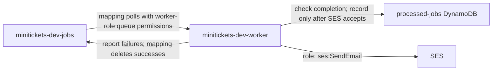

# Lambda: the city workers called when needed

History: see [CHANGELOG.md](../CHANGELOG.md) or run `pnpm docs:history`

Area: AWS Compute · Status: ✅ built in repository; live AWS acceptance is separate
<!-- interview-card: v2 -->

## 1. What is it?

[Lambda](../glossary.md#lambda) runs a function when work arrives. AWS supplies the machine; we provide the code and bound how long it may run.

## 2. Why do we need it?

MiniTickets needs an email worker only when bookings create work. Lambda can process those messages without us keeping an idle worker process running between bookings.

## 3. How does it work?

1. AWS polls SQS and invokes the worker with a batch.
2. The handler validates messages, checks completion and sends eligible email.
3. Record completion after email acceptance. Failed records retry; the Lambda integration deletes successes.

## 4. How do we use it in MiniTickets?

Email and ticket functions share one container image but use different handlers. They have separate queues and limits. Both stay outside our VPC because their messages contain the facts they need and their work only calls AWS APIs.

## 5. Interview-ready answer

“MiniTickets uses Lambda for short background jobs and ECS for its running HTTP services. AWS polls SQS, invokes the worker and deletes successful records. We reuse clients across warm invocations, but still account for startup time, timeouts and quotas. Local handler tests do not prove live AWS permissions or performance.”

## 6. Important follow-up questions

- **Can an invocation run forever?** No. Its timeout cuts off unfinished work, which may then repeat.
- **What is a cold start?** AWS starts a new execution environment and initializes its code before handling work.
- **Does more concurrency always help?** No. It can overwhelm SES or other dependencies and hit account limits.
- **Does a public subnet give Lambda a public IP?** No. VPC attachment needs deliberate networking; our workers have no VPC attachment.

## 7. Advanced details

Technical reference

### Configuration and security

The worker role trusts `lambda.amazonaws.com` via `sts:AssumeRole`. Its scoped permissions include processed-jobs `dynamodb:GetItem/PutItem`, `ses:SendEmail` with identity/from restrictions, `logs:CreateLogStream/PutLogEvents`, and source-queue actions including `sqs:ChangeMessageVisibility`. Lambda itself uses the ECR repository policy to pull the image.

Email reads `minitickets-dev-jobs` with 256 MB and 10 seconds; tickets use 512 MB and 30 seconds. AWS pollers call `lambda.handler` for email; the ticket function uses `ticket-lambda.handler` from the same image. Both functions run outside the VPC, call AWS HTTPS APIs on 443 and use temporary role credentials, not server passwords.

### Implementation and operational limits

- Anchor: `apps/worker/Dockerfile` — `as`; follow the numbered comments at this boundary.
- Anchor: `apps/worker/src/lambda.ts` — `that`; follow the numbered comments at this boundary.
- Anchor: `infra/src/jobs/queue-trigger.ts` — `createQueueTrigger`; follow the numbered comments at this boundary.
- Anchor: `infra/src/jobs/worker-lambda.ts` — `createWorkerLambda`; follow the numbered comments at this boundary.
- Anchor: `infra/src/registry.ts` — `is`; follow the numbered comments at this boundary.

Both functions use the one worker ECR image built for `linux/arm64`; an architecture mismatch can fail startup. The email Docker image defaults to `lambda.handler`; the ticket function overrides its command. Email queue mapping uses batch size 10 and maximum concurrency 5; tickets use 1 and 2. Both enable `ReportBatchItemFailures`. Email has no reserved concurrency by default (`-1`); comments record a historical low account quota, not a current verified limit. Check Service Quotas before making reservations. Matching poller demand to available concurrency avoids consuming receives on throttled calls.

A cold start runs top-level code once; warm processes reuse SDK connections. The email clients set 1-second connect and 3-second request timeouts; Lambda's overall timeout still cuts off the batch. Logs are JSON stdout in our seven-day groups, not an unbounded default `/aws/lambda/*` group. Ticket logs use `/minitickets/dev/tickets`.

No `vpcConfig`, NAT gateway or paid interface endpoints are added. Moving a worker inside private networking would require deliberate routes/endpoints for the AWS APIs it calls. Provisioned concurrency is not built; consider it only after measuring startup latency. `pnpm demo:tickets` checks local handlers, not AWS cold starts or quotas. EKS is not built. [Compute-choice scenario](../guides/interview-scenarios.md#compute-choices). Usage/storage costs remain; old prices are snapshots. Live AWS acceptance is separate.

### Source references

`infra/src/jobs/worker-lambda.ts` → `createWorkerLambda`; `infra/src/tickets/lambda.ts` → `createTicketLambda`.

`apps/worker/src/lambda.ts` → `handler`; `apps/worker/src/batch.ts` → `handleBatch`.

### Console and troubleshooting

`us-east-1` → **Lambda → Functions → minitickets-dev-worker**. The function overview draws its SQS trigger. **Configuration → Triggers / Permissions / VPC** shows mapping, role and no VPC attachment. **Monitor → View CloudWatch logs** opens `/minitickets/dev/worker`.

- Timeout → logs' REPORT duration and AWS calls → bound work or calls before raising the budget.
- Throttled → mapping concurrency and account quota → match limits to actual capacity.

### Trade-offs and related concepts

- Pick ECS for MiniTickets' always-running HTTP API and web.
- Pick Lambda for short queue jobs with no idle work.
- Pick EKS when Kubernetes control justifies operating it.

| Neighbor | Direction | What allows it | Console check |
| --- | --- | --- | --- |
| [SQS](sqs.md) | in | Mapping + role receive/delete | Lambda → Configuration → Triggers |
| [DynamoDB](dynamodb.md) | out | Scoped table actions | IAM → worker-role → Permissions |
| [SES](ses-email.md) | out | `ses:SendEmail` + sender | IAM → worker-role → Permissions |
| [ECR](ecr.md) | in | Lambda repository policy | ECR → worker → Permissions |

[Open this piece in the city explorer](../guides/infra-explorer.html?concept=aws-lambda#chapter=24&piece=email-lambda).

## Where it appears in the story

- [app-story: 9c. Side path: outbox, fan-out and recoverable work](../app-story.md#9c-side-path-outbox-fan-out-and-recoverable-work)

