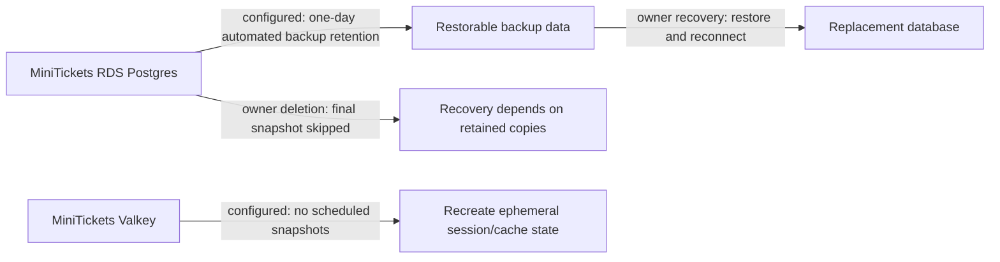

# Backups, snapshots, disaster recovery

History: see [CHANGELOG.md](../CHANGELOG.md) or run `pnpm docs:history`

Area: AWS Data · Status: 🟡 partial (dev settings) · Step doc: [14 data](../../14-infra-data.md) (sections 3.12, 3.13)

<!-- interview-card: v2 -->

## 1. What is it?

Backups are saved data copies. Disaster recovery is the plan for restoring useful service after major loss, including which copy to use and how to reconnect the application.

## 2. Why do we need it?

A MiniTickets bug could damage bookings while every server stays healthy. Extra running copies do not undo bad data; recovery needs a usable saved state and a practiced restore procedure.

## 3. How does it work?

1. Choose acceptable data loss and recovery time.
2. Keep appropriate backups and protect them from the relevant failure.
3. Practice restore and reconnect steps; record measured recovery results.

## 4. How do we use it in MiniTickets?

Dev RDS has short automated retention, deletion protection off and no final snapshot on deletion. Valkey has no scheduled snapshots. These are partial learning-environment safeguards, not tested production recovery. Available retained backups or manual snapshots determine recovery after deletion.

## 5. Interview-ready answer

“MiniTickets has development backup settings, not a demonstrated disaster-recovery guarantee. RDS retains a short automated recovery window, while deletion skips a final snapshot and cache snapshots are disabled. I would first define acceptable data loss and recovery time, then choose retention, protection and independent copies. The decisive evidence is a restore drill that reconnects the application, not just a configured backup value.”

## 6. Important follow-up questions

- **What is recovery point versus recovery time?** How much recent data may be lost versus how long service recovery may take.
- **Does no final snapshot mean no possible recovery?** Not universally. Retained automated backups or existing manual snapshots may still help.
- **Does high availability replace backups?** No. Replicas can receive the same deletion or corruption.
- **What should a restore drill verify?** Usable data, access, secrets, reconnects and measured recovery—not merely creating a database.

## 7. Advanced details

Technical reference

### Current configuration and deletion nuance

`infra/src/data/postgres.ts` sets `backupRetentionPeriod: 1`, `skipFinalSnapshot: true`, `deletionProtection: false`, `applyImmediately: true`, with encrypted storage/backups. Automated backups/logs support point-in-time recovery within available retention. `deleteAutomatedBackups` is **not explicitly set** in this code; the installed Pulumi AWS provider documents a **true** default, so this configuration relies on default automated-backup removal during deletion. This is a provider/configuration inference, not a live deletion check. Deliberately retained automated backups and existing manual snapshots are separate recovery choices. Skipping a final snapshot removes that deletion-time copy; it does not prove every earlier manual/retained automated backup is gone. [AWS RDS deletion and retained backups](https://docs.aws.amazon.com/AmazonRDS/latest/UserGuide/USER_DeleteInstance.html).

`infra/src/data/cache.ts` sets `snapshotRetentionLimit: 0`; session/cache reconstruction is distinct from recovering authoritative bookings. ECR image retention is code-artifact recovery, not data backup: current `infra/src/registry.ts` keeps newest **10 deployed**, **30 other tagged** images and expires untagged after **1 day**, correcting the old generic ten-images claim.

### Inspection, owner actions and future design

Read-only: `aws rds describe-db-instances --profile ticketlite --db-instance-identifier minitickets-dev-db --query 'DBInstances[0].[BackupRetentionPeriod,LatestRestorableTime,DeletionProtection]'`. No deletion/restore was run here. The old switch-off/on exercise is destructive owner-only work and not a recommended backup verification; no existing data should be assumed recoverable without checking retained copies.

Production choices follow business RPO/RTO: longer **7–35 day** retention where appropriate, final snapshots, deletion protection, independent cross-account/region copies and restore drills. AWS Backup or regional replicas add different capabilities and operational work; no fixed minutes-to-recover guarantee is established.

### Cost and acceptance

The old “no backup cost/instant teardown/unrecoverable” claims were too broad. Backup storage exists under configured retention; billing depends on allowance, retained/manual copies and current pricing. No current price or tested RPO/RTO is claimed. Restore speed/data loss remain unmeasured; encryption/access control must be usable during recovery too.

### Code anchors

- Anchor: `infra/src/data/postgres.ts` · `backupRetentionPeriod: 1`, `skipFinalSnapshot: true`, `deletionProtection: false`.
- Anchor: `infra/src/data/cache.ts` · `snapshotRetentionLimit: 0`.

### Related reading

[RDS](rds-postgres.md) · [Valkey](elasticache-valkey.md) · [cost switches](cost-switches.md) · [high-availability](high-availability.md) · [kms](kms.md)

[Open this concept in the city explorer](../guides/infra-explorer.html?concept=backups-dr#chapter=5&piece=rds).

## Where it appears in the story

- [Infra story: 7. RDS Postgres](../infra-story.md#7-rds-postgres)

