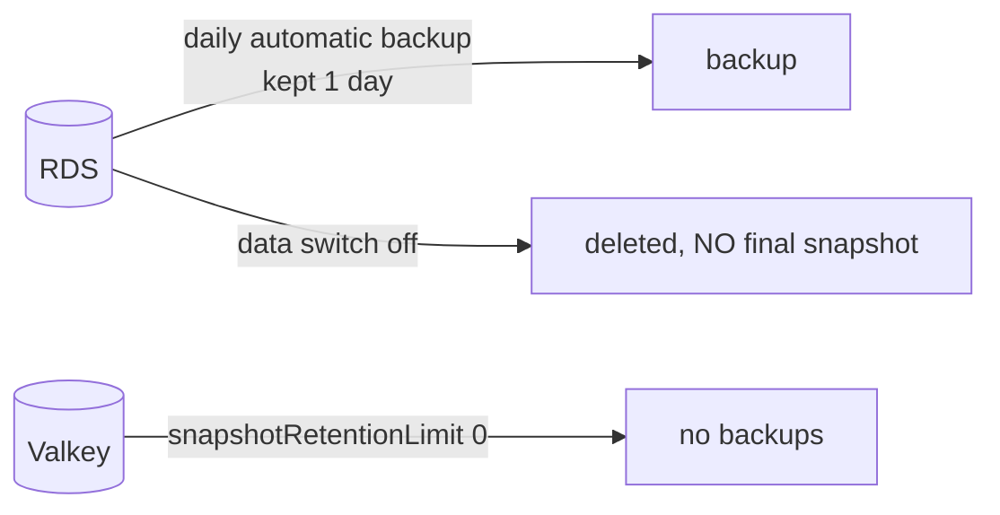

# Backups, snapshots, disaster recovery

History: see [CHANGELOG.md](../CHANGELOG.md) or run `pnpm docs:history`

Area: AWS Data · Status: 🟡 partial (dev settings) · Step doc: [14 data](../../14-infra-data.md) (sections 3.12, 3.13)

## 1. In one line

**Backups** are saved copies of data; **disaster recovery (DR)** is the plan for getting the system
and its data back after a big failure. Our dev setup keeps almost none, on purpose.

## 2. Real-life comparison

Photocopies of important papers. In dev we keep yesterday's copy only and shred everything when we
close the office. A real business keeps weeks of copies, and one in another city.

## 3. Picture it



## 4. Where in our code

- Anchor: `infra/src/data/postgres.ts` · `backupRetentionPeriod: 1`, `skipFinalSnapshot: true`, `deletionProtection: false`.
- Anchor: `infra/src/data/cache.ts` · `snapshotRetentionLimit: 0`.

Step by step:

1. RDS keeps automatic daily backups (and transaction logs for point-in-time restore) for **1 day**.
2. `skipFinalSnapshot: true`: when `dataEnabled` goes false, the database is deleted **without** a
   last copy. The data is gone.
3. `deletionProtection: false`: Pulumi is allowed to delete it.
4. Valkey keeps no snapshots: sessions can be recreated by logging in.
5. ECR's lifecycle keeps the last 10 images per repo: an "artifact backup" for rolling back code.

## 5. See it yourself

```bash
aws rds describe-db-instances --profile ticketlite --db-instance-identifier minitickets-dev-db \
  --query "DBInstances[0].[BackupRetentionPeriod,LatestRestorableTime,DeletionProtection]"
```

**Break it on purpose:** switch the data layer off and on (owner runs `pulumi up`). Log in with an
account created before: it does not exist any more.

## 6. How it connects

- **Uses ←** [RDS](rds-postgres.md), [Valkey](elasticache-valkey.md), [cost switches](cost-switches.md).
- **Gives →** the honest answer to "what is our RPO/RTO?" in dev: none. See
  [high-availability](high-availability.md) for the other half of resilience.

## 7. Our settings and WHY

| Setting | Dev | Production | Why dev |
| ------- | --- | ---------- | ------- |
| `backupRetentionPeriod` | 1 | 7-35 | Data is throwaway test users. |
| `skipFinalSnapshot` | true | false + `finalSnapshotIdentifier` | Fast, free teardown. |
| `deletionProtection` | false | true | The switch must be able to delete it. |
| Valkey snapshots | 0 | low | Sessions are not the source of truth. |

## 8. Trade-offs

- **Pros:** no snapshot storage cost, instant teardown.
- **Cons:** every "off" destroys all data; no restore after a mistake.

## 9. Alternatives and when to choose them

- **Point-in-time recovery 7-35 days + final snapshot:** any real data.
- **AWS Backup** with cross-region or cross-account copies: DR against region or account loss.
- **Read replica in another region:** fast regional failover (RTO of minutes).

## 10. What breaks, and how we'd notice

- Turning data off deletes users permanently; nothing warns except the docs and `pulumi preview`.
- Without a final snapshot, a mistaken `pulumi up` is unrecoverable.

## 11. Reach / Allowed / Password

Not a connection. Backups inherit the instance's encryption ([kms](kms.md)).

## 12. Cost

RDS backup storage up to the size of the database is included at no extra charge (AWS's documented
rule; our usage is far below it). Snapshots kept beyond that are billed per GB-month.

## 13. Interview answers at 3 levels

- **Simple:** We keep one day of database backups in dev and throw the data away when we switch off.
- **Senior:** RDS has `backupRetentionPeriod: 1`, `skipFinalSnapshot: true` and no deletion
  protection, so the data switch can delete it cheaply; Valkey keeps no snapshots because sessions are
  disposable.
- **Lead:** I'd set RPO and RTO with the business first. Then: 7-35 days of point-in-time recovery,
  final snapshots, deletion protection, cross-region copies, and, above all, a regularly tested restore,
  because an untested backup is not a backup.

## 14. Follow-up questions interviewers ask

- *RPO vs RTO?* How much data you may lose (time since the last good copy) vs how long recovery may
  take.
- *Snapshot vs point-in-time restore?* A snapshot is one moment; PITR replays logs to any second in the
  retention window.

## 15. Say it in 30 seconds

"Dev is deliberately disposable: one day of RDS backups, no final snapshot, no deletion protection,
no cache snapshots. Production would set RPO and RTO first, then turn on PITR for weeks, final
snapshots, cross-region copies and regular restore tests."

## 16. Status

🟡 partial. **To make it production-grade:** longer retention, final snapshot, deletion protection,
cross-region copies, restore drills.
