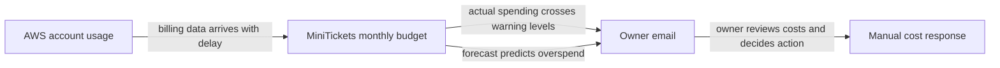

# Budget alerts

History: see [CHANGELOG.md](../CHANGELOG.md) or run `pnpm docs:history`

Area: DevOps & CI/CD · Status: ✅ built · Step doc: [13 security groups + budget](../../13-infra-security-groups.md) (section 3.9)

<!-- interview-card: v2 -->

## 1. What is it?

A budget alert warns when spending passes a chosen level or is forecast to do so. It is a warning system, not a spending cap.

## 2. Why do we need it?

Leaving MiniTickets infrastructure running can create a bill while nobody is using the app. An early email gives the owner a chance to review what is still running.

## 3. How does it work?

1. Set the spending limit and recipient.
2. Compare actual and forecast spending with warning levels.
3. The owner investigates; the alert itself stops nothing.

## 4. How do we use it in MiniTickets?

MiniTickets defines an account-wide monthly budget, including usage covered by credits so underlying cost stays visible. It remains present independently of application on/off switches. Separate health alarms cover stuck work and server errors.

## 5. Interview-ready answer

“MiniTickets uses a monthly account budget with early actual-spend warnings and a forecast warning. We exclude credits from reducing the reported cost, so temporary credits do not hide the underlying run rate. Budgets help us notice forgotten infrastructure, but billing data is delayed and an email is not an automatic stop mechanism. Operational alerts are a different concern.”

## 6. Important follow-up questions

- **Does the budget stop spending?** No. Automatic budget actions would be a separate design.
- **Why avoid hiding cost behind credits?** We need to understand the bill the same usage will produce after credits expire.
- **Can an alert arrive late?** Yes. Billing data can lag usage, so this is not real-time protection.
- **What if the recipient is wrong?** No useful warning reaches the owner; verify the configured destination and delivery.

## 7. Advanced details

Technical reference

### Configuration and source

`infra/src/budget.ts` → `createBudget` creates `minitickets-dev-monthly-cost`: `budgetType: COST`, limit **20 USD**, `timeUnit: MONTHLY`. Four percentage notifications: ACTUAL **25/50/100%**, FORECASTED **100%**. `includeCredit: false` keeps credits from reducing reported usage. The budget is always present and account-wide, not restricted to MiniTickets resources. Required encrypted `alertEmail` configuration avoids a missing recipient without exposing its value.

Console: Billing → Budgets → `minitickets-dev-monthly-cost`. Read-only reference: `aws budgets describe-budgets --profile ticketlite --account-id <account-id> --query 'Budgets[].[BudgetName,BudgetLimit.Amount,CalculatedSpend.ActualSpend.Amount]'`; obtain account ID with `aws sts get-caller-identity --profile ticketlite`. No live delivery or current bill was checked here.

### Limits, alternatives and cost caveat

Billing updates lag by hours; this does not enforce a cap. The old “our only alerting” phrase is obsolete because symptom alarms now exist. Budget actions could apply restrictions or stop supported resources; Cost Anomaly Detection can flag unusual usage; per-project budgets can use activated cost-allocation tags such as `Project`.

Original docs described one email-only budget with no actions as $0 but explicitly did not verify current pricing. This rewrite preserves that uncertainty and makes no current price claim. Wrong recipients and credits included in net spend can hide useful warnings; verify configuration/delivery deliberately.

### Code anchors

- Anchor: `infra/src/budget.ts` · `createBudget`: a monthly COST budget with 4 notifications.

### Related reading

[cost switches](cost-switches.md) · [alerting](alerting.md)

[Open this concept in the city explorer](../guides/infra-explorer.html?concept=budget-alerts#chapter=1&piece=budget).

## Where it appears in the story

- [Infra story: 13. The budget](../infra-story.md#13-the-budget)

