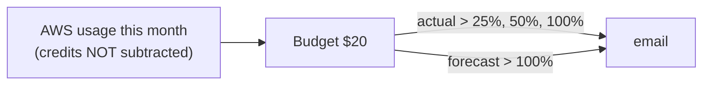

# Budget alerts

History: see [CHANGELOG.md](../CHANGELOG.md) or run `pnpm docs:history`

Area: DevOps & CI/CD · Status: ✅ built · Step doc: [13 security groups + budget](../../13-infra-security-groups.md) (section 3.9)

## 1. In one line

An **AWS Budget** watches the account's spending and emails us at 25%, 50% and 100% of $20 a month,
and when AWS forecasts the month will pass $20.

## 2. Real-life comparison

A smoke alarm for the bill. It doesn't put out the fire (it stops nothing); it makes sure you hear
about it early.

## 3. Picture it



## 4. Where in our code

- Anchor: `infra/src/budget.ts` · `createBudget`: a monthly COST budget with 4 notifications.

Step by step:

1. `index.ts` reads `alertEmail` with `config.require` (stored encrypted in `Pulumi.dev.yaml`), so a
   budget can never email nobody.
2. `budgetType: "COST"`, `limitAmount: "20"`, `limitUnit: "USD"`, `timeUnit: "MONTHLY"`.
3. `costTypes.includeCredit: false`: credits are not subtracted, so we see the real cost even while
   credits pay the bill.
4. `notification(...)` helper: 25/50/100% ACTUAL and 100% FORECASTED, `thresholdType: "PERCENTAGE"`.
5. Always on; it watches the whole account, not just our resources.

## 5. See it yourself

In the console: **Billing → Budgets → `minitickets-dev-monthly-cost`**. Or:

```bash
aws budgets describe-budgets --profile ticketlite \
  --account-id $(aws sts get-caller-identity --profile ticketlite --query Account --output text) \
  --query "Budgets[].[BudgetName,BudgetLimit.Amount,CalculatedSpend.ActualSpend.Amount]"
```

## 6. How it connects

- **Uses ←** nothing (a global service).
- **Gives →** the safety net for [cost switches](cost-switches.md); our only [alerting](alerting.md).

## 7. Our settings and WHY

| Setting | Value | Why |
| ------- | ----- | --- |
| Limit | $20 / month | Everything on all month would pass it. |
| Alerts | 25/50/100% actual + 100% forecast | Early warning and a prediction. |
| `includeCredit` | false | Otherwise it shows $0 while credits last. |

## 8. Trade-offs

- **Pros:** free, account-wide, no code to run.
- **Cons:** billing data lags by hours, so alerts are late; it never stops anything.

## 9. Alternatives and when to choose them

- **Budget actions:** apply an IAM deny policy or stop instances when a threshold is hit.
- **Cost Anomaly Detection:** ML-based alerts on unusual spend.
- **Per-project budgets with cost allocation tags** (our `Project` tag): many projects in one account.

## 10. What breaks, and how we'd notice

- Wrong email: alerts go nowhere. Test by checking the subscription in the console.
- Credits included: no warning until the credits end.

## 11. Reach / Allowed / Password

Not a connection.

## 12. Cost

We have one budget with email alerts and no budget actions. My understanding is that this costs
nothing, but I have not checked AWS Budgets' current pricing page; the step docs list it as $0.

## 13. Interview answers at 3 levels

- **Simple:** AWS emails us when we spend too much.
- **Senior:** A $20 monthly cost budget in Pulumi with actual alerts at 25/50/100% and a forecast alert
  at 100%, excluding credits so we see real usage.
- **Lead:** Budgets are lagging indicators; I'd pair them with cost allocation tags, anomaly detection
  and, for sandboxes, budget actions that cut permissions automatically.

## 14. Follow-up questions interviewers ask

- *Does a budget stop spending?* No, unless you add budget actions.
- *Why exclude credits?* To see what the project really costs.

## 15. Say it in 30 seconds

"A $20 monthly AWS Budget, defined in Pulumi, emails at 25, 50 and 100 percent of actual spend and when
the forecast passes 100 percent. Credits are excluded so it shows real cost. It warns; it doesn't stop
anything."

## 16. Status

✅ built.
