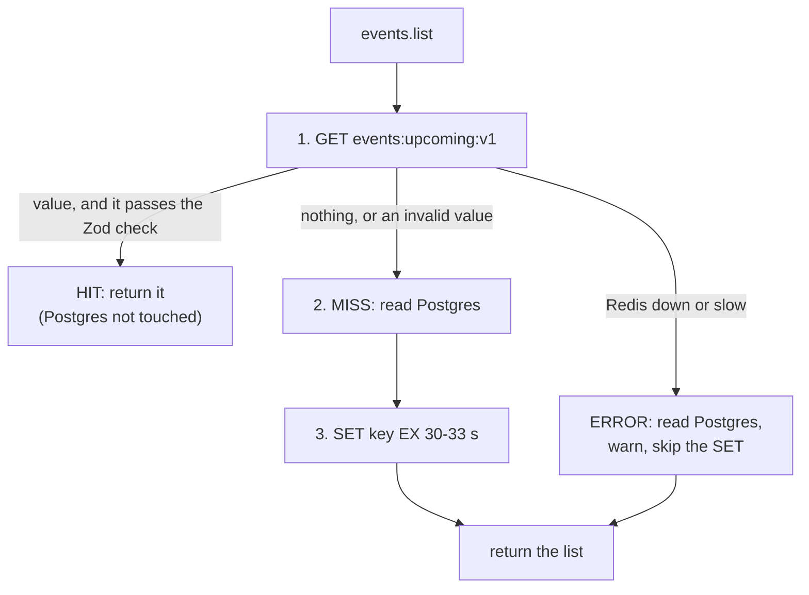
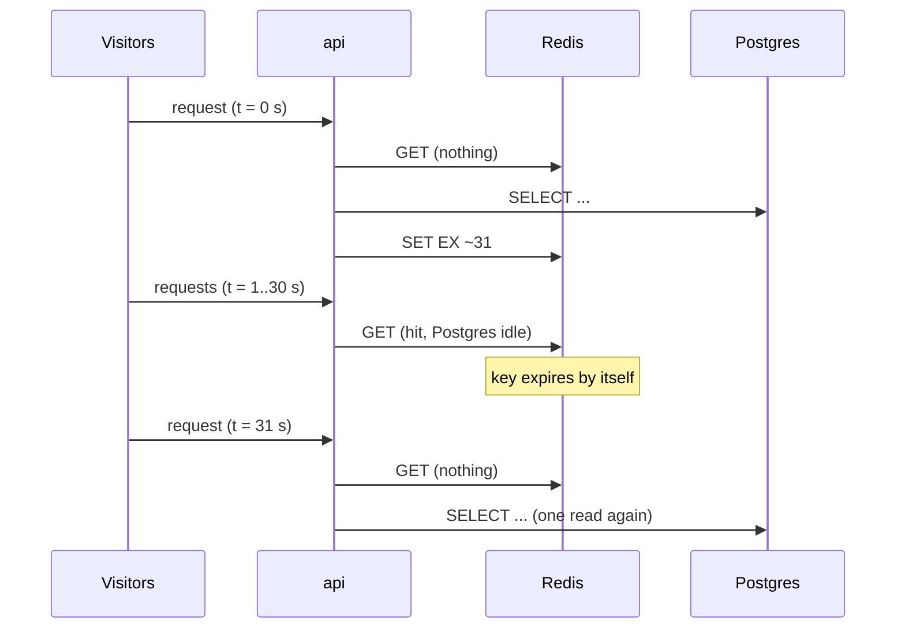

# Cache-aside

History: see [CHANGELOG.md](../CHANGELOG.md) or run `pnpm docs:history`

Area: Performance & Caching · Status: ✅ built (`events.list`, 30 s TTL; invalidation and stampede protection are 📋 next steps) · Step doc: [24 events cache](../../24-events-cache.md)

## 1. In one line

**Cache-aside** (also "lazy loading"): the app code itself checks the cache first; on a **miss** it
reads the database, puts the answer in the cache with a TTL, and returns it. Ours: `events.list`
checks Redis for `events:upcoming:v1` before it asks Postgres.

## 2. Real-life comparison

A waiter with a notepad of today's specials. A guest asks "what's on?": the waiter reads the notepad
(hit). If the notepad page is blank (miss), the waiter walks to the kitchen, asks the chef, writes it
on the notepad, and answers. The kitchen is only bothered once per page, not once per guest. The
notepad can be a little out of date; the kitchen is always right.

## 3. Picture it



The key's life over time:



## 4. Where in our code

- Anchor: `apps/api/src/services/events.ts` · `listUpcomingEvents`: the logic (read cache → hit, or Postgres → write cache → return).
- Anchor: `apps/api/src/queries/events-cache.ts` · `getUpcomingFromCache`, `setUpcomingInCache`: the only code that touches Redis for this.

Step by step:

1. The **service** owns the logic; the **query** file only does `GET` and `SET ... EX` and returns
   text. "Only queries touch a data store" stays true ([layered-api](layered-api.md)).
2. `getUpcomingFromCache()` returns the stored JSON text or `null`.
3. A value is only trusted after `JSON.parse` + the shared `ListEventsOutput` Zod schema. A bad one
   counts as a miss and is overwritten ([cache-key-versioning](cache-key-versioning.md)).
4. On a miss the service reads Postgres, maps rows to the public shape (dates as ISO strings, which
   is also what is stored), and calls `setUpcomingInCache(json, ttl)` with the TTL from
   [ttl](ttl.md) (30 s + 0-3 s jitter).
5. Any Redis error or timeout is caught: Postgres answers, a warning is logged, the request
   succeeds ([graceful-degradation](graceful-degradation.md)).
6. The procedure adds `cache: "hit" | "miss" | "error"` to the request's log line.

**Staleness:** a list can be up to ~33 s old (for example `seatsLeft` too high). **Booking will
always check the database**, never this cache, so a stale list can never cause overselling. The
page is for browsing; the booking transaction is the source of truth.

## 5. See it yourself

```bash
docker exec minitickets-redis-1 redis-cli DEL events:upcoming:v1     # force a miss
curl -s localhost:4000/trpc/events.list > /dev/null                  # miss: reads Postgres, fills Redis
docker exec minitickets-redis-1 redis-cli TTL events:upcoming:v1     # 30-33
curl -s localhost:4000/trpc/events.list > /dev/null                  # hit
```

The api terminal shows `"cache":"miss"` and then `"cache":"hit"` on the `request completed` lines.
Measured numbers are in [docs/24](../../24-events-cache.md#6-measured-miss-vs-hit).

**Break it on purpose:** `redis-cli SET events:upcoming:v1 '[{"old":"shape"}]'`. The next call
logs a warning, answers from Postgres (`"cache":"miss"`) and rewrites a good value.

## 6. How it connects

- **Uses ←** [ttl](ttl.md), [sql-vs-nosql](sql-vs-nosql.md) (Redis as a fast store),
  [layered-api](layered-api.md), [validation-at-boundaries](validation-at-boundaries.md).
- **Gives →** a cheap read path for `/events`; next steps: server-side invalidation (📋) and
  stampede protection (📋). The browser also has its own cache ([tanstack-query](tanstack-query.md));
  these are two different caches in series.

## 7. Our settings and WHY

| Setting | Value | Why |
| ------- | ----- | --- |
| Key | `events:upcoming:v1` | One list for everyone; version for shape changes. |
| TTL | 30 s + 0-3 s jitter | Bounds staleness; jitter spreads expiry. |
| Redis timeout | 100 ms | A slow Redis must not slow the page. |
| Write after a read error | skipped | Redis is probably sick; don't add another wait. |

## 8. Trade-offs

- **Pros:** Postgres is read about once per 30 s instead of once per visitor; simple; if Redis
  dies the app still works.
- **Cons:** stale data for up to ~33 s; two copies of the truth; the first request after expiry is
  slower (miss); many requests can miss together (stampede, 📋).

## 9. Alternatives and when to choose them

- **Read-through:** the cache library fetches from the database for you; less app code, less control.
- **Write-through / write-behind:** the write path updates the cache; use when staleness is not
  acceptable.
- **Invalidate on write** (📋, next step): delete the key when an event changes.
- **HTTP/CDN caching:** fine for public pages; ours is per API call and CloudFront does not cache `/trpc/*`
  ([cdn-caching](cdn-caching.md)).

## 10. What breaks, and how we'd notice

- **Stale data:** an edited event shows old values for up to ~33 s. Visible in the page; no alert.
- **Cache stampede (📋):** when the key expires under heavy load, many requests miss at once and all
  query Postgres. Not handled yet; with one key and a tiny query it is harmless today.
- **Redis down/slow:** warnings `events cache read failed`, `"cache":"error"`; page still works.
- **Shape changed without bumping the version:** the Zod check catches it (warning + miss).
- **Memory:** one small key; Redis eviction does not matter yet.

## 13. Interview answers at 3 levels

- **Simple:** Keep a copy of the answer in a fast store for 30 seconds so the database is asked less often.
- **Senior:** Cache-aside in the service: GET, validate, on miss read Postgres and `SET ... EX`.
  Values are JSON validated with the same Zod schema as the output, the key is versioned, the TTL has
  jitter, and any Redis failure falls back to Postgres. I measured the api-side time on a miss vs a hit.
- **Lead:** A cache is a consistency decision. Browsing may be 30 s stale because booking checks the
  database, so overselling is impossible. Next: invalidate on write, protect against stampedes
  (lock or request coalescing, early refresh), and alert on hit ratio and Redis errors.

## 14. Follow-up questions interviewers ask

- *Cache-aside vs read-through?* In cache-aside the application talks to both; in read-through the cache does the loading.
- *Can a stale list oversell?* No: booking will check Postgres inside its own transaction.
- *What if Redis is slow, not down?* A 100 ms deadline, then Postgres.
- *Why validate cached data?* It was written by another version of the code, maybe long ago.
- *What is a stampede?* Many misses at once after expiry; fix with locking, coalescing or refresh-ahead.

## 15. Say it in 30 seconds

"events.list is cache-aside: the service checks Redis, validates the JSON with our Zod schema, and
on a miss reads Postgres and stores the list for 30 seconds plus jitter. Redis failures never fail the
request; we fall back to Postgres. The list can be 30 seconds stale, which is fine because booking
checks the database."

## 16. Status

✅ built for one endpoint. **To make it production-grade:** invalidate on write, stampede protection,
metrics for hit ratio, alarm on Redis errors.

## Where it appears in the story

- [App story: 10b. Reading events](../app-story.md#10b-reading-events)
