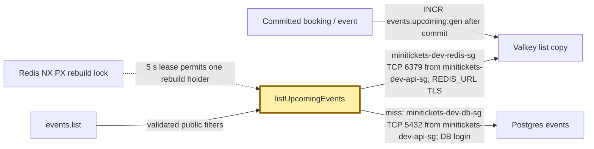
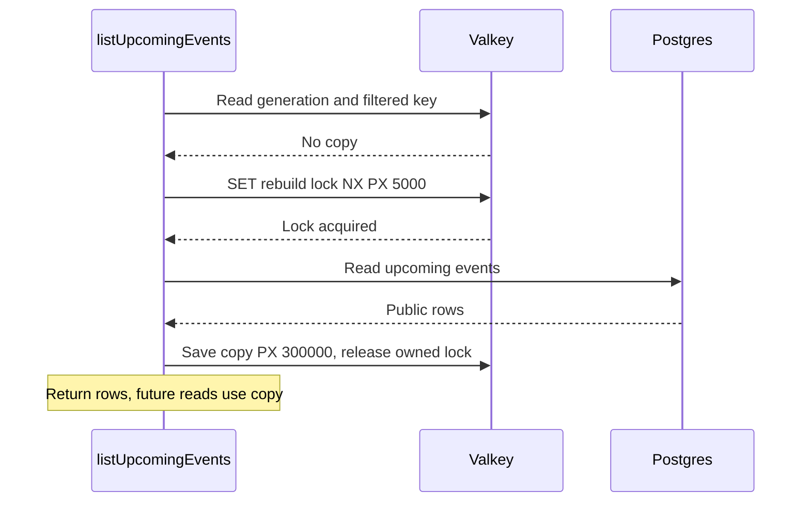

# Cache-aside: the ticket office’s spare catalogue

History: see [CHANGELOG.md](../CHANGELOG.md) or run `pnpm docs:history`

Area: Performance & Caching · Status: ✅ built in repository; live AWS acceptance is separate

<!-- interview-card: v1 -->

## 1. In one line

For `events.list`, MiniTickets checks a [cache](../glossary.md#cache-aside)—a spare copy of public data—before opening the Postgres ledger.

## 2. Where it sits

[Open this piece in the city explorer](../guides/infra-explorer.html?concept=cache-aside#chapter=24&piece=valkey).

## 3. How it works

## 4. What happens in MiniTickets

1. `listUpcomingEvents` normalizes filters and reads `events:upcoming:gen`.
2. It checks `events:upcoming:v3:g<gen>:<hash>` in Redis. A fresh copy returns immediately.
3. A missing copy is rebuilt from Postgres and saved. One process shares work; a Redis lock shares it across tasks.
4. After 30–33 seconds, serve the old copy while refreshing. Never serve it beyond 300 seconds.
5. Booking/event writes bump the generation after commit. Current `events.search` bypasses this list cache.

## 5. Reach / Allowed / Password

**Reach:** API → Valkey :6379 and RDS :5432; both guards admit minitickets-dev-api-sg.

**Allowed:** application queries use data-store credentials, without per-command IAM.

**Password:** encrypted `REDIS_URL` and RDS login; both use TLS on AWS.

## 6. In our code

`apps/api/src/services/events.ts` → `listUpcomingEvents`

`apps/api/src/queries/events-cache.ts` → `upcomingKey`, `tryLockUpcomingRebuild`

## 7. In the AWS console

ElastiCache → Valkey caches → `minitickets-dev-valkey` → Configuration / Monitoring: endpoint and memory. CloudWatch → Logs → `/minitickets/dev/api`: cache warnings. The console does not show individual cache keys.

## 8. Good / Bad

**Good:** repeat reads avoid SQL; an old public copy can cover a short database failure.

**Bad:** displayed seats can be old; extra cache layers have separate clocks.

## 9. Other choices

- Pick direct SQL when results must be current or queries rarely repeat.
- Pick a managed HTTP cache when whole public responses can safely be shared.

## 10. Connected to

| Neighbor | Direction | What allows it | Console check |
| --- | --- | --- | --- |
| [Valkey](elasticache-valkey.md) | → copy | minitickets-dev-redis-sg :6379 from minitickets-dev-api-sg | ElastiCache → cache |
| [RDS](rds-postgres.md) | → miss rebuild | minitickets-dev-db-sg :5432 from minitickets-dev-api-sg | RDS → database |
| [Row locks](row-locks.md) | → real purchase | SQL transaction, never cached seats | RDS → database |

## 11. When it breaks

- Slow first read → API cache status → check Redis and SQL.
- Redis unavailable → warning then SQL fallback → restore Redis.
- Old list after write → generation/invalidation logs → repair failed invalidation; expiry still bounds age.

## 12. Say it in 30 seconds

“MiniTickets reads Redis first for its legacy public list. A miss reads Postgres and fills the cache. Old data can be served briefly while one refresh runs, with a five-minute hard age cap. Writes change the generation so older keys stop being read. Buying seats always checks Postgres, and today’s search route bypasses this cache.”

## 13. Likely follow-ups

- **Why not lock seats in Redis?** Its rebuild lock may expire; an extra rebuild is harmless, an extra sale is not.
- **Does an admin write refresh every open tab?** No. Browser queries have their own refresh rules.

## 14. Remember it

A spare catalogue speeds browsing; the ledger decides the sale.

## 15. More detail

Source notes, earlier detail and code anchors

Cache-aside checks Redis before Postgres for legacy events.list. It now has generation/filter keys, SWR, bounded stale-if-error and stampede protection. Current events.search intentionally bypasses it.

### Earlier card: 2. Real-life comparison

A dated catalogue at the ticket office: many readers can share it, but the clerk must know when a newer edition exists.

### Earlier card: 3. Picture it

### Earlier card: 4. Where in our code

- Anchor: `apps/api/src/queries/events-cache.ts` — `upcomingKey`; follow the numbered comments at this boundary.
- Anchor: `apps/api/src/services/events.ts` — `SOFT_TTL_MS`; follow the numbered comments at this boundary.

`apps/api/src/services/events.ts` applies fresh/stale/error windows and tracks in-flight refreshes. `apps/web/src/features/events/server/cached-events.ts` and `hooks/use-events.ts` add separate caches. Run `pnpm test` for fake-clock SWR/error cases. P10 disables shared HTML caching while retaining explicit public data caching.

### Earlier card: 5. See it yourself

Run `pnpm test` and inspect the asserted outcome described above.

Failure thought experiment: Does a successful admin write refresh all open tabs? No; they refetch on their own query policy. Do not change a live stack to demonstrate it.

### Earlier card: 6. How it connects

Uses the [current system](../00-big-picture.md); gives a concrete decision to the [scenario](../guides/interview-scenarios.md#swr-caches) and [explorer tour](../guides/infra-explorer.html?tour=search).

### Earlier card: 7. Our settings and WHY

Cache-aside checks Redis before Postgres for legacy events.list. It now has generation/filter keys, SWR, bounded stale-if-error and stampede protection. Current events.search intentionally bypasses it. Bounded stale public listings trade freshness for latency/availability.

### Earlier card: 8. Trade-offs

Never use stale data for authorization or seats. Long independent TTLs can compound staleness. A failing refresh must not reset old data to fresh.

### Earlier card: 9. Alternatives and when to choose them

10x: expose age/hit telemetry. 100x: consolidate overlapping caches and define end-to-end freshness budgets.

### Earlier card: 10. What breaks and how we notice

Does a successful admin write refresh all open tabs? No; they refetch on their own query policy.

### Earlier card: 13. Interview answers at 3 levels

- **Simple:** Cache-aside checks Redis before Postgres for legacy events.list.
- **Senior:** SWR serves a bounded stale value while one background refresh runs; stale-if-error serves a previous good value during a bounded outage. Each cache layer has its own clock: Redis, Next public data and browser queries. Fresh at one layer does not force another layer to refetch. Seat purchase always checks the writer.
- **Lead:** 10x: expose age/hit telemetry. 100x: consolidate overlapping caches and define end-to-end freshness budgets.

### Earlier card: 14. Follow-up questions with answers

Does a successful admin write refresh all open tabs? No; they refetch on their own query policy.

Can stale listings authorize booking? **No.**

### Earlier card: 15. Say it in 30 seconds

SWR serves a bounded stale value while one background refresh runs; stale-if-error serves a previous good value during a bounded outage. Each cache layer has its own clock: Redis, Next public data and browser queries. Fresh at one layer does not force another layer to refetch. Seat purchase always checks the writer.

### Earlier card: 16. Status and production work

Repository implementation and local evidence are described above. Live AWS/CI execution remains owner acceptance. 10x: expose age/hit telemetry. 100x: consolidate overlapping caches and define end-to-end freshness budgets.

## Where it appears in the story

- [app-story: 10c. Public list caches and freshness](../app-story.md#10c-public-list-caches-and-freshness)
