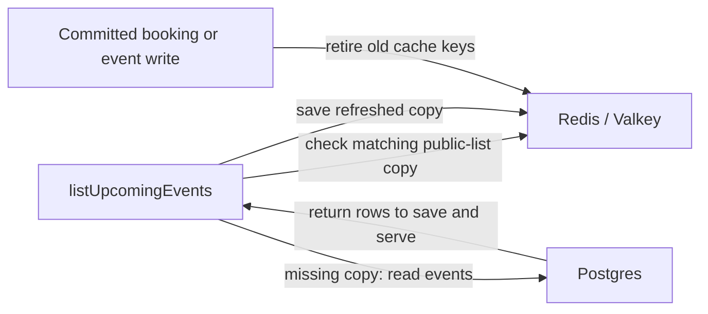

# Cache-aside: the ticket office’s spare catalogue

History: see [CHANGELOG.md](../CHANGELOG.md) or run `pnpm docs:history`

Area: Performance & Caching · Status: ✅ built in repository; live AWS acceptance is separate

<!-- interview-card: v2 -->

## 1. What is it?

Cache-aside keeps a reusable copy of data near the application. The application checks that copy first and reads the database when it needs a replacement.

## 2. Why do we need it?

Hundreds of visitors may request the same event catalogue. Sharing one recent copy avoids repeating the same database query for everyone.

## 3. How does it work?

1. Look up a copy matching the filters and current catalogue version.
2. Return a fresh copy, or rebuild a missing one from Postgres.
3. Briefly reuse an older copy while refreshing; stop at its hard age limit.

## 4. How do we use it in MiniTickets?

`listUpcomingEvents` caches legacy `events.list` results. Rebuild coordination avoids many callers repeating the same work. Booking and event writes invalidate after committing. Today’s `events.search` bypasses this list cache, and buying seats always checks Postgres.

## 5. Interview-ready answer

“MiniTickets uses cache-aside for its legacy public list: read Redis first, then fill missing data from Postgres. It can serve bounded stale data while one refresh runs, or during a short database failure. Writes retire the old cache keys. This improves browsing speed and availability, but displayed seats may be old, so purchases always use the database.”

## 6. Important follow-up questions

- **What if Redis fails?** Log the problem and fall back to SQL.
- **Can stale seats authorize a purchase?** No. Only the database transaction decides availability.
- **What stops a cache stampede?** Shared in-process work plus a temporary Redis rebuild lock.
- **Does invalidation refresh every tab?** No. Browser queries and server data caches have separate refresh rules.

## 7. Advanced details

Technical reference

### Keys, freshness and coordination

[Cache-aside](../glossary.md#cache-aside) applies to legacy `events.list`, not current `events.search`. `apps/api/src/services/events.ts` → `listUpcomingEvents` normalizes filters and reads `events:upcoming:gen`. `apps/api/src/queries/events-cache.ts` → `upcomingKey` builds `events:upcoming:v3:g<gen>:<hash>`.

Freshness is 30–33 seconds (soft TTL/jitter); the hard age limit is **300 seconds**, with Redis `PX 300000`. Stale-while-revalidate returns an older value while background refresh runs; bounded stale-if-error reuses a previous good value during an outage. A failed refresh must not reset old data to fresh. Never use stale data for authorization or seat purchase.

One in-process refresh is shared. `tryLockUpcomingRebuild` uses Redis `SET ... NX PX 5000` for a **5-second** cross-task lease; release checks ownership. Lease expiry may permit an extra rebuild, which is tolerable here but unsuitable for seat ownership. Booking/event writes `INCR events:upcoming:gen` after commit; failed invalidation logs a warning, while expiry still bounds cached age.

`apps/web/src/features/events/server/cached-events.ts` and `hooks/use-events.ts` add separate caches with independent clocks. Freshness in one layer does not force another to refetch; overlapping TTLs can compound age. P10 disables shared HTML caching while retaining explicit public-data caching.

### Network, operations and evidence

API → Valkey TCP 6379 is admitted by `minitickets-dev-redis-sg` from `minitickets-dev-api-sg`; `REDIS_URL` uses TLS. API → Postgres TCP 5432 is admitted by `minitickets-dev-db-sg` from the same API group; RDS login also uses TLS. Application data commands use credentials, not per-command IAM.

Console: ElastiCache → Valkey caches → `minitickets-dev-valkey` → Configuration / Monitoring for endpoint/memory; CloudWatch → Logs → `/minitickets/dev/api` for warnings. Individual keys require a Redis client. Slow first reads call for cache-status/SQL checks. Redis failure falls back to SQL; old lists after writes call for generation/invalidation checks. [Valkey](elasticache-valkey.md), [RDS](rds-postgres.md) and [row locks](row-locks.md) distinguish cache, source and actual purchase.

`pnpm test` includes fake-clock stale/error cases; no run or live AWS/CI acceptance is claimed by this rewrite. Higher traffic calls for age/hit telemetry and an end-to-end freshness budget. Direct SQL suits current or rarely repeated queries; managed HTTP caching suits safely shareable whole public responses. Read the [current system](../00-big-picture.md), [cache scenario](../guides/interview-scenarios.md#swr-caches) and [search tour](../guides/infra-explorer.html?tour=search).

### Code anchors

- Anchor: `apps/api/src/queries/events-cache.ts` — `upcomingKey`; follow the numbered comments at this boundary.
- Anchor: `apps/api/src/services/events.ts` — `SOFT_TTL_MS`; follow the numbered comments at this boundary.

[Open this piece in the city explorer](../guides/infra-explorer.html?concept=cache-aside#chapter=24&piece=valkey).

## Where it appears in the story

- [app-story: 10c. Public list caches and freshness](../app-story.md#10c-public-list-caches-and-freshness)

