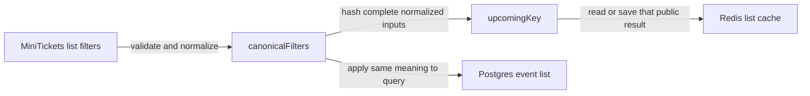

# Cache filter keys

History: see [CHANGELOG.md](../CHANGELOG.md) or run `pnpm docs:history`

Area: Performance & Caching · Status: 🟡 partial

<!-- interview-card: v2 -->

## 1. What is it?

A filter cache key names the exact question a cached result answers. Equivalent filters should share a key, while filters that change the result need different keys.

## 2. Why do we need it?

MiniTickets visitors looking for different venues must not receive each other’s lists. At the same time, extra spaces or equivalent date formats should not cause needless duplicate cache entries.

## 3. How does it work?

1. Validate filters and turn equivalent values into one representation.
2. Use every result-changing input when naming the result.
3. Apply the same meaning to the database query and cache lookup.

## 4. How do we use it in MiniTickets?

Legacy list filters normalize venue and UTC day ranges before hashing. Its key also includes payload version and catalogue generation. This is a public-list contract, not a way to mix authenticated user data into shared results. The card remains marked partial.

## 5. Interview-ready answer

“MiniTickets normalizes list filters before building the cache key, so equivalent questions reuse a result and different questions stay separate. The database query must interpret those filters identically. Hashing keeps the key bounded, but correctness comes from including every input and respecting public versus private data. I would investigate wrong results as a key-contract failure, not just clear the cache.”

## 6. Important follow-up questions

- **Why normalize first?** Equivalent input forms should not multiply entries or disagree with query behavior.
- **What if a filter is omitted?** Different questions can collide semantically and return the wrong result.
- **Does a hash hide secrets?** No. It is not encryption; avoid putting private data into public cache identities.
- **Can one key still be a bottleneck?** Yes. Hot queries and shared generation reads can concentrate traffic.

## 7. Advanced details

Technical reference

### Current filter contract

`apps/api/src/services/event-filters.ts` → `canonicalFilters` trims venue and uses exact case-insensitive matching; dates are UTC days. `apps/api/src/queries/events-cache.ts` uses a **16-hex-character SHA-256** input hash in `events:upcoming:v3:g<generation>:<hash>`. Include all result-changing fields; hashing cannot recover an omitted input.

`apps/api/src/queries/sessions.ts` requires authoritative session-index membership; private pages are not public cache data. Shared Redis for sessions/results/quotas shares failure and eviction behavior. Public data can be rebuilt; missing session membership must fail closed, and quota eviction can reset allowance.

### Verification, partial status and growth

`pnpm test` covers canonical filter/key and session-eviction cases. The original status remains **🟡 partial**; this rewrite neither expands implementation nor claims live AWS acceptance. Dedicated Redis isolation remains explain-only. At higher load inspect cardinality, hot keys and eviction, then consider separate critical-store policies or measured sharding.

### Code anchors

- Anchor: `apps/api/src/services/event-filters.ts` — `canonicalFilters`; follow the numbered comments at this boundary.

### Related reading

[current system](../00-big-picture.md) · [scenario](../guides/interview-scenarios.md#hot-keys-privacy) · [explorer tour](../guides/infra-explorer.html?tour=search)

[Open this concept in the city explorer](../guides/infra-explorer.html?concept=cache-filter-keys#chapter=5&piece=valkey).

## Where it appears in the story

- [app-story: 10c. Public list caches and freshness](../app-story.md#10c-public-list-caches-and-freshness)

