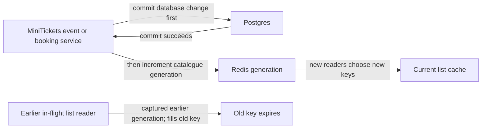

# Cache invalidation

History: see [CHANGELOG.md](../CHANGELOG.md) or run `pnpm docs:history`

Area: Performance & Caching · Status: ✅ built in repository; live AWS acceptance is separate

<!-- interview-card: v2 -->

## 1. What is it?

Cache invalidation stops serving copies that no longer reflect a committed change. MiniTickets changes the catalogue generation so new readers use new keys.

## 2. Why do we need it?

An administrator adds an event while an older list query is still running. Simply deleting the cache allows that slow query to refill it with the old list.

## 3. How does it work?

1. A reader captures the generation before its database query.
2. A writer commits, then advances the generation.
3. Later readers choose the new generation even if an earlier query finishes late.

## 4. How do we use it in MiniTickets?

Event and booking services invalidate legacy list results after successful writes, then notify the Next data cache. Failure is logged rather than undoing a committed change. Browser queries have their own refresh rules, so open tabs do not all update instantly.

## 5. Interview-ready answer

“MiniTickets prevents a slow old query from repopulating the current list by including a generation in cache keys. Readers capture that generation before reading the database; writers commit before advancing it. A late reader can only fill its old generation. This handles an important race, but invalidation can still fail and independent browser or server caches need their own freshness rules.”

## 6. Important follow-up questions

- **Why not delete one key?** An already-running old reader can refill it afterward.
- **Why capture generation before SQL?** Capturing it afterward could label old rows as the new generation.
- **What if invalidation fails?** Keep the committed write, log the problem and rely on bounded cache age while recovering.
- **Does this refresh every tab?** No. Browser queries refetch under their own policy.

## 7. Advanced details

Technical reference

### Implementation and ordering

`apps/api/src/services/events.ts` invalidates after event creation and exposes `invalidateEventLists` for committed booking changes. `apps/api/src/queries/events-cache.ts` builds generation/filter keys and increments generation; `apps/api/src/queries/web-cache.ts` calls signed Next revalidation. Capture generation before SQL, commit before `INCR`, then notify web. The old card’s service/query `invalidateUpcomingList` naming should be read at its actual query-layer boundary.

`pnpm demo:stampede` and invalidation unit cases cover late refill and failure locally. No new execution/live acceptance is claimed. TTL bounds stale data after an invalidation failure; invalidation errors do not undo already-committed events/bookings.

### Trade-offs and growth

Old generations temporarily increase key count until expiry. Redis, Next data and browser caches have separate clocks; one invalidation is not an instantaneous whole-system refresh. Watch failure logs and key churn. Outbox-driven invalidation and explicit freshness objectives are future options, not current guarantees.

### Code anchors

- Anchor: `apps/api/src/queries/events-cache.ts` — `upcomingKey`; follow the numbered comments at this boundary.
- Anchor: `apps/api/src/services/events.ts` — `listUpcomingEvents`; follow the numbered comments at this boundary.

### Related reading

[current system](../00-big-picture.md) · [scenario](../guides/interview-scenarios.md#cache-invalidation) · [explorer tour](../guides/infra-explorer.html?tour=search)

[Open this concept in the city explorer](../guides/infra-explorer.html?concept=cache-invalidation#chapter=5&piece=valkey).

## Where it appears in the story

- [app-story: 10c. Public list caches and freshness](../app-story.md#10c-public-list-caches-and-freshness)

