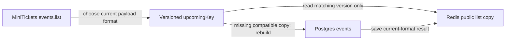

# Cache key versioning

History: see [CHANGELOG.md](../CHANGELOG.md) or run `pnpm docs:history`

Area: Performance & Caching · Status: ✅ built in repository; live AWS acceptance is separate

<!-- interview-card: v2 -->

## 1. What is it?

A cache-key version separates old and new data formats. The application asks for the format it understands instead of accidentally reading an incompatible older copy.

## 2. Why do we need it?

Suppose MiniTickets changes the saved event-list fields. An old cached result may still exist after deployment. A new version in the key prevents the new code treating that old format as current.

## 3. How does it work?

1. Choose a new key version for incompatible stored formats.
2. Include the complete normalized query inputs and write generation.
3. Let old keys expire rather than reading them as the new format.

## 4. How do we use it in MiniTickets?

Legacy event-list keys distinguish three things: payload version, catalogue generation after writes, and filters. These solve different problems. Current search bypasses this list cache, and private session authority is not stored in public list results.

## 5. Interview-ready answer

“MiniTickets puts a format version in its public list cache key so an incompatible deployment does not read an old payload. The key also contains the write generation and normalized filters. Versioning handles shape changes; invalidation handles changed data. It does not repair missing inputs or make cached information suitable for authorization.”

## 6. Important follow-up questions

- **When should the version change?** When cached shape or interpretation becomes incompatible, rather than for every data write.
- **Is generation the same thing?** No. A generation retires earlier data after a write.
- **Does hashing make keys private?** No. Hashing is not encryption and cannot compensate for omitted inputs.
- **What if old versions remain?** They consume temporary storage until expiry or eviction; monitor key growth.

## 7. Advanced details

Technical reference

### Key construction and boundaries

`apps/api/src/queries/events-cache.ts` → `upcomingKey` uses `events:upcoming:v3:g<generation>:<hash>`. `apps/api/src/services/event-filters.ts` normalizes filter inputs; the cache query hashes complete inputs. Version handles schema, generation handles writes, input identity handles filters. Missing a venue/date/user dimension can produce wrong or private results.

`apps/api/src/queries/sessions.ts` requires session-index membership; private pages are never public-list entries. One Redis deployment holds sessions, public results and quotas, sharing eviction/failure behavior. Eviction is acceptable for reconstructible catalogue data; session authority fails closed, and evicted quotas are not durable accounting.

### Verification and growth

`pnpm test` includes canonical filter/key and session-eviction cases; no test rerun/live AWS acceptance is claimed here. Dedicated Redis isolation is explain-only. A hot event or generation key can still concentrate load despite hashed result keys. Watch hot keys/evictions, consider separate security-critical policies at greater scale, and shard only measured bottlenecks.

### Code anchors

- Anchor: `apps/api/src/queries/events-cache.ts` — `upcomingKey`; follow the numbered comments at this boundary.

### Related reading

[current system](../00-big-picture.md) · [scenario](../guides/interview-scenarios.md#hot-keys-privacy) · [explorer tour](../guides/infra-explorer.html?tour=search)

[Open this concept in the city explorer](../guides/infra-explorer.html?concept=cache-key-versioning#chapter=5&piece=valkey).

## Where it appears in the story

- [app-story: 10c. Public list caches and freshness](../app-story.md#10c-public-list-caches-and-freshness)

