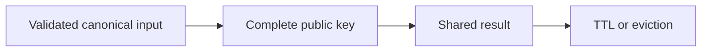

# Cache key versioning

History: see [CHANGELOG.md](../CHANGELOG.md) or run `pnpm docs:history`

Area: Performance & Caching · Status: ✅ built in repository; live AWS acceptance is separate

## 1. In one line

A version separates incompatible cached shapes. Current list keys are events:upcoming:v3:g<generation>:<hash>; generation handles writes, version handles schema, and canonical input handles filters.

## 2. Real-life comparison

A dated catalogue at the ticket office: many readers can share it, but the clerk must know when a newer edition exists.

## 3. Picture it

## 4. Where in our code

- Anchor: `apps/api/src/queries/events-cache.ts` — `upcomingKey`; follow the numbered comments at this boundary.

`apps/api/src/services/event-filters.ts` normalizes filters; `queries/events-cache.ts` hashes complete inputs. `queries/sessions.ts` requires session-index membership and never caches private pages. Run `pnpm test` for canonical filter/key and session eviction cases. Dedicated Redis isolation is explain-only.

## 5. See it yourself

Run `pnpm test` and inspect the asserted outcome described above.

Failure thought experiment: Is hashing a key encryption? No; do not put secrets into it assuming privacy. Do not change a live stack to demonstrate it.

## 6. How it connects

Uses the [current system](../00-big-picture.md); gives a concrete decision to the [scenario](../guides/interview-scenarios.md#hot-keys-privacy) and [explorer tour](../guides/infra-explorer.html?tour=search).

## 7. Our settings and WHY

A version separates incompatible cached shapes. Current list keys are events:upcoming:v3:g<generation>:<hash>; generation handles writes, version handles schema, and canonical input handles filters. Missing a venue/date/user dimension can return wrong or private data.

## 8. Trade-offs

Hashing bounds key size but does not fix omitted input. One cache used for sessions/results/quotas shares failure and eviction behavior.

## 9. Alternatives and when to choose them

10x: hot-key and eviction metrics. 100x: separate security-critical stores/policies and shard only measured bottlenecks.

## 10. What breaks and how we notice

Is hashing a key encryption? No; do not put secrets into it assuming privacy.

## 13. Interview answers at 3 levels

- **Simple:** A version separates incompatible cached shapes.
- **Senior:** A cache key must include every input that changes the result. Canonicalize dates/venue so equivalent filters share a key; keep authenticated data out of public keys. A very hot event or generation key still concentrates load. Redis eviction is acceptable for reconstructible public data, but sessions should fail closed and quotas are only advisory under eviction.
- **Lead:** 10x: hot-key and eviction metrics. 100x: separate security-critical stores/policies and shard only measured bottlenecks.

## 14. Follow-up questions with answers

Is hashing a key encryption? No; do not put secrets into it assuming privacy.

What must a result cache key include? **All result-changing inputs.**

## 15. Say it in 30 seconds

A cache key must include every input that changes the result. Canonicalize dates/venue so equivalent filters share a key; keep authenticated data out of public keys. A very hot event or generation key still concentrates load. Redis eviction is acceptable for reconstructible public data, but sessions should fail closed and quotas are only advisory under eviction.

## 16. Status and production work

Repository implementation and local evidence are described above. Live AWS/CI execution remains owner acceptance. 10x: hot-key and eviction metrics. 100x: separate security-critical stores/policies and shard only measured bottlenecks.

## Where it appears in the story

- [app-story: 10c. Public list caches and freshness](../app-story.md#10c-public-list-caches-and-freshness)
