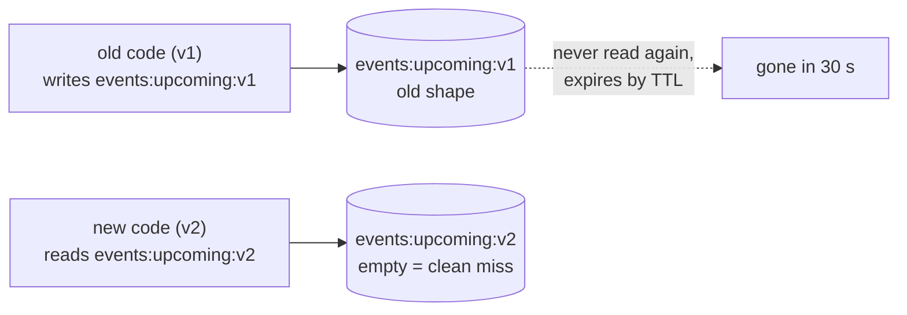

# Cache key versioning

History: see [CHANGELOG.md](../CHANGELOG.md) or run `pnpm docs:history`

Area: Performance & Caching · Status: ✅ built (`events:upcoming:v1`) · Step doc: [24 events cache](../../24-events-cache.md)

## 1. In one line

Put a **version** in the cache key (`events:upcoming:v1`) so a deploy that changes the shape of the
cached data starts with a fresh key instead of reading data written by the old code.

## 2. Real-life comparison

Forms with a revision number in the corner ("Form 7B, rev. 2"). When the form changes, you print
rev. 3 and old rev. 2 forms in the drawer are simply never picked up by the new office procedure.

## 3. Picture it



## 4. Where in our code

- Anchor: `apps/api/src/queries/events-cache.ts` · `UPCOMING_KEY`: the versioned key.

Step by step:

1. The key is one constant, `"events:upcoming:v1"`.
2. If you change the **shape** of a public event (add, rename or remove a field in
   `packages/shared/src/schemas/events.ts`), change the constant to `v2` in the same commit.
3. After the deploy the new code reads `v2`: a miss, then it fills it with the new shape.
4. The `v1` key is never read again and Redis deletes it when its TTL ends (≤ 33 s).
5. Second line of defence: the service validates every cached value with the Zod schema, so a value
   in a wrong shape is a miss with a warning even if someone forgot to bump the version.

## 5. See it yourself

```bash
docker exec minitickets-redis-1 redis-cli --scan --pattern 'events:*'      # events:upcoming:v1
```

**Break it on purpose:** `redis-cli SET events:upcoming:v1 '[{"title":"old"}]'` and call
`events.list`: the Zod check rejects it, the log says `events cache value is invalid, treating as a miss`.

## 6. How it connects

- **Uses ←** [cache-aside](cache-aside.md), [ttl](ttl.md) (old keys disappear on their own).
- **Gives →** safe deploys of shape changes; the same idea applies to sessions if their JSON ever changes.

## 7. Our settings and WHY

`v1`, bumped by hand. WHY: it is one line and obvious. During a rolling deploy old and new tasks run
together; each reads its own version, so neither sees the other's shape.

## 8. Trade-offs

- **Pros:** no flush needed; old and new versions can coexist; trivially simple.
- **Cons:** a manual step someone can forget (the Zod check is the safety net); the first request after
  the bump is a miss; it only helps for shape changes, not for stale *values*.

## 9. Alternatives and when to choose them

- **Flush the cache on deploy:** blunt; a cold cache for everything, and it does not help rolling deploys.
- **Version inside the value** (`{ v: 1, data }`): the reader checks it; handy when keys are many.
- **Hash of the schema in the key:** automatic, harder to read.

## 10. What breaks, and how we'd notice

Forgetting to bump the version: new code finds old-shaped data; Zod rejects it; warnings in the log and
one extra Postgres read. Without the Zod check, wrong-shaped data could reach users for ≤ 33 s.

## 13. Interview answers at 3 levels

- **Simple:** The key has a version so new code never reads old-format data.
- **Senior:** `events:upcoming:v1`; bump it when the cached shape changes. During a rolling deploy both
  versions run side by side on different keys. The reader also validates with Zod as a safety net.
- **Lead:** Cache entries outlive the code that wrote them. Treat a cached value like an API
  contract: version it, validate on read, and let TTL clean up. For many keys, put the version in the
  value or generate it from the schema.

## 14. Follow-up questions interviewers ask

- *Why not just flush Redis on deploy?* It also drops sessions in our case, and rolling deploys still overlap.
- *Does versioning fix stale data?* No, that is TTL and invalidation.

## 15. Say it in 30 seconds

"Our cache key is events:upcoming:v1. If a deploy changes the data shape we bump it to v2, so the new
code starts with an empty key and old data just expires. A Zod check on read catches anything we forgot."

## 16. Status

✅ built.

## Where it appears in the story

- [App story: 10b. Reading events](../app-story.md#10b-reading-events)
