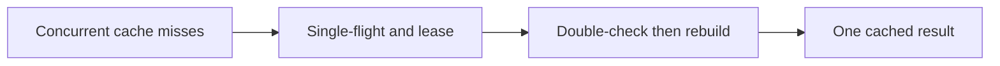

# Cache stampede

History: see [CHANGELOG.md](../CHANGELOG.md) or run `pnpm docs:history`

Area: Performance & Caching · Status: ✅ built in repository; live AWS acceptance is separate

## 1. In one line

A stampede is many callers rebuilding the same missing result. One promise per process plus a Redis owner-token lease and double-check coalesce work; bounded wait can still fall back.

## 2. Real-life comparison

A dated catalogue at the ticket office: many readers can share it, but the clerk must know when a newer edition exists.

## 3. Picture it

## 4. Where in our code

- Anchor: `apps/api/src/queries/events-cache.ts` — `upcomingKey`; follow the numbered comments at this boundary.
- Anchor: `apps/api/src/services/single-flight.ts` — `singleFlight`; follow the numbered comments at this boundary.

`apps/api/src/services/single-flight.ts` shares a promise with cleanup on both success/error. `queries/events-cache.ts` uses SET NX PX and Lua compare/delete. `pnpm demo:stampede` previously measured 100 concurrent requests as 1 DB query, including two instances after the double-check fix.

## 5. See it yourself

Run `pnpm demo:stampede` and inspect the asserted outcome described above.

Failure thought experiment: Why random owner token? A late old holder must not delete a newer lease. Do not change a live stack to demonstrate it.

## 6. How it connects

Uses the [current system](../00-big-picture.md); gives a concrete decision to the [scenario](../guides/interview-scenarios.md#cache-stampede) and [explorer tour](../guides/infra-explorer.html?tour=search).

## 7. Our settings and WHY

A stampede is many callers rebuilding the same missing result. One promise per process plus a Redis owner-token lease and double-check coalesce work; bounded wait can still fall back. A fast cache can amplify database load when many entries expire together.

## 8. Trade-offs

The 5 s lease and bounded wait permit duplicate rebuilds if slow or evicted. That is acceptable for public reads, never scarce-seat correctness.

## 9. Alternatives and when to choose them

10x: TTL jitter and refresh metrics. 100x: hot-key partitioning, stale serving and bounded rebuild queues.

## 10. What breaks and how we notice

Why random owner token? A late old holder must not delete a newer lease.

## 13. Interview answers at 3 levels

- **Simple:** A stampede is many callers rebuilding the same missing result.
- **Senior:** Use single-flight inside one process and a short distributed rebuild lock across processes. Recheck the cache after taking the lock: another holder may have filled it while this request waited. Release only with the owner token. Bound waiting and fall back to Postgres so a broken cache does not hang the request.
- **Lead:** 10x: TTL jitter and refresh metrics. 100x: hot-key partitioning, stale serving and bounded rebuild queues.

## 14. Follow-up questions with answers

Why random owner token? A late old holder must not delete a newer lease.

What must happen after acquiring a rebuild lock? **Recheck the cache.**

## 15. Say it in 30 seconds

Use single-flight inside one process and a short distributed rebuild lock across processes. Recheck the cache after taking the lock: another holder may have filled it while this request waited. Release only with the owner token. Bound waiting and fall back to Postgres so a broken cache does not hang the request.

## 16. Status and production work

Repository implementation and local evidence are described above. Live AWS/CI execution remains owner acceptance. 10x: TTL jitter and refresh metrics. 100x: hot-key partitioning, stale serving and bounded rebuild queues.

## Where it appears in the story

- [app-story: 10c. Public list caches and freshness](../app-story.md#10c-public-list-caches-and-freshness)
