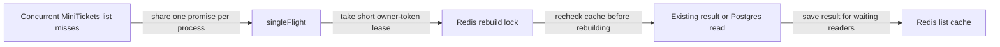

# Cache stampede

History: see [CHANGELOG.md](../CHANGELOG.md) or run `pnpm docs:history`

Area: Performance & Caching · Status: ✅ built in repository; live AWS acceptance is separate

<!-- interview-card: v2 -->

## 1. What is it?

A cache stampede happens when many requests rebuild the same missing value at once. Sharing that work protects the database during a burst.

## 2. Why do we need it?

If a popular MiniTickets list expires just before many visitors arrive, every request could run the same SQL. A cache meant to reduce work would suddenly send a surge to Postgres.

## 3. How does it work?

1. Share in-process work for the same missing result.
2. Use a temporary Redis lease across API processes.
3. Recheck after acquiring it, rebuild if needed, and release only your own lease.

## 4. How do we use it in MiniTickets?

The list service combines `singleFlight` with a Redis owner-token lock. Waiting is bounded; a slow or failed cache can still lead to database fallback. This coordination reduces repeated public reads, but it is not a correctness lock for scarce seats.

## 5. Interview-ready answer

“MiniTickets coalesces concurrent list rebuilds inside one process and uses a short Redis lease across processes. After taking the lease, it checks the cache again because another request may already have filled it. Release verifies ownership. This reduces stampedes, but expiry or bounded fallback can still produce duplicate rebuilds; that is acceptable for public reads, never for booking ownership.”

## 6. Important follow-up questions

- **Why recheck after taking the lock?** The previous holder may have filled the cache while this request waited.
- **Why use an owner token?** An expired old holder must not delete a newer holder’s lease.
- **What if a rebuild exceeds the lease?** Another rebuild may start; the design tolerates that for read copies.
- **Could this guard ticket sales?** No. Durable database rules must decide seats.

## 7. Advanced details

Technical reference

### Implementation and historical evidence

`apps/api/src/services/single-flight.ts` shares one promise per key and cleans it up on both success and error. `apps/api/src/queries/events-cache.ts` uses `SET NX PX` with a **5-second lease** and Lua compare/delete ownership checks. The cache is checked again after acquisition. Waiting is bounded and can fall back to Postgres.

Historical `pnpm demo:stampede` measured **100 concurrent requests as one DB query**, including two instances after the double-check fix. This is recorded local evidence, not a universal guarantee, fresh run or AWS acceptance. A slow rebuild, eviction or expired lease can still duplicate SQL.

### Trade-offs and future work

The lock protects efficiency, not seat correctness. Future options include TTL jitter, refresh telemetry, stale serving, bounded rebuild queues and measured hot-key partitioning. Track database fallback and contention before adding complexity.

### Code anchors

- Anchor: `apps/api/src/queries/events-cache.ts` — `upcomingKey`; follow the numbered comments at this boundary.
- Anchor: `apps/api/src/services/single-flight.ts` — `singleFlight`; follow the numbered comments at this boundary.

### Related reading

[current system](../00-big-picture.md) · [scenario](../guides/interview-scenarios.md#cache-stampede) · [explorer tour](../guides/infra-explorer.html?tour=search)

[Open this concept in the city explorer](../guides/infra-explorer.html?concept=cache-stampede#chapter=5&piece=valkey).

## Where it appears in the story

- [app-story: 10c. Public list caches and freshness](../app-story.md#10c-public-list-caches-and-freshness)

