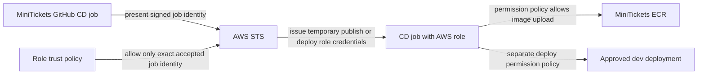

# OIDC: the delivery crew’s temporary badges

History: see [CHANGELOG.md](../CHANGELOG.md) or run `pnpm docs:history`
Area: DevOps & CI/CD · Status: ✅ built in repository; live AWS acceptance is separate
<!-- interview-card: v2 -->

## 1. What is it?

OIDC lets GitHub prove which job is running using a signed identity. AWS exchanges an accepted identity for temporary credentials instead of requiring stored access keys.

## 2. Why do we need it?

MiniTickets must upload release images and deploy them. Long-lived AWS keys in GitHub would create a lasting secret to rotate and protect; temporary job credentials reduce that exposure.

## 3. How does it work?

1. GitHub issues a signed identity for the job.
2. AWS checks the role’s trust rules before issuing temporary credentials.
3. The role’s permissions limit what that job can do.

## 4. How do we use it in MiniTickets?

Publish and deploy have separate roles. Publish trusts this repository’s main identity; deploy trusts its protected `dev` environment identity. `createCicd` defines those boundaries. GitHub’s environment protection supplies approval rules; live protections and AWS acceptance still need checking.

## 5. Interview-ready answer

“MiniTickets uses GitHub’s signed job identity to obtain temporary AWS credentials. Trust rules decide which repository and job context may obtain a role; permission rules decide what that role can do. We separate publishing from deployment and protect the deployment environment. OIDC removes stored AWS access keys, but strong trust conditions, restricted permissions and approval controls still matter.”

## 6. Important follow-up questions

- **Why separate trust and permissions?** Knowing who a job is does not decide which resources it may change.
- **Why use immutable repository IDs?** A reused or transferred repository name should not silently gain trust.
- **Does environment trust enforce main?** No. Environment branch/reviewer protection must constrain that separately.
- **What if role assumption works but an action fails?** Check the permission policy for that action and resource.

## 7. Advanced details

Technical reference

### Provider and exact trust conditions

[OIDC](../glossary.md#oidc) uses issuer `token.actions.githubusercontent.com`, audience `sts.amazonaws.com` and `sts:AssumeRoleWithWebIdentity`. `.github/workflows/cd.yml` Configure AWS credentials steps request a token with `id-token: write`; this allows identity issuance, not repository writes. Runner HTTPS must reach GitHub identity, STS and AWS APIs; trust grants no network route. Temporary credentials still need protection.

`infra/src/cicd.ts` → `createCicd` uses exact `StringEquals` audience/subject, not wildcard identity:

- Publish: `repo:maheshnd@63289193/minitickets@1412723955:ref:refs/heads/main`.
- Deploy: the same immutable repository/owner prefix plus `:environment:dev`.

`githubSubjectPrefix` includes immutable IDs to prevent deleted/transferred/reused names becoming the same trusted identity. An environment subject names the environment rather than branch; branch/reviewer protection in GitHub is essential. [GitHub’s AWS OIDC guide](https://docs.github.com/en/actions/how-tos/secure-your-work/security-harden-deployments/oidc-in-aws).

### Permissions and attachment

Publish role `minitickets-dev-gh-publish`, inline `push-images`, attaches to the publish job. `infra/src/publish-policy.ts` → `publishPolicyDocument` grants `ecr:GetAuthorizationToken` on `*` because registry login requires it. `BatchCheckLayerAvailability`, `BatchGetImage`, `GetDownloadUrlForLayer`, `InitiateLayerUpload`, `UploadLayerPart`, `CompleteLayerUpload`, `PutImage` are limited to the three API/web/worker repository ARNs. Manifest reads detect existing images; upload-only access is insufficient.

Deploy role `minitickets-dev-gh-deploy`, inline `deploy`, attaches to the approved deploy job. Infrastructure access is scoped/named in `cicd.ts`. `iam:PassRole` is limited to listed execution/task/function roles with `iam:PassedToService` constrained to ECS tasks or Lambda. It allows attaching those roles, not assuming them as the runner. Some discovery/create actions cannot use existing-resource ARNs; conditions and naming deserve review.

Sessions are `gh-publish-<run id>` / `gh-deploy-<run id>`. Role ARN variables are addresses, not passwords. Pulumi backend credentials are separate. The newest-deploy guard, not OIDC alone, prevents stale infrastructure runs.

### Operations, alternatives and acceptance

Console: IAM → Identity providers → `token.actions.githubusercontent.com`; IAM → Roles → publish/deploy role → Trust relationships / Permissions. GitHub → Settings → Environments → dev checks approval protection. No current protection or successful live assumption is claimed. Failed assumption calls for exact subject/audience comparison; post-assumption denial calls for the action/resource policy, changed only through reviewed source.

At higher scale, consider exact-SHA approvals, approval expiry, separate accounts and automated policy review. Other signed workload identities can use federation too. [CI](ci-pipeline.md) gates automatic publishing, [ECR](ecr.md) stores releases and [rolling deploy](zero-downtime-deploys.md) uses the deployment identity.

### Code anchors

- Anchor: `infra/src/cicd.ts` — `createCicd`; follow the numbered comments at this boundary.

[Open this piece in the city explorer](../guides/infra-explorer.html?concept=cd-oidc#chapter=24&piece=iam).

## Where it appears in the story

- [app-story: 16b. Publish, approval and stale-run safety](../app-story.md#16b-publish-approval-and-stale-run-safety)

