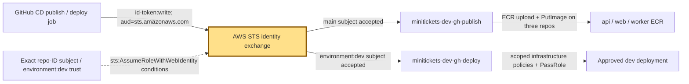
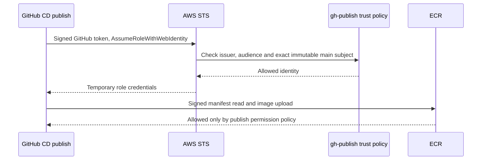

# OIDC: the delivery crew’s temporary badges

History: see [CHANGELOG.md](../CHANGELOG.md) or run `pnpm docs:history`
Area: DevOps & CI/CD · Status: ✅ built in repository; live AWS acceptance is separate
<!-- interview-card: v1 -->

## 1. In one line

MiniTickets exchanges a signed GitHub [OIDC](../glossary.md#oidc) identity for a short-lived AWS badge instead of saving AWS access keys.

## 2. Where it sits

[Open this piece in the city explorer](../guides/infra-explorer.html?concept=cd-oidc#chapter=24&piece=iam).

## 3. How it works

## 4. What happens in MiniTickets

1. `createCicd` registers GitHub’s identity provider for audience `sts.amazonaws.com`.
2. Publish trust requires `repo:maheshnd@63289193/minitickets@1412723955:ref:refs/heads/main`.
3. Deploy trust requires the same repository prefix plus `:environment:dev`; GitHub environment protection supplies approval rules.
4. STS gives temporary credentials. Publish can access three image repositories; deploy has a separate infrastructure policy.
5. Role trust answers who; permissions answer what. Neither grants a network route.

## 5. Reach / Allowed / Password

**Reach:** runner HTTPS to GitHub identity, STS and AWS APIs.

**Allowed:** exact trust conditions, then each role’s permission policy.

**Password:** no long-lived AWS keys; temporary credentials still need protection.

## 6. In our code

`infra/src/cicd.ts` → `createCicd`.

`infra/src/publish-policy.ts` → `publishPolicyDocument`.

`.github/workflows/cd.yml` → Configure AWS credentials steps.

## 7. In the AWS console

`us-east-1` console session → IAM → Identity providers → `token.actions.githubusercontent.com`; IAM → Roles → `minitickets-dev-gh-publish` or `minitickets-dev-gh-deploy` → Trust relationships / Permissions. GitHub → Settings → Environments → dev holds approval protection. Live protections were not inspected.

## 8. Good / Bad

**Good:** No stored AWS access keys. Separate badges limit publishing versus deploying.

**Bad:** A bad trust condition can admit the wrong job. Broad deployment rights still deserve review.

## 9. Other choices

- Separate AWS accounts: pick them when environments need stronger blast boundaries.
- Workload federation: pick it for other systems that can present trusted signed identities.

## 10. Connected to

| Neighbor | Direction | What allows it | Console check |
| --- | --- | --- | --- |
| [CI](ci-pipeline.md) | In ← | Successful main-push CI; CD conditions | GitHub → Actions → CI / CD |
| [ECR](ecr.md) | Out → | Publish role ECR actions | IAM → gh-publish → Permissions |
| [Rolling deploy](zero-downtime-deploys.md) | Out → | Dev trust + deploy policy + PassRole | IAM → gh-deploy; GitHub → dev environment |

## 11. When it breaks

Cannot assume role → Trust relationships → compare exact token subject and audience.

Assumed role, action denied → Permissions → add only the required action/resource through reviewed code.

## 12. Say it in 30 seconds

“GitHub presents a signed identity to STS. Our trust policies accept only this repository’s immutable identity on main for publish, or its dev environment for deploy. STS returns temporary credentials. A separate permission policy then limits what that badge can do. OIDC solves identity; it does not make every AWS action allowed.”

## 13. Likely follow-ups

- Why two subjects? An environment job’s identity names its environment, not its branch.
- Does id-token write modify the repo? No; it permits requesting the signed identity token.

## 14. Remember it

Trust checks who wears the badge; permissions check which doors it opens.

## 15. More detail

Settings, limits and deeper interview notes

- Anchor: `infra/src/cicd.ts` — `createCicd`; follow the numbered comments at this boundary.

The immutable repository/owner IDs in `githubSubjectPrefix` prevent a repository name being deleted, transferred or reused from silently becoming the same trusted identity. Trust uses exact `StringEquals` on audience and subject rather than a wildcard. The OIDC issuer is `token.actions.githubusercontent.com`; `sts:AssumeRoleWithWebIdentity` exchanges its signed identity for AWS credentials.

Publish role is `minitickets-dev-gh-publish`, inline policy `push-images`. `ecr:GetAuthorizationToken` uses resource `*` because it is a registry login action. `BatchCheckLayerAvailability`, `BatchGetImage`, `GetDownloadUrlForLayer`, `InitiateLayerUpload`, `UploadLayerPart`, `CompleteLayerUpload`, `PutImage` are restricted to the three repository ARNs. Publish needs manifest reads to detect existing images; upload-only policy is insufficient.

Deploy role is `minitickets-dev-gh-deploy`, inline policy `deploy`. It can manage the infrastructure named/scoped in `cicd.ts`; `iam:PassRole` is restricted to listed execution/task/function roles and `iam:PassedToService` ECS tasks or Lambda. PassRole lets a deployment attach a role; it is not permission for the runner to assume that task role itself. Some AWS discovery/create actions cannot use narrow existing-resource ARNs, so conditions and resource naming need review.

The workflow names sessions `gh-publish-<run id>` / `gh-deploy-<run id>` for audit correlation. Role ARN repository variables are addresses, not passwords. Pulumi backend access is a separate credential concern. GitHub environment branch/reviewer protection is essential because an environment subject alone does not name main. The newest deploy guard prevents old/superseded infrastructure runs; OIDC alone does not.

At higher scale, consider approval expiry, exact-SHA approvals, separate accounts and automated policy review. Nothing here proves current GitHub protections or successful live AWS assumption. [GitHub’s AWS OIDC guide](https://docs.github.com/en/actions/how-tos/secure-your-work/security-harden-deployments/oidc-in-aws) explains immutable subjects and environment protection.

## Where it appears in the story

- [app-story: 16b. Publish, approval and stale-run safety](../app-story.md#16b-publish-approval-and-stale-run-safety)
