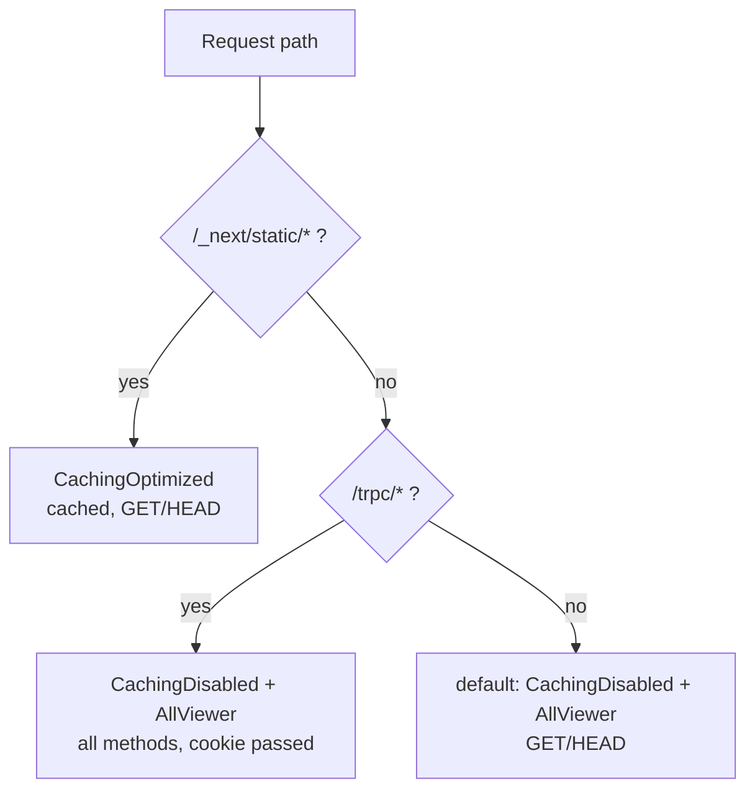

# CDN caching: hashed static files cached, per-user answers never

Area: Performance & Caching · Status: ✅ built · Step doc: [19 CloudFront](../../19-infra-cloudfront.md) (sections 3.2-3.4)

## 1. In one line

CloudFront keeps copies of the built JS and CSS files at the edge for up to a year, and never caches
pages or API answers, because those depend on who is asking.

## 2. Real-life comparison

A newsstand keeps printed newspapers on the shelf (same for everyone). It never keeps copies of
someone's bank statement to hand to the next customer.

## 3. Picture it



## 4. Where in our code

- Anchor: `infra/src/entry/cdn.ts` · `orderedCacheBehaviors`, `defaultCacheBehavior`: the three behaviors.

Step by step:

1. Managed policies are looked up by name: `Managed-CachingOptimized`, `Managed-CachingDisabled`,
   `Managed-AllViewer`.
2. `/_next/static/*` → CachingOptimized: the cache key is the path only (plus the normalised
   `Accept-Encoding`), TTL between 1 second and 1 year, honouring the file's `Cache-Control`. Next.js
   sends `max-age=31536000, immutable` for these hashed files.
3. `/trpc/*` → CachingDisabled + AllViewer: every request goes to the ALB with all headers, cookies
   and query strings; all 7 methods allowed (POST for mutations).
4. Default (pages) → CachingDisabled + AllViewer, GET and HEAD only: pages show who is logged in.
5. Order: ordered behaviors top to bottom, first match wins; the default catches the rest.

**Why `/trpc/*` must never be cached:** the answer depends on the `sid` cookie. If the cache key did
not contain the cookie, one user's `account.profile` would be served to the next user
([docs/19](../../19-infra-cloudfront.md), section 3.4).

## 5. See it yourself

```bash
cd infra && APP=$(pulumi stack output appUrl)
FILE=$(curl -s "$APP/" | grep -o '/_next/static/[^"]*\.js' | head -1)
curl -s -o /dev/null -D - "$APP$FILE" | grep -i '^x-cache'   # Miss, then run again: Hit
curl -s -o /dev/null -D - "$APP/" | grep -i '^x-cache'        # always Miss
```

**Break it on purpose (thought experiment, never deploy):** give `/trpc/*` CachingOptimized. Alice's
profile response is cached by path; Mallory's request for the same path gets Alice's email.

## 6. How it connects

- **Uses ←** [CloudFront](cloudfront.md); Next.js content-hashed file names.
- **Gives →** fast static loads; [compression](compression.md) for the cached files; a safe API path
  for the session cookie.

## 7. Our settings and WHY

| Behavior | Cache | Why |
| -------- | ----- | --- |
| `/_next/static/*` | up to 1 year | Content hash in the name: a name never changes content. |
| `/trpc/*` | never | Per-user answers. |
| pages | never | Header shows the logged-in user. |

## 8. Trade-offs

- **Pros:** static files come from the nearest edge and cost our tasks nothing; zero risk of
  cross-user leaks on the api.
- **Cons:** every page view still goes to Virginia; the landing page could be cached but isn't.

## 9. Alternatives and when to choose them

- **Cache public pages** with a short TTL and no cookie in the key: when pages stop depending on the
  session (render user parts on the client).
- **Cache some public api answers** with the right cache key: when there are public, shared queries.
- **Invalidations:** for files whose names do not change (we don't need them).

## 10. What breaks, and how we'd notice

- Per-user data cached: a data leak, noticed only by users. Prevent by design (CachingDisabled).
- AllViewer missing: the cookie is not forwarded; nobody is ever logged in.
- Static files not cached: `x-cache: Miss` every time; slower loads.

## 11. Reach / Allowed / Password

Not a connection. Note the **Password** angle: the cookie must be forwarded (`AllViewer`) and must
never be part of a shared cache.

## 12. Cost

Free tier covers 1 TB and 10 million requests a month; every hit saves origin work.

## 13. Interview answers at 3 levels

- **Simple:** We cache the static files at the CDN and never cache personal data.
- **Senior:** Three behaviors: content-hashed `/_next/static/*` with CachingOptimized, honouring
  Next's one-year immutable header; `/trpc/*` and pages with CachingDisabled and AllViewer so the
  cookie reaches the origin. `x-cache` shows Hit/Miss.
- **Lead:** Cache keys are a security boundary. I'd only widen caching after making responses
  explicitly public, and I'd monitor hit ratio to decide whether rendering changes are worth it.

## 14. Follow-up questions interviewers ask

- *How do you deploy new JS without invalidating?* New content gets a new hashed name; old names stay
  valid.
- *Why not cache with the cookie in the key?* No two users share a session, so there is nothing to gain.

## 15. Say it in 30 seconds

"Only hashed static files are cached, for up to a year, because their names change with their
content. Pages and `/trpc/*` use CachingDisabled with AllViewer, so the cookie reaches the origin and
one user's answer can never be served to another."

## 16. Status

✅ built.
