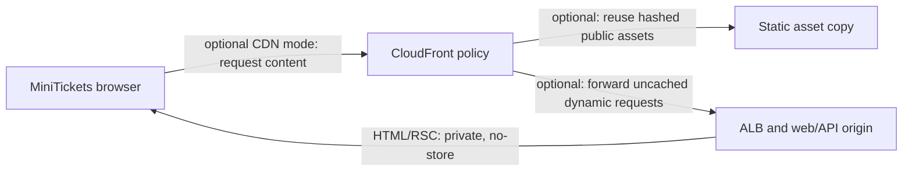

# CDN caching: hashed static files cached, per-user answers never

History: see [CHANGELOG.md](../CHANGELOG.md) or run `pnpm docs:history`

Area: Performance & Caching · Status: ✅ built in repository; live AWS acceptance is separate

<!-- interview-card: v2 -->

## 1. What is it?

A content delivery network (CDN) keeps reusable responses near visitors. Safe caching depends on deciding exactly which responses may be shared.

## 2. Why do we need it?

Sharing a JavaScript bundle speeds up MiniTickets for everyone. Sharing one buyer’s account page with another visitor would be a serious data leak, so these are different caching decisions.

## 3. How does it work?

1. Classify public static files separately from dynamic or user-bound responses.
2. Make cache policy and origin headers agree.
3. Verify actual response headers and cache behavior when CDN mode is enabled.

## 4. How do we use it in MiniTickets?

CloudFront is optional and inactive in the committed dev shape. Current HTML and React navigation responses are private,no-store because scripts use a fresh request code. Explicit public-data caches and hashed static files are separate from shared page caching.

## 5. Interview-ready answer

“MiniTickets allows caching of reusable public assets while keeping HTML and user-bound responses out of shared caches. Current HTML has per-request script authorization, so even the public catalogue page is no-store. CloudFront is inactive today. If enabled, its cache policy must respect those headers; a positive minimum TTL could override privacy instructions and create a dangerous mismatch.”

## 6. Important follow-up questions

- **Does Vary: Cookie make sharing safe?** No. The CDN cache key and expiration rules must also match the intended behavior.
- **Why avoid caching public catalogue HTML?** It contains a fresh per-request script code, unlike reusable catalogue data.
- **Can static files still be cached?** Yes. Content-hashed assets are designed for long reuse.
- **What should acceptance inspect?** HTML and navigation payload headers, cookies, cache keys and observed hits—not configuration alone.

## 7. Advanced details

Technical reference

### Current configuration and sources

Committed `cdnEnabled=false` means CloudFront is inactive; repository settings are not live deployment proof. `apps/web/src/proxy.ts` and `apps/web/next.config.ts` apply private,no-store to HTML/RSC, including catalogue pages. `apps/web/src/features/events/server/cached-events.ts` separately caches explicit public data.

`infra/src/entry/cdn.ts` retains optional behaviors for hashed static assets, API and events. Events policy has **minimum/default TTL 0** (maximum 330); zero minimum respects origin privacy directives. A positive minimum can override no-store/private. Static hashed files retain long caching. Do not rely on a generic Vary header to define CloudFront cache identity.

### Trade-offs, checks and growth

Per-user edge keys multiply entries and are hard to audit. No-store trades server work for a simple privacy boundary; static JS/images can still be reused. `pnpm demo:security` covers production-mode local headers/cache behavior, not live CDN acceptance and was not rerun here. Inspect both HTML and RSC headers. Future public-HTML caching would require a deliberate separate security/cache strategy and centralized policy checks.

### Code anchors

- Anchor: `infra/src/entry/cdn.ts` — `module configuration`; follow the numbered comments at this boundary.

### Related reading

[current system](../00-big-picture.md) · [scenario](../guides/interview-scenarios.md#private-page-cache) · [explorer tour](../guides/infra-explorer.html?tour=security-layers)

[Open this concept in the city explorer](../guides/infra-explorer.html?concept=cdn-caching#chapter=12&piece=cloudfront).

## Where it appears in the story

- [app-story: 9b. A booking reaches its transaction](../app-story.md#9b-a-booking-reaches-its-transaction)

