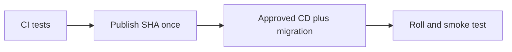

# CI pipeline: quality, e2e and docker jobs

History: see [CHANGELOG.md](../CHANGELOG.md) or run `pnpm docs:history`

Area: DevOps & CI/CD · Status: ✅ built in repository; live AWS acceptance is separate

## 1. In one line

CI typechecks/lints/tests/checks docs and builds/scans images; CD publish then deploy are separate jobs. Publish builds each SHA once, while approved deploy applies committed shape and an SSM release tag.

## 2. Real-life comparison

A sealed package is built once, then checked at a gate before the manager installs that exact version.

## 3. Picture it

## 4. Where in our code

- Anchor: `.github/workflows/ci.yml` — `module configuration`; follow the numbered comments at this boundary.

The publish job in `.github/workflows/cd.yml` builds/pushes; its deploy job resolves release and runs two-phase deploy/migrate/smoke checks. `infra/src/image-tag.ts` reads the tag; `release.ts` tracks last deployed commit. See runbook §3.11–3.18. No publish, AWS write or live rollback was performed by this documentation work.

## 5. See it yourself

Use the linked scenario and tour to trace the existing integration point. This proposed extension has no runnable feature demo.

Failure thought experiment: Should rollback run old Pulumi code? No; image rollback and infrastructure rollback are different risks. Do not change a live stack to demonstrate it.

## 6. How it connects

Uses the [current system](../00-big-picture.md); gives a concrete decision to the [scenario](../guides/interview-scenarios.md#delivery-rollback) and [explorer tour](../guides/infra-explorer.html?tour=deploy).

## 7. Our settings and WHY

CI typechecks/lints/tests/checks docs and builds/scans images; CD publish then deploy are separate jobs. Publish builds each SHA once, while approved deploy applies committed shape and an SSM release tag. Rebuilding on deploy can ship bytes that were never reviewed or tested.

## 8. Trade-offs

Rolling deployment overlaps versions. Blue/green gives a switchable target but costs overlap and still needs compatible migrations. Secrets/config are part of release compatibility.

## 9. Alternatives and when to choose them

10x: expired approvals and automated rollback criteria. 100x: canary analysis, immutable manifests and cross-service compatibility.

## 10. What breaks and how we notice

Should rollback run old Pulumi code? No; image rollback and infrastructure rollback are different risks.

## 13. Interview answers at 3 levels

- **Simple:** CI typechecks/lints/tests/checks docs and builds/scans images; CD publish then deploy are separate jobs.
- **Senior:** Publish API/web/worker images once with the git SHA after CI, then deploy that immutable release. The environment switches live in committed Pulumi YAML; deployed image tag lives in SSM and is written by CD. Migration runs before rollout. Roll back app images to a known tag while respecting current schema and current infrastructure.
- **Lead:** 10x: expired approvals and automated rollback criteria. 100x: canary analysis, immutable manifests and cross-service compatibility.

## 14. Follow-up questions with answers

Should rollback run old Pulumi code? No; image rollback and infrastructure rollback are different risks.

Where is the deployed image tag recorded? **SSM release parameter.**

## 15. Say it in 30 seconds

Publish API/web/worker images once with the git SHA after CI, then deploy that immutable release. The environment switches live in committed Pulumi YAML; deployed image tag lives in SSM and is written by CD. Migration runs before rollout. Roll back app images to a known tag while respecting current schema and current infrastructure.

## 16. Status and production work

Repository implementation and local evidence are described above. Live AWS/CI execution remains owner acceptance. 10x: expired approvals and automated rollback criteria. 100x: canary analysis, immutable manifests and cross-service compatibility.

## Where it appears in the story

- [app-story: 16b. Publish, approval and stale-run safety](../app-story.md#16b-publish-approval-and-stale-run-safety)
