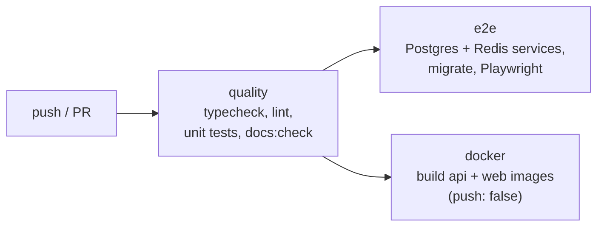

# CI pipeline: quality, e2e and docker jobs

History: see [CHANGELOG.md](../CHANGELOG.md) or run `pnpm docs:history`

Area: DevOps & CI/CD · Status: ✅ built (CI only; deploys are manual) · Step doc: [10 CI](../../10-ci.md)

## 1. In one line

On every push and pull request, GitHub Actions runs three jobs: **quality** (types, lint, unit
tests, handbook check), then **e2e** (real browser, real Postgres and Redis) and **docker** (both
images build) in parallel.

## 2. Real-life comparison

A car factory's inspection line: quick checks on every part first; only parts that pass go to the
test track and to final assembly. Nothing leaves the factory yet (no delivery truck: no CD).

## 3. Picture it



## 4. Where in our code

- Anchor: `.github/workflows/ci.yml` · `jobs: quality, e2e, docker`; `permissions: contents: read`; `concurrency`.

Step by step:

1. `permissions: contents: read`: the job token can only read ([least-privilege](least-privilege.md)).
2. `concurrency: ci-${{ github.ref }}` with `cancel-in-progress`: a new push cancels the old run on
   the same branch.
3. **quality** (10 min limit): pnpm and Node versions from `packageManager` and `.nvmrc`;
   `pnpm install --frozen-lockfile`; `pnpm typecheck`, `pnpm lint`, `pnpm test`, `pnpm docs:check`.
4. **e2e** (`needs: quality`): service containers `postgres:17.6` and `redis:7.4.5` with health
   checks; `drizzle-kit migrate`; Playwright browsers cached by lockfile hash; `pnpm test:e2e`
   (Playwright starts the api and a production build of the web app); HTML report uploaded on
   failure.
5. **docker** (`needs: quality`): Buildx builds both Dockerfiles with `push: false` and the GitHub
   Actions layer cache ([docker-layer-caching](docker-layer-caching.md)).
6. **Not built:** continuous deployment. Images are pushed from a laptop (`pnpm images:push`) and
   deployed by the owner's `pulumi up` (planned card `continuous-deployment`).

## 5. See it yourself

GitHub → Actions → the latest run: three jobs, e2e and docker start after quality. Locally the
quality job is:

```bash
pnpm install --frozen-lockfile && pnpm typecheck && pnpm lint && pnpm test && pnpm docs:check
```

**Break it on purpose:** add an `@concept: not-a-card` anchor in a code comment and push to a
branch: quality fails at `pnpm docs:check`, and e2e and docker never start.

## 6. How it connects

- **Uses ←** [static-checks](static-checks.md), [unit-tests](unit-tests.md),
  [e2e-tests](e2e-tests.md), [docker-multi-stage](docker-multi-stage.md), [migrations](migrations.md).
- **Gives →** a gate on every change; the base for future CD (build once, push the tested image).

## 7. Our settings and WHY

| Setting | Why |
| ------- | --- |
| quality first, others `needs: quality` | Cheap checks fail fast; slow jobs only run on good code. |
| `--frozen-lockfile` | CI installs exactly what was committed. |
| Same pinned images as `docker-compose.yml` | CI tests what developers run. |
| `push: false` | Proves images build; no registry credentials in CI yet. |
| `timeout-minutes` | A hung job can't burn minutes forever. |

## 8. Trade-offs

- **Pros:** every change is type-checked, linted, unit-, e2e- and build-tested; fast feedback.
- **Cons:** the image CI builds is not the image deployed (rebuilt on a laptop for ARM64); no
  branch protection or CD yet.

## 9. Alternatives and when to choose them

- **CD with OIDC to AWS:** push the tested image to ECR by digest and deploy.
- **Affected-only jobs** (Turborepo/Nx) when CI gets slow.
- **Required checks + branch protection** on `main`.

## 10. What breaks, and how we'd notice

- Flaky e2e: random red runs; the uploaded Playwright report shows why.
- CI green but deploy broken: possible, because deploy builds a different (ARM64) image.

## 13. Interview answers at 3 levels

- **Simple:** Every push is automatically checked and tested before anything else.
- **Senior:** GitHub Actions with three jobs: quality (typecheck, lint, Vitest, docs:check), then e2e
  with Postgres and Redis service containers and Playwright against a production web build, and a
  Docker job that builds both images with the GHA layer cache. Read-only token, concurrency
  cancellation, timeouts.
- **Lead:** The next step is CD: build once in CI, push by digest with an OIDC role, run migrations
  as a gated step, then deploy. That also closes the "tested image ≠ deployed image" gap.

## 14. Follow-up questions interviewers ask

- *Why service containers instead of mocks?* e2e must test the real stores.
- *Why cancel in-progress runs?* Only the newest commit on a branch matters.

## 15. Say it in 30 seconds

"GitHub Actions: a quality job with typecheck, lint, unit tests and the handbook check, then in
parallel an e2e job with real Postgres and Redis and Playwright, and a Docker job that builds both
images with layer caching. The token is read-only. Deploys are still manual; CD is the next step."

## 16. Status

✅ built for CI. **To make it production-grade:** CD with OIDC, image digests, migrations as a
gated step, branch protection.

## Where it appears in the story

- [App story: 16. CI](../app-story.md#16-ci)
