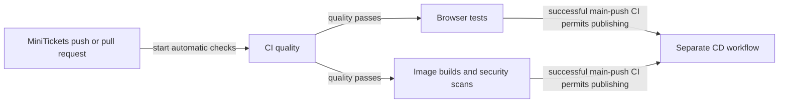

# CI: the city’s inspection gate

History: see [CHANGELOG.md](../CHANGELOG.md) or run `pnpm docs:history`
Area: DevOps & CI/CD · Status: ✅ built in repository; live AWS acceptance is separate
<!-- interview-card: v2 -->

## 1. What is it?

Continuous integration (CI) automatically checks a proposed code change. MiniTickets uses it to catch mistakes before publishing a release.

## 2. Why do we need it?

A booking fix might pass locally but break login or the release image. Repeatable checks give reviewers evidence beyond “it works on my machine.”

## 3. How does it work?

1. Check types, style, unit tests, dependency security and documentation.
2. If those pass, run browser tests and image checks in parallel.
3. Successful CI from a main-branch push can start publishing; deployment has its own approval.

## 4. How do we use it in MiniTickets?

`.github/workflows/ci.yml` defines `quality`, `e2e` and `docker`. Browser tests use disposable databases and app servers. Image builds do not publish. A newer branch run cancels its older CI run; pull-request success cannot automatically publish that change.

## 5. Interview-ready answer

“MiniTickets runs fast quality checks first, then browser tests and image scans in parallel. That catches different failure types while avoiding expensive work after an early failure. CI does not publish or deploy. Successful main-push CI starts a separate publishing workflow, and deployment needs approval. Green checks provide evidence for tested behavior, not proof that a release is fault-free.”

## 6. Important follow-up questions

- **Why use a frozen lockfile?** It rejects disagreement between dependency definitions and the committed resolution.
- **Does a clean scan mean no vulnerabilities?** No. The gate selects specific severity and fixability rules.
- **Where do browser failures lead?** The uploaded Playwright report shows failed requests, screenshots and steps.
- **Is the tested image exactly the deployed image?** No. CI and release builds use different architectures and separate builds.

## 7. Advanced details

Technical reference

### Workflow and commands

[CI](../glossary.md#ci) runs on `push` / `pull_request` with `contents: read`, branch-scoped concurrency and `cancel-in-progress: true`. It has no AWS credential step or production password. GitHub runners reach package/image registries; e2e uses throwaway local credentials/services.

`.github/workflows/ci.yml`: `quality` timeout **10 minutes**; `e2e` / `docker` **15 minutes**. Node comes from `.nvmrc`, pnpm from root `packageManager`; install uses `--frozen-lockfile` and a cached pnpm store. Quality runs `pnpm typecheck`, `pnpm lint`, `pnpm test`, `pnpm audit --audit-level=critical`, `pnpm docs:check`. Lower-severity advisories are not ruled out.

`e2e` and `docker` both declare `needs: quality`. Browser service containers use **Postgres 17.6 / Redis 7.4.5**; the disposable DB is migrated/seeded and Chromium installed. A Playwright report uploads even on failure. Runner ports :3000/:4000 are separate from the owner’s laptop servers.

Docker Buildx builds API/web/worker with `push: false`, `load: true` and separate GitHub cache scopes. The web test build gets `NEXT_PUBLIC_API_URL=http://localhost:4100`. CI uses hosted x86; CD releases use native ARM64. Green CI is not a digest assertion about later release bytes. Trivy gates CRITICAL vulnerability findings with exit code 1 and `ignore-unfixed: true`; dated `.trivyignore` exceptions are independent. It omits unfixed findings, rather than proving no vulnerabilities.

### Publishing boundary and operations

`.github/workflows/cd.yml` → `workflow_run`, `publish.if` checks successful CI, main branch and original event `push`, excluding a fork PR whose branch is named main. Manual CD without an image tag bypasses waiting for CI and should deliberately select a checked commit. Deploy retains a separate approval gate.

GitHub → `maheshnd/minitickets` → Actions → CI → run → job graph → quality/e2e/docker. No AWS console resource represents this gate. Fix the first failed quality check; inspect the Playwright report for browser failures; inspect and repair fixable critical findings under scan policy. Live GitHub execution was not checked by this rewrite.

More integration tests can isolate store failures. Required branch checks can make merges wait for these jobs; their existence is not asserted here. [E2E tests](e2e-tests.md) run browser checks, [ECR](ecr.md) receives images later from CD, and [OIDC](cd-oidc.md) provides CD’s separate AWS identity.

### Code anchors

- Anchor: `.github/workflows/ci.yml` — `module configuration`; follow the numbered comments at this boundary.

[Open this piece in the city explorer](../guides/infra-explorer.html?concept=ci-pipeline#chapter=24&piece=github).

## Where it appears in the story

- [app-story: 16b. Publish, approval and stale-run safety](../app-story.md#16b-publish-approval-and-stale-run-safety)

