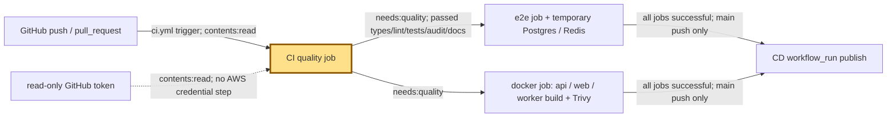
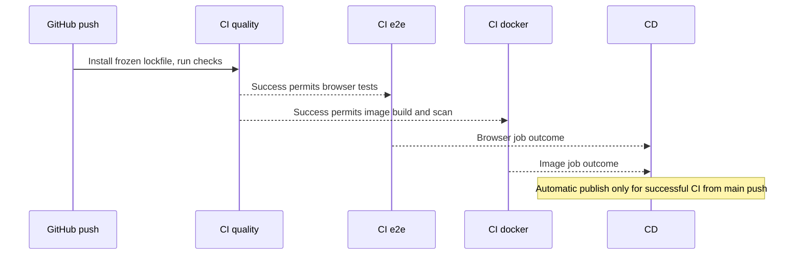

# CI: the city’s inspection gate

History: see [CHANGELOG.md](../CHANGELOG.md) or run `pnpm docs:history`
Area: DevOps & CI/CD · Status: ✅ built in repository; live AWS acceptance is separate
<!-- interview-card: v1 -->

## 1. In one line

Before MiniTickets publishes a release, [CI](../glossary.md#ci), automatic checks on each change, inspects code, browser behavior and image security.

## 2. Where it sits

[Open this piece in the city explorer](../guides/infra-explorer.html?concept=ci-pipeline#chapter=24&piece=github).

## 3. How it works

## 4. What happens in MiniTickets

1. `CI` runs on every push and pull request. A newer branch run cancels its older CI run.
2. `quality` runs typecheck, lint, unit tests, critical dependency audit and `docs:check`.
3. After quality passes, `e2e` runs Chromium against app servers and disposable Postgres/Redis.
4. In parallel, `docker` builds three images without publishing and scans for fixable CRITICAL findings.
5. Successful main-push CI triggers CD; pull-request success cannot publish a stranger’s code.

## 5. Reach / Allowed / Password

**Reach:** GitHub runners reach package/image registries; e2e uses its own local services.

**Allowed:** `contents: read`; CI has no AWS login.

**Password:** no production password; e2e uses throwaway local credentials.

## 6. In our code

`.github/workflows/ci.yml` → jobs `quality`, `e2e`, `docker`.

`.github/workflows/cd.yml` → `workflow_run` trigger and `publish.if`.

## 7. In the AWS console

GitHub → `maheshnd/minitickets` → Actions → CI → run → visual job graph → quality / e2e / docker. Open failing steps; e2e publishes a Playwright report artifact. This gate has no AWS console resource. GitHub execution was not checked live.

## 8. Good / Bad

**Good:** Fast checks fail early. Browser and image checks run together after quality.

**Bad:** Green checks cover only tested behavior. CI’s x86 image build is separate from release ARM64 build.

## 9. Other choices

- More integration tests: pick them when store behavior needs narrower failure reports.
- Required branch checks: pick them when merging must wait for these jobs.

## 10. Connected to

| Neighbor | Direction | What allows it | Console check |
| --- | --- | --- | --- |
| [E2E tests](e2e-tests.md) | Out → | needs:quality + service containers | GitHub → CI run → e2e |
| [ECR](ecr.md) | Later → | CD publish, not CI push | GitHub → CD run → publish |
| [OIDC](cd-oidc.md) | Later → | Separate CD AWS identity | IAM → gh-publish; GitHub → CD |

## 11. When it breaks

Quality red → first failed check → fix that cause before rerunning.

Browser red → Playwright report → inspect the failed request/screenshot.

Scan red → Trivy finding → repair the fixable critical issue under the policy.

## 12. Say it in 30 seconds

“CI is our inspection gate. It checks types, lint, unit tests, dependency security and docs first. Then browser tests and image builds/scans run in parallel. It never publishes. Only successful CI from a main push starts automatic CD publish; deploy still has its own approval gate.”

## 13. Likely follow-ups

- Why frozen lockfile? It rejects dependency files that disagree.
- Does passing CI deploy? No; publish and approved deploy are separate jobs.

## 14. Remember it

The inspector clears a change; the delivery crew ships it later.

## 15. More detail

Settings, limits and deeper interview notes

- Anchor: `.github/workflows/ci.yml` — `module configuration`; follow the numbered comments at this boundary.

The workflow uses `contents: read`, branch-scoped concurrency and `cancel-in-progress: true`. `quality` has a 10-minute timeout; `e2e` and `docker` have 15 minutes. Node comes from `.nvmrc`; pnpm from root `packageManager`. Installation uses `--frozen-lockfile`, with a cached pnpm store.

Quality commands are `pnpm typecheck`, `pnpm lint`, `pnpm test`, `pnpm audit --audit-level=critical`, `pnpm docs:check`. This does not claim zero advisories of lower severity. Browser tests use service-container Postgres 17.6 and Redis 7.4.5, migrate/seed their disposable database, install Chromium and upload a report even on failure. Their :3000/:4000 belong to a separate hosted runner, not the owner’s laptop servers.

Docker Buildx builds API/web/worker with `push: false`, `load: true` and separate GitHub cache scopes. The web test build receives `NEXT_PUBLIC_API_URL=http://localhost:4100`. CI’s hosted x86 runner tests that architecture; CD uses native ARM64 for the deployed images. These are separate builds, so a green CI build is not a content digest assertion about the later release build.

Trivy scans vulnerability findings at CRITICAL with exit code 1 and `ignore-unfixed: true`; the dated `.trivyignore` exception is independent. The configured gate omits unfixed findings; it is not “no vulnerabilities”. CD checks CI’s successful conclusion and original event `push`, avoiding a pull request from a fork whose branch happens to be named main. Manual CD without an image tag bypasses waiting for CI and must be used deliberately on a checked commit.

## Where it appears in the story

- [app-story: 16b. Publish, approval and stale-run safety](../app-story.md#16b-publish-approval-and-stale-run-safety)
