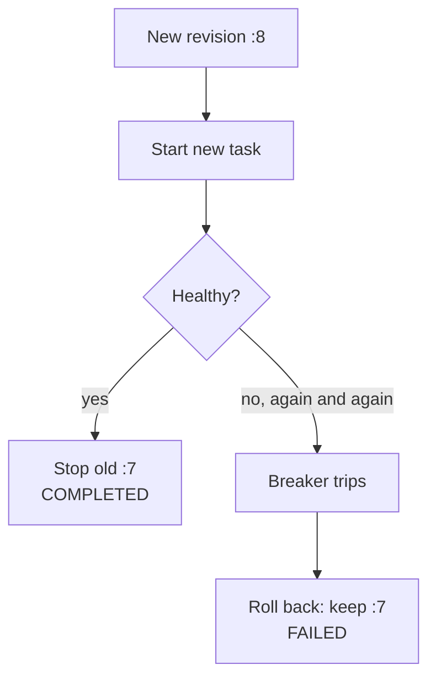

# Circuit breaker

Area: Reliability · Status: 🟡 partial (deployments only) · Step doc: [17 ECS api](../../17-infra-ecs-api.md) (section 3.11)

## 1. In one line

A **circuit breaker** stops repeating something that keeps failing; ours is ECS's **deployment
circuit breaker**, which stops a failing rollout and rolls back to the last working revision.

## 2. Real-life comparison

The fuse box at home. When a faulty kettle keeps tripping the power, the fuse cuts that circuit
instead of letting it burn. Our version: the new recipe keeps failing, so the kitchen goes back to
yesterday's recipe.

## 3. Picture it



The app-level kind (explain-only today): in the api, after N failed calls to a dependency, stop
calling it for a while and fail fast, then try one call to see if it recovered (closed → open →
half-open).

## 4. Where in our code

- Anchor: `infra/src/compute/service.ts` · `deploymentCircuitBreaker: { enable: true, rollback: true }`: api.
- Anchor: `infra/src/compute/web-service.ts` · `deploymentCircuitBreaker`: web.

Step by step:

1. A new task definition revision starts a rolling deployment.
2. ECS counts tasks that fail to start or fail health checks during the deployment.
3. Past AWS's threshold (it depends on the desired count; I have not looked up the exact formula),
   the deployment is marked FAILED.
4. `rollback: true`: ECS redeploys the last revision that reached a steady state.
5. On the very first deployment there is nothing to roll back to: it just fails.

**Not in our app:** an application circuit breaker around Postgres or Valkey calls. Instead, the api
fails fast with timeouts and no offline queue (Phase 3 `fail-fast` card).

## 5. See it yourself

```bash
aws ecs describe-services --profile ticketlite --cluster minitickets-dev --services minitickets-dev-api \
  --query "services[0].deployments[].[status,rolloutState,rolloutStateReason,taskDefinition]"
```

**Break it on purpose (scratch branch, owner deploys):** push an image whose start command crashes
(or remove a required env var). The rollout state becomes FAILED and the service returns to the old
revision; events say the circuit breaker triggered.

## 6. How it connects

- **Uses ←** [ecs-service](ecs-service.md), [task-definition](task-definition.md) revisions, health checks.
- **Gives →** safe deploys ([zero-downtime-deploys](zero-downtime-deploys.md)); stops a crash loop
  billing forever.

## 7. Our settings and WHY

`enable: true, rollback: true` on both services: a bad image is not retried forever, and the old
version keeps serving.

## 8. Trade-offs

- **Pros:** automatic rollback, no infinite crash loop.
- **Cons:** only catches failures visible to ECS (start-up, health checks); a version that is healthy
  but returns wrong answers is not rolled back.

## 9. Alternatives and when to choose them

- **CloudWatch alarm-based rollback** (ECS deployment alarms): roll back on error rate or latency.
- **Blue/green with CodeDeploy:** test traffic before shifting.
- **App-level breakers** (e.g. `opossum` in Node): calls to slow or failing dependencies.

## 10. What breaks, and how we'd notice

- Deployment FAILED + rollback: service events and `rolloutStateReason`.
- First deployment fails: no rollback target; look at the stopped reason.

## 11. Reach / Allowed / Password

Not a connection.

## 12. Cost

Free; it saves the cost of a crash loop.

## 13. Interview answers at 3 levels

- **Simple:** If a new version keeps failing, ECS stops and goes back to the old one.
- **Senior:** Both services have the deployment circuit breaker with rollback. ECS watches task starts
  and health checks during a rollout and, past a threshold, marks the deployment failed and redeploys
  the previous revision. We don't have an application circuit breaker; the api fails fast instead.
- **Lead:** Deployment breakers protect releases; app breakers protect the request path. I'd add
  alarm-based rollback on error rate, and app breakers only for dependencies that can be slow, not
  just down.

## 14. Follow-up questions interviewers ask

- *Closed, open, half-open?* Normal; failing fast; letting one trial call through.
- *Why fail fast instead?* With one dependency per call and short timeouts, a breaker adds little.

## 15. Say it in 30 seconds

"Our circuit breaker is ECS's deployment circuit breaker with rollback on both services: a new
revision that keeps failing is stopped and the previous one keeps serving. There's no app-level
breaker; the api fails fast with short timeouts instead."

## 16. Status

🟡 partial. **To make it production-grade:** alarm-based rollback; app breakers where dependencies can
hang.
