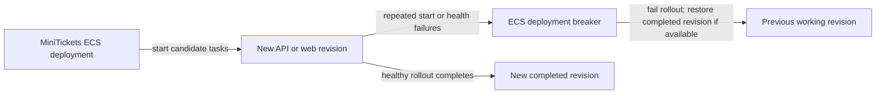

# Circuit breaker

History: see [CHANGELOG.md](../CHANGELOG.md) or run `pnpm docs:history`

Area: Reliability · Status: 🟡 partial (deployments only) · Step doc: [17 ECS api](../../17-infra-ecs-api.md) (section 3.11)

<!-- interview-card: v2 -->

## 1. What is it?

A circuit breaker stops repeatedly attempting work that keeps failing. MiniTickets has a deployment breaker that stops a bad rollout and can restore a previous working revision.

## 2. Why do we need it?

A new API image might crash whenever it starts. Replacing it repeatedly wastes time and threatens service; the deployment should stop instead of retrying that broken version indefinitely.

## 3. How does it work?

1. ECS starts the new task revision.
2. Startup or health failures count toward its deployment threshold.
3. If the breaker trips, fail the rollout and roll back when a completed target exists.

## 4. How do we use it in MiniTickets?

Both API and web services enable ECS deployment rollback. This is separate from an application breaker around a database or external dependency. That request-path breaker is not built; MiniTickets currently uses bounded timeouts and fails quickly.

## 5. Interview-ready answer

“MiniTickets uses ECS’s deployment circuit breaker to stop a revision that repeatedly fails startup or health checks and restore a previous completed deployment. It protects the release process, not every request. We have no application dependency breaker. A healthy but logically wrong version may pass ECS checks, so version verification and application smoke tests still matter.”

## 6. Important follow-up questions

- **What if the first deployment fails?** There may be no completed deployment to restore; investigate the stopped task.
- **Does healthy mean correct?** No. Health checks cannot detect every incorrect business result.
- **What is an application breaker?** It would pause calls after repeated dependency failures and later allow a trial recovery call.
- **What could improve rollback?** Error-rate or latency deployment alarms, plus rehearsed recovery.

## 7. Advanced details

Technical reference

### Configuration and AWS semantics

`infra/src/compute/service.ts` and `infra/src/compute/web-service.ts` set `deploymentCircuitBreaker: { enable: true, rollback: true }`. No custom threshold configuration is set. The recorded AWS reference describes default `BOUNDED_PERCENT` 50%, rounded up and bounded **3–200**, with `resetOnHealthyTask: true`. Thus desired counts 1/10/25/1000 yield thresholds 3/5/13/200. These details should be checked against the linked AWS contract when operating; this rewrite does not claim a live failure drill. [AWS deployment circuit-breaker documentation](https://docs.aws.amazon.com/AmazonECS/latest/developerguide/deployment-circuit-breaker.html).

Rollback requires a prior completed deployment. Only failures ECS observes during rollout count; healthy-but-wrong behavior needs other detection. This mechanism is not a network connection and needs no separate password. The original cost claim is that the breaker has no separate service charge; no current price check is claimed.

### Inspection and alternatives

Read service `deployments` / `rolloutStateReason` using `aws ecs describe-services --profile ticketlite --cluster minitickets-dev --services minitickets-dev-api --query 'services[0].deployments[].[status,rolloutState,rolloutStateReason,taskDefinition]'`. Service events and stopped reasons explain failure. A deliberately crashing scratch image would require owner deployment; none was deployed here.

Application breakers use closed (normal), open (fail immediately), half-open (trial recovery). No app-level Postgres/Valkey breaker or offline request queue exists. Short timeouts currently provide fail-fast behavior. Alternatives include ECS deployment alarms, blue/green traffic shifting, and a dependency breaker where repeated slow failures justify its state/complexity.

### Code anchors

- Anchor: `infra/src/compute/service.ts` · `deploymentCircuitBreaker: { enable: true, rollback: true }`: api.
- Anchor: `infra/src/compute/web-service.ts` · `deploymentCircuitBreaker`: web.

### Related reading

[ecs-service](ecs-service.md) · [task-definition](task-definition.md) · [zero-downtime-deploys](zero-downtime-deploys.md)

[Open this concept in the city explorer](../guides/infra-explorer.html?concept=circuit-breaker#chapter=8&piece=ecs).

## Where it appears in the story

- [Infra story: 4. ECS: cluster, service, task definition, task, Spot](../infra-story.md#4-ecs-cluster-service-task-definition-task-spot)
- [Infra story: The deploy story](../infra-story.md#the-deploy-story)

