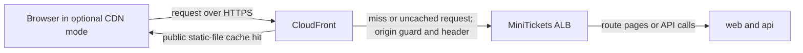

# CloudFront: the optional front layer outside the city

History: see [CHANGELOG.md](../CHANGELOG.md) or run `pnpm docs:history`

Area: AWS Network · Status: ✅ built in repository; live AWS acceptance is separate
<!-- interview-card: v2 -->

## 1. What is it?

[CloudFront](../glossary.md#cloudfront) is AWS's worldwide delivery layer. It can serve reusable files near visitors instead of fetching every copy from our app.

## 2. Why do we need it?

If many visitors download the same MiniTickets JavaScript file, nearby copies can reduce delay and origin work. A person's login data or page security nonce must not become a shared copy.

## 3. How does it work?

1. CloudFront chooses the rules for the requested path.
2. It can reuse safe public static files.
3. Other requests reach the ALB; private responses must stay unshared.

## 4. How do we use it in MiniTickets?

The optional distribution is implemented but currently disabled; visitors use HTTPS directly to the load balancer (ALB). If enabled, hashed static files can be cached, while API calls and today's nonce-bearing HTML remain uncached. Live CDN acceptance is pending.

## 5. Interview-ready answer

"CloudFront can deliver MiniTickets' public static files from nearby locations. It is implemented but off today. Our API and nonce-bearing HTML must remain private, so cache keys and caching rules matter as much as speed. The optional origin also needs its own access protection; a CDN alone does not secure it."

## 6. Important follow-up questions

- **Does every request become faster?** No. Uncached requests still reach the origin and add another hop.
- **Can cookies alone protect privacy?** No. Configured cache behavior must prevent unsafe reuse.
- **What if private content is cached?** Stop unsafe caching and inspect keys, response headers and policy lifetimes.
- **Does browser HTTPS encrypt every hop?** No. The optional origin currently uses HTTP; that needs a separate design decision.

## 7. Advanced details

Technical reference

### Configuration and security

In optional CDN mode, the ALB routes the verified header plus `/trpc/*` to API and the verified-header default to web. App security groups permit TCP 4000/3000 from `minitickets-dev-alb-sg`. The historical web listener rule has priority 200. The explorer link describes the optional path, not the current active front door.

Committed `cdnEnabled=false` disables the distribution pending account verification. Optional viewer HTTPS uses the default CloudFront certificate; origin reach uses the CloudFront prefix list on TCP 80 plus `X-Origin-Verify`. The header is separate from visitor cookies. No per-visitor IAM check applies. `Vary: Cookie` alone does not define the configured cache key.

### Implementation and operational limits

- Anchor: `infra/src/entry/cdn.ts` — `distribution`; follow the numbered comments at this boundary.

### The implemented optional distribution

`createCdn` looks up managed `CachingOptimized`, `CachingDisabled` and `AllViewer` policies. The distribution enables HTTP/2 and HTTP/3, compression where the policy permits it, `PriceClass_100` edge locations, no country blocking and the default `*.cloudfront.net` certificate. A custom viewer domain would need an appropriate certificate in `us-east-1`. HTTP visits redirect to HTTPS. Implementation is not proof of live deployment; account verification remains an owner acceptance item.

Origin ID is `alb`; its DNS name comes from `createAlb`. `originProtocolPolicy: "http-only"` uses port 80. `httpsPort: 443` and `originSslProtocols: ["TLSv1.2"]` are present but do not encrypt an HTTP-only origin hop. Use an owned origin domain/certificate plus HTTPS-only to change that. The origin header value is a 32-character alphanumeric Pulumi secret; it is not stored in Secrets Manager. Do not expose the value in screenshots, logs or this card.

Behaviors are checked in order: `/_next/static/*` uses `CachingOptimized`, GET/HEAD, with hashed immutable filenames; `/trpc/*` uses `CachingDisabled` and `AllViewer`, allows all configured HTTP methods including POST, and forwards cookies; exact `/events` uses our custom events policy; default pages use `CachingDisabled` plus `AllViewer`, GET/HEAD only. The default does not accept page POSTs. `/events/` and `/events/<id>` do not match exact `/events`.

The events policy has minimum/default/maximum TTL `0/0/330` seconds. Cache key query fields are `venue`, `from`, `to`, `_rsc`; cookies are absent. Headers are `RSC`, `Next-Router-State-Tree`, `Next-Router-Prefetch`, `Next-Router-Segment-Prefetch`, `Next-Url`; gzip/Brotli negotiation is normalized. There is no extra origin-request policy on that behavior. Ignored tracking parameters do not multiply cache keys, but arbitrary allowed filter values still can.

Those historical cache settings remain in infra, but current `proxy.ts` and `next.config.ts` mark HTML/RSC `private,no-store` with a fresh CSP nonce. Earlier comments promising a shared 30-second events page are historical and do not describe current privacy behavior. The explicit public-data helper in `features/events/server/cached-events.ts` is separate; current search SSR bypasses it. Hashed static assets remain cacheable.

CloudFront does not use arbitrary Vary headers as a cache key. Next HTML and RSC can share a URL but require different response handling. Dropping RSC headers or `_rsc` can cause mismatched payloads or redirect loops. A positive minimum TTL can override private/no-store ([AWS policy rule](https://docs.aws.amazon.com/AmazonCloudFront/latest/DeveloperGuide/cache-key-understand-cache-policy.html)); keep minimum zero for this policy. Default zero also avoids caching responses without explicit lifetime. Managed CachingDisabled does not negotiate the compression key flags, so `compress: true` alone does not guarantee compression on those behaviors.

No app-triggered CloudFront invalidation is implemented. The old 30-second edge-fresh plus 300-second stale-window rationale belonged to public HTML before nonce privacy. At scale inspect HTML/RSC headers, test policy/key alignment centrally and keep public-data strategy separate. `pnpm demo:security` is a local privacy demonstration, not a CDN acceptance test. CloudFront usage and transfer pricing depend on requests/region; no live bill was checked.

### Source references

`infra/src/entry/cdn.ts` → `createCdn` (`distribution`).

`infra/src/entry/listener.ts` → `createListener`.

`apps/web/src/proxy.ts` → `proxy` sets nonce and privacy headers.

### Console and troubleshooting

CloudFront → Distributions → the matching distribution, if deployed → Origins / Behaviors. Check origin protocol, paths and attached policies; Policies → Cache lists `minitickets-dev-events-page`. Current committed mode should not create it. ALB Resource map shows only the origin’s next hops. Live distribution/account status was not verified.

- No CDN header today → check committed mode → diagnose direct ALB first.
- Optional mode returns 403 → origin header/listener rules → align the secret references.
- Mixed/private content reused → inspect key and minimum TTL → disable unsafe caching.

### Trade-offs and related concepts

- Pick direct HTTPS ALB when regional delivery is sufficient; that is our current choice.
- Pick a custom-domain HTTPS origin when enabling CDN and requiring encrypted origin hops.
- Pick a private ALB VPC origin when removing the public origin fits the design.

| Neighbor | Direction | What allows it | Console check |
| --- | --- | --- | --- |
| [ALB](alb.md) | Optional edge → origin | TCP 80 prefix list + secret header | ALB → Security / listener rules |
| [Origin protection](origin-protection.md) | Guards origin | Prefix list + `X-Origin-Verify` | CloudFront → Origins; ALB rules |
| [Cache privacy](cdn-caching.md) | Response → edge copy | Cache policy + origin headers | Distribution → Behaviors |
| [TLS](tls-termination.md) | Browser → edge | Distribution certificate | Distribution → Settings |

[Open this piece in the city explorer](../guides/infra-explorer.html?concept=cloudfront#chapter=24&piece=cloudfront).

## Where it appears in the story

- [app-story: 9b. A booking reaches its transaction](../app-story.md#9b-a-booking-reaches-its-transaction)

