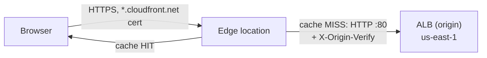

# CloudFront: CDN and HTTPS

History: see [CHANGELOG.md](../CHANGELOG.md) or run `pnpm docs:history`

Area: AWS Network · Status: ✅ built · Step doc: [19 CloudFront](../../19-infra-cloudfront.md)

## 1. In one line

**CloudFront** is AWS's CDN: browsers connect over HTTPS to a nearby **edge location**, which
answers from its cache or fetches from our **origin** (the ALB).

## 2. Real-life comparison

Local branch offices of a shop. You walk into the branch in your town. If it has the item on the
shelf, you get it at once; if not, the branch orders it from the central warehouse in Virginia.

## 3. Picture it



## 4. Where in our code

- Anchor: `infra/src/entry/cdn.ts` · `distribution`: the one distribution, its origin, three cache behaviors and the default certificate.

Step by step:

1. Look up three AWS managed policies by name: `Managed-CachingOptimized`,
   `Managed-CachingDisabled`, `Managed-AllViewer`.
2. `origins`: one origin, id `alb`, `domainName: albDnsName`, `originProtocolPolicy: "http-only"`,
   plus the `X-Origin-Verify` custom header.
3. `orderedCacheBehaviors`: `/_next/static/*` (cached) and `/trpc/*` (not cached, all methods);
   `defaultCacheBehavior` for pages (not cached, GET/HEAD). Details: [cdn-caching](cdn-caching.md).
4. `viewerProtocolPolicy: "redirect-to-https"` on every behavior: `http://` gets a 301.
5. `httpVersion: "http2and3"`, `priceClass: "PriceClass_100"`, no geo restriction.
6. `viewerCertificate: { cloudfrontDefaultCertificate: true }`: the free `*.cloudfront.net`
   certificate, so we need no domain.
7. Returns `appUrl = https://<id>.cloudfront.net`, which `index.ts` passes to the api task as
   `WEB_ORIGIN`.

## 5. See it yourself

```bash
cd infra && APP=$(pulumi stack output appUrl)
curl -sI "$APP/" | grep -iE '^(x-cache|via|x-amz-cf-pop)'
curl -s -o /dev/null -w '%{http_code} %{redirect_url}\n' "http://${APP#https://}/"   # 301 https://…
```

`x-amz-cf-pop` names the edge location that answered.

**Break it on purpose (scratch branch):** set the `/trpc/*` behavior's `allowedMethods` to
`["GET", "HEAD"]`. Login, signup and logout (POST) get CloudFront's own 403 page.

## 6. How it connects

- **Uses ←** the [ALB](alb.md) DNS name; the origin secret ([origin-protection](origin-protection.md)).
- **Gives →** HTTPS for the browser ([tls-termination](tls-termination.md)), so the `Secure` session
  cookie works; edge caching ([cdn-caching](cdn-caching.md)); HTTP/2 and 3
  ([http-versions](http-versions.md)); `appUrl` → `WEB_ORIGIN`; two proxy hops for `trustProxy`.

## 7. Our settings and WHY

| Setting | Value | Why |
| ------- | ----- | --- |
| Certificate | default `*.cloudfront.net` | Free HTTPS without owning a domain. |
| `priceClass` | `PriceClass_100` | Cheapest edge group (North America, Europe, Israel). Others still work, from farther away. |
| Origin protocol | `http-only` | We cannot get a certificate for the ALB's AWS-owned name. Dev compromise. |
| Viewer protocol | `redirect-to-https` | Nobody uses the site over plain HTTP. |
| One origin | the ALB | Same-origin routing happens behind it. |

## 8. Trade-offs

- **Pros:** free HTTPS, global edge, cached static files, no hourly price.
- **Cons:** slow to create (5-15 min) and slower to delete (it must be disabled first); an extra
  hop for every uncached request; the edge-to-ALB hop is unencrypted in dev.

## 9. Alternatives and when to choose them

- **ACM certificate + custom domain on the ALB, no CDN:** simplest HTTPS if users are near one region
  and nothing needs edge caching. The ALB costs the same either way.
- **CloudFront + custom domain + HTTPS to origin:** production.
- **Another CDN (Cloudflare, Fastly):** multi-cloud or specific edge features.

## 10. What breaks, and how we'd notice

| You see | Means |
| ------- | ----- |
| CloudFront `502` | It cannot connect to the ALB (security group, listener missing, or `https-only` with no 443 listener) |
| CloudFront `403` page | Method not allowed on that path |
| ALB plain-text `Forbidden` | Header mismatch, e.g. a distribution change still rolling out |
| Logged out right after login | You used `http://` or the ALB name, not `appUrl` |

## 11. Reach / Allowed / Password

- **Reach:** browser → edge over the public internet; edge → ALB on port 80, allowed only from
  CloudFront's prefix list.
- **Allowed:** no IAM on requests; Pulumi creates the distribution with the owner's login.
- **Password:** the `X-Origin-Verify` header proves to the ALB that the request came from our
  distribution.

## 12. Cost

No hourly price. The free tier covers 1 TB out and 10 million requests a month; data from the ALB
to CloudFront is free. Dev traffic: $0 ([docs/19](../../19-infra-cloudfront.md), section 3.12).

## 13. Interview answers at 3 levels

- **Simple:** A CDN serves content from servers near the user and gives us HTTPS.
- **Senior:** One distribution with the ALB as origin over HTTP plus a secret header. Three
  behaviors: hashed static files cached with CachingOptimized, `/trpc/*` and pages never cached with
  CachingDisabled and AllViewer so the cookie passes through. The default `*.cloudfront.net`
  certificate gives HTTPS, which makes the `Secure` cookie work.
- **Lead:** CloudFront is where I'd add edge security (WAF, rate limiting), and the path to
  production is a custom domain, an ACM certificate in `us-east-1`, HTTPS to the origin, and
  monitoring of cache hit rate and 5xx at the edge.

## 14. Follow-up questions interviewers ask

- *Why did login not work before CloudFront?* The cookie is `Secure`; on plain HTTP the browser
  drops it.
- *Why must a custom-domain certificate be in `us-east-1`?* CloudFront only reads certificates from
  ACM in `us-east-1`.
- *Why is deleting slow?* It must be disabled at every edge first, then deleted.

## 15. Say it in 30 seconds

"CloudFront sits in front of the ALB and gives us HTTPS on a `*.cloudfront.net` address for free.
Hashed static files are cached at the edge; pages and `/trpc` are never cached and get the cookie
passed through. It talks to the ALB over HTTP with a secret header, which the ALB requires."

## 16. Status

✅ built. **To make it production-grade:** custom domain, HTTPS to the origin, WAF, monitoring.
