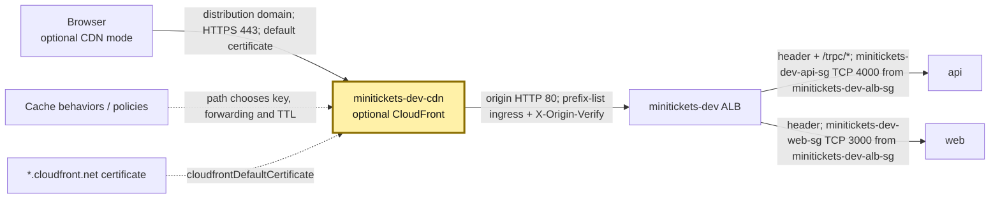
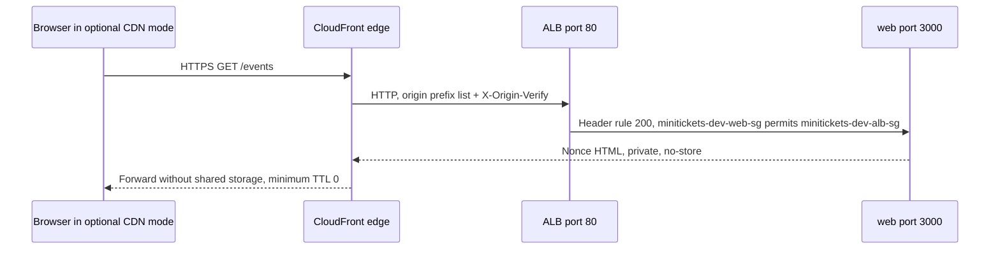

# CloudFront: the optional front layer outside the city

History: see [CHANGELOG.md](../CHANGELOG.md) or run `pnpm docs:history`

Area: AWS Network · Status: ✅ built in repository; live AWS acceptance is separate
<!-- interview-card: v1 -->

## 1. In one line

MiniTickets can put [CloudFront](../glossary.md#cloudfront), AWS edge delivery, before its ALB; `cdnEnabled=false` means visitors currently use the HTTPS ALB path.

## 2. Where it sits

[Open this piece in the city explorer](../guides/infra-explorer.html?concept=cloudfront#chapter=24&piece=cloudfront).

## 3. How it works

## 4. What happens in MiniTickets

1. Committed CDN mode is off, pending account verification; live AWS was not checked.
2. If enabled, browsers use the distribution's HTTPS address.
3. `/_next/static/*` can reuse copies of hashed files at the edge.
4. `/trpc/*` and ordinary pages disable caching. `/events` has minimum/default TTL `0` and honors today's `private,no-store` HTML.
5. Origin misses travel to ALB `80` with `X-Origin-Verify`. Its prefix-list guard and header check both apply.

## 5. Reach / Allowed / Password

**Reach:** in optional mode, CloudFront origin IPs reach ALB `80`; ALB reaches app ports.

**Allowed:** no per-visitor IAM; cache rules decide whether a response may be reused.

**Password:** CloudFront adds the origin header. This is separate from the visitor's login cookie.

## 6. In our code

`infra/src/entry/cdn.ts` → `createCdn` (`distribution`).

`infra/src/entry/listener.ts` → `createListener`.

`apps/web/src/proxy.ts` → `proxy` sets nonce and privacy headers.

## 7. In the AWS console

CloudFront → Distributions → the matching distribution, if deployed → Origins / Behaviors. Check origin protocol, paths and attached policies; Policies → Cache lists `minitickets-dev-events-page`. Current committed mode should not create it. ALB Resource map shows only the origin’s next hops. Live distribution/account status was not verified.

## 8. Good / Bad

**Good:** static files can arrive from nearby edges; origin load can fall for reusable content.

**Bad:** wrong cache keys can mix responses; our optional origin hop is HTTP.

## 9. Other choices

- Pick direct HTTPS ALB when regional delivery is sufficient; that is our current choice.
- Pick a custom-domain HTTPS origin when enabling CDN and requiring encrypted origin hops.
- Pick a private ALB VPC origin when removing the public origin fits the design.

## 10. Connected to

| Neighbor | Direction | What allows it | Console check |
| --- | --- | --- | --- |
| [ALB](alb.md) | Optional edge → origin | TCP 80 prefix list + secret header | ALB → Security / listener rules |
| [Origin protection](origin-protection.md) | Guards origin | Prefix list + `X-Origin-Verify` | CloudFront → Origins; ALB rules |
| [Cache privacy](cdn-caching.md) | Response → edge copy | Cache policy + origin headers | Distribution → Behaviors |
| [TLS](tls-termination.md) | Browser → edge | Distribution certificate | Distribution → Settings |

## 11. When it breaks

- No CDN header today → check committed mode → diagnose direct ALB first.
- Optional mode returns 403 → origin header/listener rules → align the secret references.
- Mixed/private content reused → inspect key and minimum TTL → disable unsafe caching.

## 12. Say it in 30 seconds

“CloudFront is implemented but off for MiniTickets today. If enabled it can cache hashed static assets, while API and nonce-bearing HTML remain private. Its key must distinguish response variants, and minimum TTL must allow no-store. Prefix-list ingress and a secret header protect the ALB origin.”

## 13. Likely follow-ups

- **Does `Vary: Cookie` alone protect privacy?** No; CloudFront uses its configured key.
- **What can override no-store?** A positive minimum TTL. [AWS policy rule](https://docs.aws.amazon.com/AmazonCloudFront/latest/DeveloperGuide/cache-key-understand-cache-policy.html).

## 14. Remember it

Share copies of public files, never a visitor’s page or its nonce.

## 15. More detail

Reference notes, source anchors and earlier useful detail

- Anchor: `infra/src/entry/cdn.ts` — `distribution`; follow the numbered comments at this boundary.

### The implemented optional distribution

`createCdn` looks up managed `CachingOptimized`, `CachingDisabled` and `AllViewer` policies. The distribution enables HTTP/2 and HTTP/3, compression where the policy permits it, `PriceClass_100` edge locations, no country blocking and the default `*.cloudfront.net` certificate. A custom viewer domain would need an appropriate certificate in `us-east-1`. HTTP visits redirect to HTTPS. Implementation is not proof of live deployment; account verification remains an owner acceptance item.

Origin ID is `alb`; its DNS name comes from `createAlb`. `originProtocolPolicy: "http-only"` uses port 80. `httpsPort: 443` and `originSslProtocols: ["TLSv1.2"]` are present but do not encrypt an HTTP-only origin hop. Use an owned origin domain/certificate plus HTTPS-only to change that. The origin header value is a 32-character alphanumeric Pulumi secret; it is not stored in Secrets Manager. Do not expose the value in screenshots, logs or this card.

Behaviors are checked in order: `/_next/static/*` uses `CachingOptimized`, GET/HEAD, with hashed immutable filenames; `/trpc/*` uses `CachingDisabled` and `AllViewer`, allows all configured HTTP methods including POST, and forwards cookies; exact `/events` uses our custom events policy; default pages use `CachingDisabled` plus `AllViewer`, GET/HEAD only. The default does not accept page POSTs. `/events/` and `/events/<id>` do not match exact `/events`.

The events policy has minimum/default/maximum TTL `0/0/330` seconds. Cache key query fields are `venue`, `from`, `to`, `_rsc`; cookies are absent. Headers are `RSC`, `Next-Router-State-Tree`, `Next-Router-Prefetch`, `Next-Router-Segment-Prefetch`, `Next-Url`; gzip/Brotli negotiation is normalized. There is no extra origin-request policy on that behavior. Ignored tracking parameters do not multiply cache keys, but arbitrary allowed filter values still can.

Those historical cache settings remain in infra, but current `proxy.ts` and `next.config.ts` mark HTML/RSC `private,no-store` with a fresh CSP nonce. Earlier comments promising a shared 30-second events page are historical and do not describe current privacy behavior. The explicit public-data helper in `features/events/server/cached-events.ts` is separate; current search SSR bypasses it. Hashed static assets remain cacheable.

CloudFront does not use arbitrary Vary headers as a cache key. Next HTML and RSC can share a URL but require different response handling. Dropping RSC headers or `_rsc` can cause mismatched payloads or redirect loops. A positive minimum TTL can override private/no-store; keep minimum zero for this policy. Default zero also avoids caching responses without explicit lifetime. Managed CachingDisabled does not negotiate the compression key flags, so `compress: true` alone does not guarantee compression on those behaviors.

No app-triggered CloudFront invalidation is implemented. The old 30-second edge-fresh plus 300-second stale-window rationale belonged to public HTML before nonce privacy. At scale inspect HTML/RSC headers, test policy/key alignment centrally and keep public-data strategy separate. `pnpm demo:security` is a local privacy demonstration, not a CDN acceptance test. CloudFront usage and transfer pricing depend on requests/region; no live bill was checked.

## Where it appears in the story

- [app-story: 9b. A booking reaches its transaction](../app-story.md#9b-a-booking-reaches-its-transaction)
