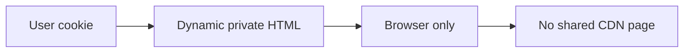

# CloudFront: CDN and HTTPS

History: see [CHANGELOG.md](../CHANGELOG.md) or run `pnpm docs:history`

Area: AWS Network · Status: ✅ built in repository; live AWS acceptance is separate

## 1. In one line

CloudFront is implemented but inactive (cdnEnabled=false); browser traffic currently reaches HTTPS ALB. Optional mode has prefix-list/header origin protection and zero minimum/default HTML TTL; never assume it is deployed.

## 2. Real-life comparison

Two clerks cannot promise the same last seat: one holds the ledger until the reservation is recorded.

## 3. Picture it

## 4. Where in our code

- Anchor: `infra/src/entry/cdn.ts` — `distribution`; follow the numbered comments at this boundary.

`apps/web/src/proxy.ts` and `apps/web/next.config.ts` guard HTML caching. `apps/web/src/features/events/server/cached-events.ts` only stores public catalogue data. `infra/src/entry/cdn.ts` has zero minimum/default TTL on the events policy. CloudFront is inactive: `cdnEnabled=false`. Run `pnpm demo:security`.

## 5. See it yourself

Run `pnpm demo:security` and inspect the asserted outcome described above.

Failure thought experiment: Does Vary: Cookie make every policy safe? No; the CDN cache key and minimum TTL must also agree. Do not change a live stack to demonstrate it.

## 6. How it connects

Uses the [current system](../00-big-picture.md); gives a concrete decision to the [scenario](../guides/interview-scenarios.md#private-page-cache) and [explorer tour](../guides/infra-explorer.html?tour=security-layers).

## 7. Our settings and WHY

CloudFront is implemented but inactive (cdnEnabled=false); browser traffic currently reaches HTTPS ALB. Optional mode has prefix-list/header origin protection and zero minimum/default HTML TTL; never assume it is deployed. A cross-user cache leak exposes private data, and cached nonce HTML breaks CSP assumptions.

## 8. Trade-offs

Per-user edge keys are difficult to audit and multiply cache entries. No-store simplifies privacy at server cost. Static JS/images can still be cached.

## 9. Alternatives and when to choose them

10x: inspect headers on HTML and RSC. 100x: centralize cache policy tests and keep any public HTML strategy separate.

## 10. What breaks and how we notice

Does Vary: Cookie make every policy safe? No; the CDN cache key and minimum TTL must also agree.

## 11. Reach / Allowed / Password

Prove the network path separately from the scoped IAM action and the runtime credential. [Every IAM badge](../guides/infra-build-along.md#every-iam-badge-who--what--attached) shows trust, permissions and attachment. No AWS endpoint needs an inbound SG simply because a non-VPC Lambda calls it.

## 12. Cost

Existing resource/usage costs are detailed in the corresponding infra guide chapter. No new resources were deployed by this documentation change. Historical phase costs are illustrative snapshots, not a current quote; inspect billing and current regional pricing before a capacity decision.

## 13. Interview answers at 3 levels

- **Simple:** CloudFront is implemented but inactive (cdnEnabled=false); browser traffic currently reaches HTTPS ALB.
- **Senior:** Cache public data, never a shared personalized page. P10 generates a nonce for every HTML/RSC request and explicitly sends private,no-store for those responses. Keep user-bound queries out of shared server caches. A CDN must honor no-store; a positive CloudFront minimum TTL can override origin privacy directives.
- **Lead:** 10x: inspect headers on HTML and RSC. 100x: centralize cache policy tests and keep any public HTML strategy separate.

## 14. Follow-up questions with answers

Does Vary: Cookie make every policy safe? No; the CDN cache key and minimum TTL must also agree.

Which CloudFront setting can override no-store? **A positive minimum TTL.**

## 15. Say it in 30 seconds

Cache public data, never a shared personalized page. P10 generates a nonce for every HTML/RSC request and explicitly sends private,no-store for those responses. Keep user-bound queries out of shared server caches. A CDN must honor no-store; a positive CloudFront minimum TTL can override origin privacy directives.

## 16. Status and production work

Repository implementation and local evidence are described above. Live AWS/CI execution remains owner acceptance. 10x: inspect headers on HTML and RSC. 100x: centralize cache policy tests and keep any public HTML strategy separate.

## Where it appears in the story

- [app-story: 9b. A booking reaches its transaction](../app-story.md#9b-a-booking-reaches-its-transaction)
