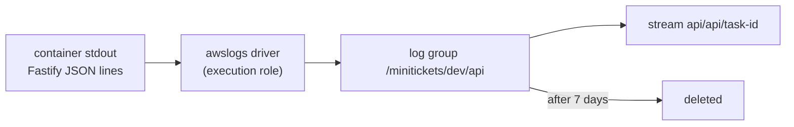

# CloudWatch Logs: log groups, streams, retention

History: see [CHANGELOG.md](../CHANGELOG.md) or run `pnpm docs:history`

Area: Observability · Status: ✅ built · Step doc: [17 ECS api](../../17-infra-ecs-api.md) (section 3.14)

## 1. In one line

**CloudWatch Logs** stores everything our containers print: one **log group** per app
(`/minitickets/dev/api`, `/minitickets/dev/web`), one **log stream** per task, kept for 7 days.

## 2. Real-life comparison

A logbook per department, with one chapter per shift. Pages older than a week are shredded.

## 3. Picture it



## 4. Where in our code

- Anchor: `infra/src/compute/logs.ts` · `createLogs`: the log group with `retentionInDays: 7`.
- Anchor: `infra/src/compute/task.ts` · `logConfiguration`: the api's awslogs driver.
- Anchor: `infra/src/compute/web-task.ts` · `logConfiguration`: the web app's awslogs driver.
- Anchor: `infra/src/jobs/worker-lambda.ts` · `loggingConfig: { logGroup }`: the worker Lambda writes to `/minitickets/dev/worker` (7 days), not to the default `/aws/lambda/...` group that would keep logs forever (S1c).
- Anchor: `infra/src/observability/log-queries.ts` · `createLogQueries`: saved Logs Insights queries `minitickets-dev/follow-one-request`, `/errors`, `/worker-durations` over the api + worker groups (P2).

Step by step:

1. `createLogs("api")` (compute switch) and `createLogs("web")` (entry switch) create the groups; the
   driver does not create them itself.
2. `retentionInDays: 7`: without it, logs are kept forever and billed.
3. `logDriver: "awslogs"` with `awslogs-group`, `awslogs-region` (looked up) and
   `awslogs-stream-prefix` (`api` / `web`): stream names are `<prefix>/<container>/<task id>`.
4. The execution role's managed policy allows writing the lines.
5. `scripts/run-migrations.sh` builds the stream name `api/api/$TASK_ID` to print a migration's output.
6. The api writes structured JSON with request ids (Phase 3 `structured-logging` card).

## 5. See it yourself

```bash
aws logs tail /minitickets/dev/api --profile ticketlite --since 15m --follow
aws logs describe-log-groups --profile ticketlite --log-group-name-prefix /minitickets/dev \
  --query "logGroups[].[logGroupName,retentionInDays,storedBytes]"
```

In the console, **Logs Insights** can query the JSON fields, e.g. `filter res.statusCode >= 500`.

## 6. How it connects

- **Uses ←** the [execution role](execution-vs-task-role.md); the task's path out to AWS endpoints.
- **Gives →** the main debugging window (aws-foundations chapter 8); future metric filters and
  [alerting](alerting.md).

## 7. Our settings and WHY

| Setting | Value | Why |
| ------- | ----- | --- |
| One group per app | api, web | Lines don't mix. |
| Retention | 7 days | Dev logs older than a week are never read. Production: 30-90 days or as audits require. |

## 8. Trade-offs

- **Pros:** zero agents to run, survives crashes, queryable with Logs Insights.
- **Cons:** ingestion is billed per GB (cheap for us, expensive at scale); no alerts on log content yet.

## 9. Alternatives and when to choose them

- **FireLens + Fluent Bit sidecar:** route logs to other tools (OpenSearch, Datadog).
- **Metric filters + alarms:** turn log patterns (5xx) into alerts.
- **Longer retention / S3 export:** audits.

## 10. What breaks, and how we'd notice

- Log group missing: the task fails to start with a logging error.
- Execution role cannot write logs: no logs and a start failure.
- No retention: the bill grows quietly.

## 11. Reach / Allowed / Password

**Reach:** the task's public IP to the CloudWatch Logs endpoint. **Allowed:** the execution role.

## 12. Cost

A few MB in dev: about $0 ([docs/17](../../17-infra-ecs-api.md), section 3.16).

## 13. Interview answers at 3 levels

- **Simple:** Our containers' output goes to CloudWatch, kept for a week.
- **Senior:** One log group per app with 7-day retention, created by Pulumi; the awslogs driver in each
  task definition ships stdout with the execution role, one stream per task. The api logs JSON, so Logs
  Insights can filter by field.
- **Lead:** Logs are the cheapest signal to add and the most expensive to keep. I'd add metric filters
  for errors, structured fields for correlation, sampling for noisy paths, and retention set by
  compliance.

## 14. Follow-up questions interviewers ask

- *Group vs stream?* A group is one app's book; a stream is one task's chapter.
- *How do you find one migration's output?* Stream `api/api/<task id>`.

## 15. Say it in 30 seconds

"Every container line goes to CloudWatch Logs through the awslogs driver: one group per app, one stream
per task, 7-day retention so storage doesn't grow forever. The api's JSON logs can be queried with
Logs Insights."

## 16. Status

✅ built.

## Where it appears in the story

- [Infra story: 9. CloudWatch Logs](../infra-story.md#9-cloudwatch-logs)
