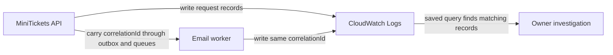

# CloudWatch Logs: the city’s incident notebooks

History: see [CHANGELOG.md](../CHANGELOG.md) or run `pnpm docs:history`
Area: Observability · Status: ✅ built in repository; live AWS acceptance is separate
<!-- interview-card: v2 -->

## 1. What is it?

Logs are records of what an application did. CloudWatch Logs keeps MiniTickets’ records after a container or worker disappears.

## 2. Why do we need it?

A buyer says their confirmation never arrived. We need to follow that booking through the API and email worker, even after either has restarted.

## 3. How does it work?

1. The API accepts a valid request ID or creates one.
2. Booking work carries that ID to the email worker.
3. Search both sets of logs for that ID and the incident’s time.

## 4. How do we use it in MiniTickets?

API, web, email-worker and ticket-worker logs have separate homes. Saved queries connect API and email-worker records. `correlationIdFor` validates the request ID; the outbox preserves it for later work. Live AWS delivery still needs acceptance.

## 5. Interview-ready answer

“MiniTickets uses a shared request ID to connect API and email-worker logs. That lets us investigate a missing confirmation across asynchronous work, even after a process restarts. Logs describe individual events; metrics drive alarms. A shared ID helps investigation, but it does not measure each service’s timing like distributed tracing.”

## 6. Important follow-up questions

- **Is a shared ID a trace?** No. It connects records without timed spans between services.
- **What if no records appear?** Check the time range, selected groups, logging setup and write permissions.
- **Can we log the whole booking?** Avoid it: customer details and credentials can leak. Log useful IDs instead.
- **What is the trade-off?** Longer retention helps investigation but increases storage and query cost.

## 7. Advanced details

Technical reference

### Configuration and access

[CloudWatch Logs](../glossary.md#cloudwatch-logs) receives ECS output through `awslogs`; the execution role permits stream creation and `PutLogEvents`. Lambda function roles permit `CreateLogStream` and `PutLogEvents`. Infrastructure creates groups, so runtime roles do not need arbitrary `CreateLogGroup` access. Temporary role credentials sign writes; no separate password is needed. ECS reaches HTTPS through public-subnet egress; Lambda uses AWS-managed access.

`infra/src/compute/logs.ts` → `createLogs` accepts `api`, `web`, `worker`, `tickets`, under `/minitickets/dev/`, all with `retentionInDays: 7`. API streams follow `api/api/<task id>`; migrations use `migrate/migrate/<task id>` in the API group.

`infra/src/observability/log-queries.ts` → `createLogQueries` saves `minitickets-dev/follow-one-request`, `minitickets-dev/errors`, `minitickets-dev/worker-durations`. The first two select API/email-worker groups; duration selects only email worker. Ticket coverage is not implied. Query text is shared with `dashboard-body.ts`. Saving a query does not itself execute a paid scan. [AWS saved-query guide](https://docs.aws.amazon.com/AmazonCloudWatch/latest/logs/CWL_Insights-Saving-Queries.html).

### Investigation, evidence and limits

`apps/api/src/http/correlation-id.ts` → `correlationIdFor` validates incoming `x-correlation-id` as a UUID or creates one, returns it to the caller and uses JSON field `correlationId`. Credentials are redacted; do not log request bodies/password hashes. Worker duration/error records distinguish thrown invocations from handled record failures.

Console: `us-east-1` → CloudWatch → Logs → Log groups → `/minitickets/dev/api` → Log streams; Logs Insights → Saved queries → `minitickets-dev/follow-one-request`. Select matching groups, time range and UUID. Missing lines suggest logging configuration or role permissions; no request match suggests identity/time/group selection.

Historical P2 local evidence: 115 ms request-to-email, about 10 seconds to retry recovery. Neither is an AWS guarantee or service-level target. Owner runbook §3.12 covers deployed investigation/notification checks. Live delivery, query usefulness and ticket coverage remain operational checks. Higher traffic may justify sampling, latency distributions, longer retention or timed tracing; these are not automatic features of the dashboard or four symptom alarms.

### Related boundaries

[Task definition](task-definition.md) configures group/region/prefix (ECS → revision → Container logs). [Lambda](aws-lambda.md) configures function logs and role (Lambda → function → Monitor). [Alarms](alerting.md) lead the owner to saved queries (CloudWatch → Alarms / Logs Insights).

### Code anchors

- Anchor: `infra/src/compute/logs.ts` — `createLogs`; follow the numbered comments at this boundary.
- Anchor: `infra/src/compute/task.ts` — `module configuration`; follow the numbered comments at this boundary.
- Anchor: `infra/src/compute/web-task.ts` — `module configuration`; follow the numbered comments at this boundary.
- Anchor: `infra/src/jobs/worker-lambda.ts` — `module configuration`; follow the numbered comments at this boundary.
- Anchor: `infra/src/observability/log-queries.ts` — `prefix`; follow the numbered comments at this boundary.

[Open this piece in the city explorer](../guides/infra-explorer.html?concept=cloudwatch-logs#chapter=8&piece=logs).

## Where it appears in the story

- [infra-story: 9b. Follow a booking through symptoms](../infra-story.md#9b-follow-a-booking-through-symptoms)

