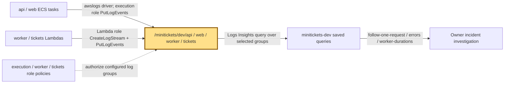
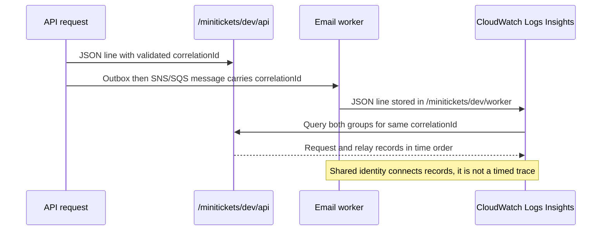

# CloudWatch Logs: the city’s incident notebooks

History: see [CHANGELOG.md](../CHANGELOG.md) or run `pnpm docs:history`
Area: Observability · Status: ✅ built in repository; live AWS acceptance is separate
<!-- interview-card: v1 -->

## 1. In one line

When a MiniTickets worker disappears, its [logs](../glossary.md#cloudwatch-logs), records of what happened, remain in CloudWatch for seven days.

## 2. Where it sits

[Open this piece in the city explorer](../guides/infra-explorer.html?concept=cloudwatch-logs#chapter=8&piece=logs).

## 3. How it works

## 4. What happens in MiniTickets

1. `createLogs` creates API, web, worker and tickets groups under `/minitickets/dev/`.
2. ECS’s `awslogs` driver copies output; Lambda logging uses each function’s role.
3. API validates `x-correlation-id` as a UUID or creates one, then returns it to the caller.
4. The outbox and email message carry that identity to worker logs.
5. Saved queries search API and email-worker groups; old lines expire after seven days.

## 5. Reach / Allowed / Password

**Reach:** HTTPS to CloudWatch; ECS uses public subnet egress, Lambda uses AWS-managed access.

**Allowed:** execution/function roles need log stream creation and event writes.

**Password:** not needed; AWS signs calls using temporary role credentials.

## 6. In our code

`infra/src/compute/logs.ts` → `createLogs`.

`infra/src/observability/log-queries.ts` → `createLogQueries`.

`apps/api/src/http/correlation-id.ts` → `correlationIdFor`.

## 7. In the AWS console

`us-east-1` → CloudWatch → Logs → Log groups → `/minitickets/dev/api` → Log streams. Then Logs Insights → Saved queries → `minitickets-dev/follow-one-request`; select the matching time range and identity. Live delivery not checked.

## 8. Good / Bad

**Good:** Survives task replacement. Shared request IDs connect separate workers.

**Bad:** Seven days is a short history. Reading many logs costs money.

## 9. Other choices

- Timed tracing: pick it when you need durations between services; not built here.
- Longer retention: pick it when recovery or audit needs older evidence.

## 10. Connected to

| Neighbor | Direction | What allows it | Console check |
| --- | --- | --- | --- |
| [Task recipe](task-definition.md) | In ← | awslogs group, region and prefix | ECS → revision → Container logs |
| [Lambda](aws-lambda.md) | In ← | Function log configuration + role | Lambda → function → Monitor |
| [Alarms](alerting.md) | Out → | Owner follows alarm to saved queries | CloudWatch → Alarms; Logs Insights |

## 11. When it breaks

No lines → task/function logging config and role → repair group/stream permissions.

No matching request → selected groups, time range and UUID → follow the original correlationId.

## 12. Say it in 30 seconds

“CloudWatch keeps our incident notebooks after workers die. The API gives a request a validated correlation ID, carries it through outbox and queues, and the email worker logs it too. Saved queries join those records. Logs explain individual events; metrics power alarms. We have no automatic distributed tracing.”

## 13. Likely follow-ups

- Why validate an incoming ID? To reject junk and fake log text.
- Is one ID a trace? No; it joins records without measuring every causal span.

## 14. Remember it

The receipt number connects the notebooks; it does not draw a stopwatch trace.

## 15. More detail

Settings, limits and deeper interview notes

- Anchor: `infra/src/compute/logs.ts` — `createLogs`; follow the numbered comments at this boundary.
- Anchor: `infra/src/compute/task.ts` — `module configuration`; follow the numbered comments at this boundary.
- Anchor: `infra/src/compute/web-task.ts` — `module configuration`; follow the numbered comments at this boundary.
- Anchor: `infra/src/jobs/worker-lambda.ts` — `module configuration`; follow the numbered comments at this boundary.
- Anchor: `infra/src/observability/log-queries.ts` — `prefix`; follow the numbered comments at this boundary.

`createLogs` accepts `api`, `web`, `worker`, `tickets`. Every group has `retentionInDays: 7`. API stream names follow `api/api/<task id>`; migration uses `migrate/migrate/<task id>` in the API group. Log groups are created by infrastructure, so task/function roles do not need permission to create arbitrary groups.

`createLogQueries` defines `minitickets-dev/follow-one-request`, `minitickets-dev/errors` and `minitickets-dev/worker-durations`. The first two select the API and email-worker groups. The duration query selects only the email worker; ticket-group coverage is not implied. Query text is shared with `dashboard-body.ts` so dashboard and saved queries agree. Saving a query is distinct from paying to execute a scan. [AWS saved-query guide](https://docs.aws.amazon.com/AmazonCloudWatch/latest/logs/CWL_Insights-Saving-Queries.html) shows that console workflow.

API JSON request logs use `correlationId`; credentials are redacted and request bodies/password hashes must not be logged. Worker duration/error records help distinguish a thrown invocation from a handled failed message. Full payload logging can leak personal data even when an identifier is useful.

P2’s recorded local evidence was 115 ms request-to-email and about 10 seconds to retry recovery. Those are local measurements, not AWS delivery guarantees or service-level targets. Owner runbook §3.12 covers deployed investigation and notification checks.

Logs explain events, metrics show counts/rates and traces time causal spans. Our four configured symptom alarms and dashboard do not create automatic traces. Higher traffic may justify sampling, latency distributions and deliberate retention budgets. Live log delivery, query usefulness and ticket coverage remain operational checks.

## Where it appears in the story

- [infra-story: 9b. Follow a booking through symptoms](../infra-story.md#9b-follow-a-booking-through-symptoms)
