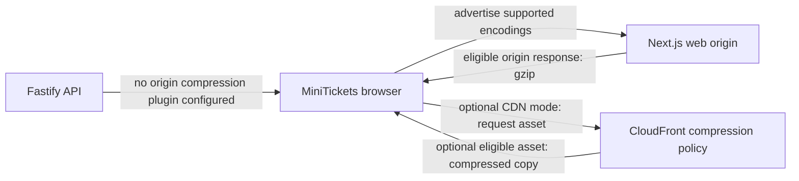

# Compression at the edge (gzip / Brotli)

History: see [CHANGELOG.md](../CHANGELOG.md) or run `pnpm docs:history`

Area: Performance & Caching · Status: 🟡 partial (static files only) · Step doc: [19 CloudFront](../../19-infra-cloudfront.md)

<!-- interview-card: v2 -->

## 1. What is it?

Compression sends a smaller representation of a response, then the browser expands it. Gzip and Brotli reduce transfer size without changing the response’s meaning.

## 2. Why do we need it?

MiniTickets JavaScript and JSON can contain repeated text. Smaller transfers help visitors on slower networks, though compressing them costs processing and may do little for tiny responses.

## 3. How does it work?

1. The browser advertises encodings it can decode.
2. The responsible origin or optional edge checks eligibility and compresses.
3. Verify actual response headers and transferred size.

## 4. How do we use it in MiniTickets?

Next.js standalone serving retains default gzip behavior; the API has no compression plugin. CloudFront compression is an optional configured path, currently inactive with the CDN. Its actual behavior depends on the selected cache policy and response eligibility, not the compression switch alone.

## 5. Interview-ready answer

“MiniTickets can reduce transfer size through origin or optional edge compression. Next.js keeps its default gzip serving behavior; Fastify currently has no compression plugin. CloudFront would require both its compression setting and suitable encoding policy. I would measure payload sizes and actual headers before adding work, and would not describe the inactive CDN as a measured production optimization.”

## 6. Important follow-up questions

- **Does one compression flag guarantee a smaller response?** No. Encoding support, policy, content type and size also matter.
- **What if the origin already compressed it?** The edge should pass the encoded response through rather than compress it again.
- **Why skip tiny responses?** Encoding overhead and CPU may outweigh the saved bytes.
- **Where should API compression happen?** Choose origin or eligible edge behavior after measuring cost, payloads and complexity.

## 7. Advanced details

Technical reference

### Verified code and optional CDN configuration

`apps/web/next.config.ts` does not disable `compress`. Installed Next code defaults it to true and standalone `server.js` uses `startServer`; router-server enables gzip middleware unless false. This establishes configured origin behavior, not every deployed response. [Next compress reference](https://nextjs.org/docs/app/api-reference/config/next-config-js/compress). `apps/api/src/app.ts` has no compression plugin, so no API-origin compression is configured.

`infra/src/entry/cdn.ts` sets `compress: true`. Optional static behavior uses Managed-CachingOptimized with gzip/Brotli; default and `/trpc/*` use Managed-CachingDisabled. Unlike the original static-only description, custom `/events` policy also enables both encoding flags with minimum/default TTL 0. Current HTML is private,no-store and committed CDN is off; do not infer observed edge compression from that configuration.

### Eligibility, inspection and alternatives

CloudFront requires compression enabled and encoding policy support, eligible content types and **1,000–10,000,000 byte** bodies. Existing `Content-Encoding` skips recompression. Brotli commonly reduces text further; browsers advertise it over HTTPS. [AWS compression rules](https://docs.aws.amazon.com/AmazonCloudFront/latest/DeveloperGuide/ServingCompressedFiles.html).

Inspect `Content-Encoding` and transferred size in browser tools or `curl -s -o /dev/null -D - -H 'Accept-Encoding: br, gzip' <app-url>/<path>` for static asset, page and API. No deployed header check was run here. Missing compression can affect transfer/latency but does not change semantic content.

Potential changes include `@fastify/compress`, precompressed build assets, or a deliberately validated zero-TTL edge policy with encoding enabled. No package is added here. Compression consumes CPU/cache capacity and may reduce transfer cost; old “free” phrasing is not a current AWS pricing claim.

### Code anchors

- Anchor: `infra/src/entry/cdn.ts` · `compress: true` on the default behavior (also set on both ordered behaviors).

### Related reading

[CloudFront](cloudfront.md) · [cdn-caching](cdn-caching.md)

[Open this concept in the city explorer](../guides/infra-explorer.html?concept=compression#chapter=12&piece=cloudfront).

## Where it appears in the story

- [Infra story: 1. CloudFront](../infra-story.md#1-cloudfront)

