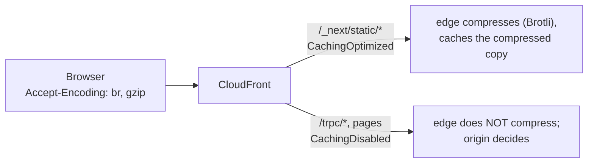

# Compression at the edge (gzip / Brotli)

History: see [CHANGELOG.md](../CHANGELOG.md) or run `pnpm docs:history`

Area: Performance & Caching · Status: 🟡 partial (static files only) · Step doc: [19 CloudFront](../../19-infra-cloudfront.md)

## 1. In one line

**Compression** shrinks responses (gzip or Brotli) before they travel; CloudFront does it at the edge,
but **only for behaviors whose cache policy enables it**, which for us is `/_next/static/*`.

## 2. Real-life comparison

Vacuum-packing clothes for a trip: the same clothes, a much smaller bag. The airline (CloudFront) only
offers vacuum-packing at the counter for checked luggage (cached files), not for hand luggage.

## 3. Picture it



## 4. Where in our code

- Anchor: `infra/src/entry/cdn.ts` · `compress: true` on the default behavior (also set on both ordered behaviors).

What actually happens (from AWS's documentation, checked while writing this card):

1. CloudFront compresses only when the behavior has `compress: true` **and** its cache policy
   enables Gzip and Brotli.
2. `Managed-CachingOptimized` enables both ("Cache compressed objects: Enabled"), so `/_next/static/*`
   files are compressed at the edge (Brotli if the browser accepts it) and cached compressed.
3. `Managed-CachingDisabled` has "Cache compressed objects: Disabled", so on `/trpc/*` and pages our
   `compress: true` has **no effect**. The comment in `cdn.ts` now says so.
4. On those paths only the origin can compress. **Next.js gzips its responses by default**, and
   `apps/web/next.config.ts` does not turn that off, so pages leave the web task gzipped.
   **Verified from Next.js docs** ([`compress`](https://nextjs.org/docs/app/api-reference/config/next-config-js/compress)):
   "By default, Next.js uses `gzip` to compress rendered content and static files when using
   `next start` or a custom server." Our image runs the standalone `server.js`, not `next start`.
   **Verified in the installed Next.js 16.4.0 source:** the standalone `server.js` calls the same
   `startServer`, and `next/dist/server/lib/router-server.js` adds the gzip middleware unless
   `compress` is `false` (the default in `config-shared.js` is `compress: true`).
5. The api (Fastify) has no compression plugin, so its JSON goes out uncompressed. I have not
   checked either origin on the deployed app; the curl below shows it.
6. Other rules: CloudFront compresses only bodies between 1,000 bytes and 10 MB, only some content
   types (JS, CSS, HTML, JSON…), and never if the origin already set `Content-Encoding`.

## 5. See it yourself

```bash
cd infra && APP=$(pulumi stack output appUrl)
FILE=$(curl -s "$APP/" | grep -o '/_next/static/[^"]*\.js' | head -1)
curl -s -o /dev/null -D - -H 'Accept-Encoding: br, gzip' "$APP$FILE" | grep -i content-encoding   # br expected
curl -s -o /dev/null -D - -H 'Accept-Encoding: br, gzip' "$APP/"     | grep -i content-encoding   # gzip from Next.js, or nothing
curl -s -o /dev/null -D - -H 'Accept-Encoding: br, gzip' "$APP/trpc/auth.me" | grep -i content-encoding  # probably nothing
```

## 6. How it connects

- **Uses ←** [CloudFront](cloudfront.md), [cdn-caching](cdn-caching.md) cache policies.
- **Gives →** smaller downloads of the JS and CSS bundles.

## 7. Our settings and WHY

`compress: true` everywhere is harmless and ready for the day a behavior gets a cache policy with
compression. Today it works only where caching is on.

## 8. Trade-offs

- **Pros:** big savings on JS/CSS, computed once per edge and cached.
- **Cons:** dynamic responses (pages via Next.js gzip, api JSON not at all) are compressed only by
  the origin, if at all.

## 9. Alternatives and when to choose them

- **A custom cache policy with TTL 0 but Gzip/Brotli enabled** for `/trpc/*`: compressed api responses
  at the edge while still effectively not caching. Check AWS's rules for zero-TTL policies before
  relying on it.
- **`@fastify/compress` in the api:** compress at the origin (adds CPU work in the task).
- **Pre-compressed assets** at build time: highest ratio, no runtime cost.

## 10. What breaks, and how we'd notice

Nothing breaks; responses are just bigger. Check `content-encoding` in DevTools or with curl.

## 11. Reach / Allowed / Password

Not a connection.

## 12. Cost

Free; smaller responses also mean less data-transfer cost beyond the free tier.

## 13. Interview answers at 3 levels

- **Simple:** CloudFront compresses our JavaScript and CSS so they download faster.
- **Senior:** Edge compression needs both `compress: true` and a cache policy with Gzip/Brotli. Our
  static behavior uses CachingOptimized, so bundles are served Brotli-compressed from cache. Pages and
  `/trpc/*` use CachingDisabled, which has compression disabled, so there only the origin compresses:
  Next.js gzips pages, the api does not compress.
- **Lead:** I'd measure response sizes first. If api payloads grow, either a custom zero-TTL cache
  policy with compression on, or origin compression, whichever costs less CPU and complexity.

## 14. Follow-up questions interviewers ask

- *Brotli vs gzip?* Brotli usually compresses text smaller; browsers send it only over HTTPS.
- *Why not compress tiny responses?* Below about 1 KB the overhead is not worth it; CloudFront skips them.
- *Who compresses our pages, then?* Next.js itself: it gzips by default (verified in its docs and
  source), and CloudFront passes the gzipped page through untouched.

## 15. Say it in 30 seconds

"CloudFront compresses only where the cache policy allows it, which for us is the hashed static files:
they're served Brotli-compressed from the edge cache. Pages and API calls use CachingDisabled, so the
edge doesn't compress them; Next.js gzips pages itself and the API doesn't compress at all."

## 16. Status

🟡 partial (the concept map listed this as ✅; corrected in Phase 2 after checking AWS's docs).
**To make it production-grade:** compression for api responses, measured first.
