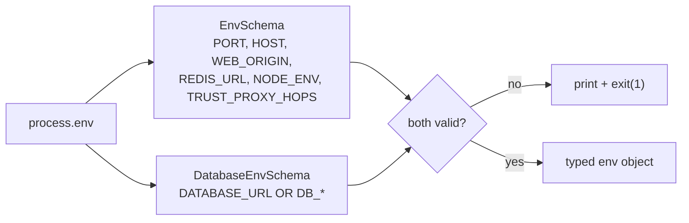

# Config validation: fail fast at startup

History: see [CHANGELOG.md](../CHANGELOG.md) or run `pnpm docs:history`

Area: API · Status: ✅ built · Step doc: [01 setup](../../01-setup.md), [17 ECS api](../../17-infra-ecs-api.md)

## 1. In one line

The api checks every environment variable with Zod **when it starts**; if one is missing or wrong it
prints what and exits, instead of failing later on a random request.

## 2. Real-life comparison

A pilot's pre-flight checklist: if a gauge is broken, you find out on the ground, not at 10,000
metres.

## 3. Picture it



## 4. Where in our code

- Anchor: `apps/api/src/config/env.ts` · `EnvSchema`, `env`: the app settings; exits on failure.
- Anchor: `apps/api/src/config/database.ts` · `DatabaseEnvSchema`: local URL **or** the five AWS pieces, with SSL on AWS.

Step by step:

1. `z.coerce.number()` turns `"4000"` into `4000` (env values are always strings).
2. `REDIS_URL: z.url({ protocol: /^rediss?$/ })`: only `redis://` or `rediss://` (TLS on AWS).
3. `NODE_ENV` defaults to `development`; only `production` changes behaviour (the `Secure` cookie).
4. `TRUST_PROXY_HOPS` 0-5, default 0 ([trust-proxy](trust-proxy.md)).
5. `DatabaseEnvSchema` is a `.transform`: exactly one of `DATABASE_URL` or
   `DB_HOST/DB_PORT/DB_NAME/DB_USER/DB_PASSWORD`; it names the missing pieces; on AWS it returns
   pg settings with `ssl: { rejectUnauthorized: true }` ([tls-in-transit](tls-in-transit.md)).
6. `env.ts` parses both with `safeParse`, prints flattened errors, says "copy
   apps/api/.env.example", and calls `process.exit(1)`.
7. Everything else imports `env`, never `process.env`.

`apps/api/src/db/migrate.ts` validates only `DatabaseEnvSchema`, because a migration needs nothing
else.

## 5. See it yourself

```bash
cd apps/api && PORT=4401 WEB_ORIGIN=not-a-url ./node_modules/.bin/tsx --env-file=.env src/server.ts
# Invalid environment variables: { WEB_ORIGIN: [ 'Invalid URL' ] }
# Hint: copy apps/api/.env.example to apps/api/.env
echo $?    # 1
```

(Output recorded on the owner's laptop. Port 4401 so it never clashes with `pnpm dev`.) Unit tests:
`apps/api/src/config/database.test.ts` (five cases: local, AWS with SSL, neither, incomplete, both).

**Break it on purpose:** in the AWS task definition, drop `DB_PORT`: the task exits at start with
"Missing DB_PORT (needed when DB_* is used)", and the ECS circuit breaker stops the rollout.

## 6. How it connects

- **Uses ←** [twelve-factor-config](twelve-factor-config.md) (config comes from the environment);
  ECS secrets ([secrets-management](secrets-management.md)).
- **Gives →** typed `env` for [fastify-app](fastify-app.md), the pool
  ([connection-pooling](connection-pooling.md)), Redis, CORS and cookies.

## 7. Our settings and WHY

| Choice | Why |
| ------ | --- |
| Validate at import, exit 1 | A crash at start is obvious and blocks a bad deploy (health checks never pass). |
| Two database modes, never both | ECS can only put each secret into its own env var; it can't build a URL. |
| `rediss://` allowed | TLS to Valkey on AWS. |

## 8. Trade-offs

- **Pros:** bad config never reaches users; clear messages; typed config everywhere.
- **Cons:** importing any file that imports `env` needs valid env vars, which makes some tests
  awkward.

## 9. Alternatives and when to choose them

- **`@t3-oss/env` or `envalid`:** the same idea packaged.
- **A config service (AWS AppConfig, Parameter Store) read at start:** central config for many
  services.
- **Lazy validation on first use:** only when startup time matters more than safety.

## 10. What breaks, and how we'd notice

- A missing variable: the process exits at once; locally you see the message, on ECS the task
  stops and the log says why.
- A variable that is valid but wrong (wrong host): passes validation; `/ready` turns 503.

## 13. Interview answers at 3 levels

- **Simple:** The api checks its settings when it starts and refuses to run if something is wrong.
- **Senior:** Zod schemas for app and database settings run at import; coercion turns strings into
  numbers; the database schema accepts a local URL or the five AWS pieces and adds verified TLS on
  AWS. Failure prints flattened errors and exits 1, so ECS never puts a misconfigured task behind the
  ALB.
- **Lead:** Fail fast turns config mistakes into failed deploys instead of incidents. Combined with
  the circuit breaker, a bad config rolls back automatically.

## 14. Follow-up questions interviewers ask

- *Why exit instead of using defaults?* A silent default (wrong database) is worse than a crash.
- *Where are secrets validated?* The same way: they arrive as env vars from ECS.

## 15. Say it in 30 seconds

"Env vars are checked with Zod at startup. Ports are coerced to numbers, URLs must have the right
protocol, and the database settings are either one local URL or the five AWS pieces with verified
TLS. Anything wrong prints a clear message and exits 1, so a bad config fails the deploy, not a
user's request."

## 16. Status

✅ built.

## Where it appears in the story

- [App story: 13. Validation at boundaries](../app-story.md#13-validation-at-boundaries)
