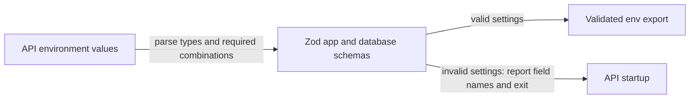

# Config validation: fail fast at startup

History: see [CHANGELOG.md](../CHANGELOG.md) or run `pnpm docs:history`

Area: API · Status: ✅ built · Step doc: [01 setup](../../01-setup.md), [17 ECS api](../../17-infra-ecs-api.md), [22 events SSR](../../22-events-ssr.md)
<!-- interview-card: v2 -->

## 1. What is it?

Configuration validation checks application settings before code depends on them. MiniTickets turns environment strings into typed settings and rejects missing or inconsistent values.

## 2. Why do we need it?

A mistyped database setting should fail clearly during startup, instead of surfacing as a mysterious error when the first customer books. Syntax checks still cannot prove the host is reachable.

## 3. How does it work?



1. Read settings at the appropriate application boundary.
2. Parse types and check dependent values together.
3. Start with validated settings or fail clearly.

## 4. How do we use it in MiniTickets?

API settings are checked at startup. Database configuration accepts either a local URL or complete AWS fields, never both. The web server checks its server-only URL lazily so builds do not require runtime settings; the revalidation endpoint validates its own secret separately.

## 5. Interview-ready answer

“MiniTickets validates configuration with Zod and exports typed settings. The API fails startup on incomplete or inconsistent configuration. Web server-only values are checked when needed because its image builds without runtime settings. Validation makes mistakes visible, but a well-formed wrong hostname can still pass, so reachability and readiness need separate checks.”

## 6. Important follow-up questions

- **Why not silently choose defaults?** A believable wrong database can be worse than a clear startup failure.
- **Can validation prove credentials work?** No. It validates shape and relationships, not external availability.
- **Why reject mixed database modes?** The app should not guess which source of credentials wins.
- **Can errors leak secret values?** Report field names and safe explanations, not sensitive configuration contents.

## 7. Advanced details

<details>
<summary>Technical reference</summary>

### Source references

- Anchor: `apps/api/src/config/env.ts` · `EnvSchema`, `env`: the app settings; exits on failure.
- Anchor: `apps/api/src/config/database.ts` · `DatabaseEnvSchema`: local URL **or** the five AWS pieces, with SSL on AWS.
- Anchor: `apps/web/src/lib/server-env.ts` · `ServerEnvSchema`, `getServerEnv`: the web server's own settings (`API_INTERNAL_URL`), checked at request time.

Step by step:

1. `z.coerce.number()` turns `"4000"` into `4000` (env values are always strings).
2. `REDIS_URL: z.url({ protocol: /^rediss?$/ })`: only `redis://` or `rediss://` (TLS on AWS).
3. `NODE_ENV` defaults to `development`; only `production` changes behaviour (the `Secure` cookie).
4. `TRUST_PROXY_HOPS` 0-5, default 0 ([trust-proxy](trust-proxy.md)).
5. `DatabaseEnvSchema` is a `.transform`: exactly one of `DATABASE_URL` or
   `DB_HOST/DB_PORT/DB_NAME/DB_USER/DB_PASSWORD`; it names the missing pieces; on AWS it returns
   pg settings with `ssl: { rejectUnauthorized: true }` ([tls-in-transit](tls-in-transit.md)).
6. `env.ts` parses both with `safeParse`, prints flattened errors, says "copy
   apps/api/.env.example", and calls `process.exit(1)`.
7. Everything else imports `env`, never `process.env`.

`apps/api/src/db/migrate.ts` validates only `DatabaseEnvSchema`, because a migration needs nothing
else.

**The web server** (Step 22) validates `API_INTERNAL_URL` with `z.url({ protocol: /^https?$/ })` in
`getServerEnv`. Two differences from the api, on purpose: it runs the first time a page needs it, not
at import, because `next build` imports every page and the Docker image is built without run-time
settings; and it **throws** instead of `process.exit(1)`, so only `/events` fails (its error
boundary shows a message) while other pages keep working. The thrown message names the field and
says "copy API_INTERNAL_URL from apps/web/.env.example into apps/web/.env.local".

### Configuration and design

| Choice | Why |
| ------ | --- |
| Validate at import, exit 1 | A crash at start is obvious and blocks a bad deploy (health checks never pass). |
| Two database modes, never both | ECS can only put each secret into its own env var; it can't build a URL. |
| `rediss://` allowed | TLS to Valkey on AWS. |

### Checks and troubleshooting

```bash
cd apps/api && PORT=4401 WEB_ORIGIN=not-a-url ./node_modules/.bin/tsx --env-file=.env src/server.ts
# Invalid environment variables: { WEB_ORIGIN: [ 'Invalid URL' ] }
# Hint: copy apps/api/.env.example to apps/api/.env
echo $?    # 1
```

(Output recorded on the owner's laptop. Port 4401 so it never clashes with `pnpm dev`.) Unit tests:
`apps/api/src/config/database.test.ts` (five cases: local, AWS with SSL, neither, incomplete, both).

**Isolated thought experiment (not performed):** in the AWS task definition, drop `DB_PORT`: the task exits at start with
"Missing DB_PORT (needed when DB_* is used)", and the ECS circuit breaker stops the rollout.

- A missing variable: the process exits at once; locally you see the message, on ECS the task
  stops and the log says why.
- A variable that is valid but wrong (wrong host): passes validation; `/ready` turns 503.

- *Why exit instead of using defaults?* A silent default (wrong database) is worse than a crash.
- *Where are secrets validated?* The same way: they arrive as env vars from ECS.

### Trade-offs and alternatives

- **Pros:** bad config never reaches users; clear messages; typed config everywhere.
- **Cons:** importing any file that imports `env` needs valid env vars, which makes some tests
  awkward.

- **`@t3-oss/env` or `envalid`:** the same idea packaged.
- **A config service (AWS AppConfig, Parameter Store) read at start:** central config for many
  services.
- **Lazy validation on first use:** only when startup time matters more than safety.

### Further technical context

Zod schemas for app and database settings run at import; coercion turns strings into
  numbers; the database schema accepts a local URL or the five AWS pieces and adds verified TLS on
  AWS. Failure prints flattened errors and exits 1, so ECS never puts a misconfigured task behind the
  ALB.

### Related reading

- **Uses ←** [twelve-factor-config](twelve-factor-config.md) (config comes from the environment);
  ECS secrets ([secrets-management](secrets-management.md)).
- **Gives →** typed `env` for [fastify-app](fastify-app.md), the pool
  ([connection-pooling](connection-pooling.md)), Redis, CORS and cookies.

[Open this piece in the city explorer](../guides/infra-explorer.html?concept=config-validation#chapter=8&piece=api-task).

## Where it appears in the story

- [App story: 13. Validation at boundaries](../app-story.md#13-validation-at-boundaries)

</details>
