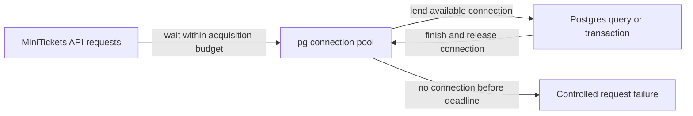

# Connection pooling

History: see [CHANGELOG.md](../CHANGELOG.md) or run `pnpm docs:history`

Area: Data · Status: ✅ built in repository; live AWS acceptance is separate
<!-- interview-card: v2 -->

## 1. What is it?

A connection pool keeps a limited set of database connections open and reuses them. Requests borrow a connection instead of opening a new session every time.

## 2. Why do we need it?

MiniTickets cannot give every waiting buyer an unlimited database session. A small shared pool saves connection setup and puts a limit on one API process’s database demand.

## 3. How does it work?

1. Reuse an idle connection or wait for one within the allowed budget.
2. Execute the SQL or transaction on that connection.
3. Release it for the next request, including after failure.

## 4. How do we use it in MiniTickets?

Each API process has a bounded pg pool and separate limits for acquiring a connection and executing SQL. A booking waiting for a row lock still occupies its connection. Adding API tasks multiplies the total potential connections.

## 5. Interview-ready answer

“MiniTickets reuses a bounded connection pool instead of opening a database session per request. Acquisition and SQL execution have separate time budgets, and lock waits still occupy connections. I size the total across all API instances and migrations. Raising the pool can move overload into Postgres rather than increase useful throughput.”

## 6. Important follow-up questions

- **Does a statement timeout bound pool waiting?** No. Waiting to acquire a connection has its own limit.
- **What if all connections wait on one event row?** Other requests queue behind occupied connections; inspect contention before increasing the pool.
- **Does a timeout prove no booking committed?** No. Resolve ambiguous outcomes using the same durable intent identity.
- **When consider an external pooler?** When connection pressure and process scale justify it; transaction behaviour must remain compatible.

## 7. Advanced details

Technical reference

### Current implementation

Current db/client.ts uses max 10, connectionTimeoutMillis 2000 and statement_timeout 5000. Idle connection errors are logged; the pool drops broken idle connections and can reconnect later. Server shutdown closes the pool. SDK budgets and selected list-cache limits are separate; general Redis calls have retry settings without a hard command deadline. Circuit breakers, bulkheads and end-to-end deadlines remain design choices, not built pooling features.

### Technical limits and diagnosis

A lock waiter still occupies its connection. More API tasks multiply possible sessions, including pressure alongside migration and other clients. An acquisition budget bounds waiting for a connection; statement timeout includes SQL and row-lock waiting. Neither proves an ambiguous operation did not commit. Keep booking intent identity and reconcile outcomes.

Unbounded waits tie up scarce connections and prolong shutdown. Separate stage limits do not replace an overall request deadline; server-side statement cancellation does not bound every network reply. Historical demo:outbox includes silent-queue timeout behaviour locally; this rewrite did not rerun it.

The proposed breaker in services/outbox.ts would wrap delivery with closed/open/half-open behaviour and leave durable work pending. It is explain-only and can hide recovery or reject useful probes if badly tuned. Pool occupancy/queue metrics, per-dependency bulkheads, adaptive limits and end-to-end deadlines are growth options, not deployed pooling guarantees.

### Source anchors

- Anchor: `apps/api/src/db/client.ts` — `pool`; follow the numbered comments at this boundary.

### Related reading

- [current system](../00-big-picture.md)
- [scenario](../guides/interview-scenarios.md#timeouts-pools)
- [explorer tour](../guides/infra-explorer.html?tour=sale-day)
- [app-story: 9b. A booking reaches its transaction](../app-story.md#9b-a-booking-reaches-its-transaction)

[Open this piece in the city explorer](../guides/infra-explorer.html?concept=connection-pooling#chapter=0&piece=laptop-postgres).

## Where it appears in the story

- [app-story: 9b. A booking reaches its transaction](../app-story.md#9b-a-booking-reaches-its-transaction)

