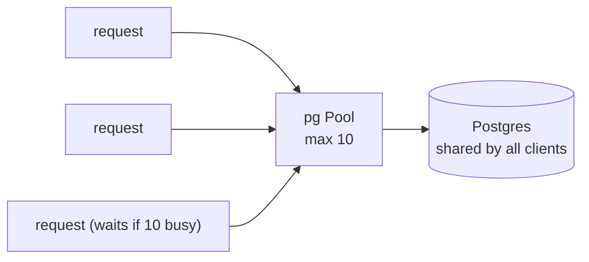

# Connection pooling

History: see [CHANGELOG.md](../CHANGELOG.md) or run `pnpm docs:history`

Area: Data · Status: ✅ built · Step doc: [05 database](../../05-database.md)

## 1. In one line

A **connection pool** keeps a few database connections open and lends them to queries, instead of
opening a new connection (slow: network + TLS + login) for every request.

## 2. Real-life comparison

A taxi rank with ten taxis. Passengers take the next free taxi; if all ten are out, the next
passenger waits in line. Nobody buys a new car for each trip.

## 3. Picture it



## 4. Where in our code

- Anchor: `apps/api/src/db/client.ts` · `pool = new Pool({ ...env.database, max: 10 })`.

Step by step:

1. One `Pool` per api process, created at import. `db` (Drizzle) and `/ready`'s `pingDb` use it.
2. A query borrows a connection, runs, and returns it.
3. All 10 busy → the next query waits in the pool's queue.
4. Idle connections are closed after 10 s (`idleTimeoutMillis` default 10000, verified in the
   installed `pg-pool` source).
5. `migrate.ts` uses its own pool with `max: 1`: one-off jobs need one connection.
6. Shutdown calls `pool.end()` after the server stops ([graceful-shutdown](graceful-shutdown.md)).

**Connection math:** each api task can open up to 10. The code comment says Postgres allows
"~100" connections in total (the Postgres default `max_connections`). On RDS the limit depends on the
instance size; I have not checked the value for our `db.t4g.micro`, so the real headroom is not
measured.

## 5. See it yourself

```bash
docker exec minitickets-postgres-1 psql -U minitickets -d minitickets \
  -c "select count(*), state from pg_stat_activity where usename = 'minitickets' group by state"
```

Use the app a little and run it again: a handful of `idle` connections from the api's pool.

**Break it on purpose:** set `max: 1` and open the dashboard in several tabs at once: requests queue
behind each other (visible as slower responses in the Network tab).

## 6. How it connects

- **Uses ←** [config-validation](config-validation.md) (`env.database`), [rds-postgres](rds-postgres.md).
- **Gives →** [drizzle-schema](drizzle-schema.md) queries, [health-checks](health-checks.md)
  (`pingDb`), [fail-fast](fail-fast.md) (`pool.on("error")`).

## 7. Our settings and WHY

`max: 10`: small and explicit, so N tasks × 10 stays well under the database limit. No
`connectionTimeoutMillis`: see the gap in [fail-fast](fail-fast.md).

## 8. Trade-offs

- **Pros:** fast queries (no handshake per request); bounded load on Postgres.
- **Cons:** a pool per task multiplies with scaling (10 tasks = 100 connections); a too-small pool
  queues requests under load.

## 9. Alternatives and when to choose them

- **RDS Proxy / PgBouncer:** a shared pool in front of the database when many tasks or Lambdas
  connect (explain-only card `rds-proxy`).
- **Bigger pool per task:** only with measured need.

## 10. What breaks, and how we'd notice

- Pool exhausted: slow responses, rising latency; no metric for it yet.
- Too many tasks × pool size: Postgres refuses new connections ("too many clients"); logged as 500s.

## 13. Interview answers at 3 levels

- **Simple:** We keep a few database connections open and reuse them.
- **Senior:** One `pg` Pool per api process with `max: 10`, shared by Drizzle and the readiness ping;
  idle connections close after 10 s; the migration runner uses `max: 1`. Shutdown ends the pool after
  in-flight requests finish.
- **Lead:** Pool size is a capacity decision across the fleet: tasks × pool must fit the database's
  connection limit with room for admin and migrations. Past a few tasks I'd put RDS Proxy in front.

## 14. Follow-up questions interviewers ask

- *How do you size a pool?* Start small; measure wait time and database CPU; total across tasks
  must fit `max_connections`.
- *What happens on a database restart?* Broken idle connections emit `error`; we log it and the
  pool opens new ones.

## 15. Say it in 30 seconds

"One pg Pool per api task with max 10 connections, shared by Drizzle and the readiness check. It
avoids a TLS handshake and login per request and caps our load on Postgres. Scaling out multiplies
it, so with many tasks I'd add RDS Proxy."

## 16. Status

✅ built.

## Where it appears in the story

- [App story: 10. Postgres and Redis](../app-story.md#10-postgres-and-redis)
