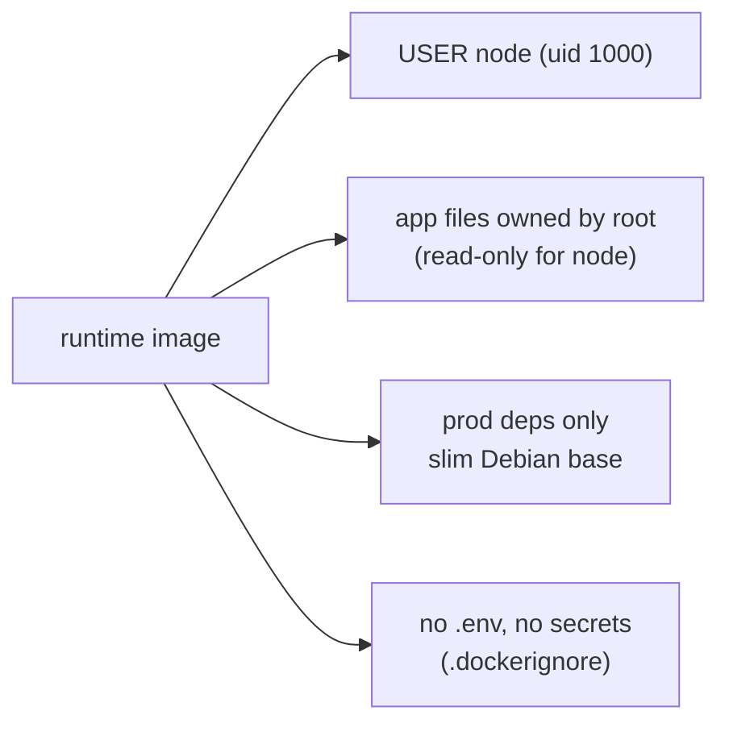

# Container hardening: non-root, slim, production-only deps

History: see [CHANGELOG.md](../CHANGELOG.md) or run `pnpm docs:history`

Area: DevOps & CI/CD · Status: ✅ built · Step doc: [11 docker](../../11-docker.md)

## 1. In one line

Our images run as the unprivileged `node` user, contain only production dependencies on a slim
base, keep app files owned by root (read-only for the app), and never contain env files or secrets.

## 2. Real-life comparison

A hotel room for a guest: they get a key card that opens their room only, the furniture is bolted
down, and the master keys and the safe codes are not in the room.

## 3. Picture it



## 4. Where in our code

- Anchor: `apps/api/Dockerfile` · step 15 `USER node`; step 9 `pnpm … --prod deploy`; step 12 copies without `--chown`.
- Anchor: `apps/web/Dockerfile` · step 15 `USER node`; standalone output only.

Step by step:

1. `USER node`: the official Node image's built-in user (uid 1000). A compromised process can't
   install packages or change system files.
2. Files are copied as root and not `chown`ed, so the app can read but not rewrite its own code.
3. Only production dependencies (`pnpm deploy --prod`; Next standalone tracing): fewer packages,
   fewer vulnerabilities.
4. `node:24.13.0-slim`: Debian with little beyond Node.
5. `.dockerignore` excludes `.env`, `.env.*`, `.git`, docs and `.claude`, so secrets and history
   never reach a layer; runtime config comes from the environment ([twelve-factor-config](twelve-factor-config.md)).
6. The RDS CA file is added with `--chmod=644` so the `node` user can read it.

## 5. See it yourself

Recorded on the owner's laptop with the compose-built image:

```bash
docker run --rm --entrypoint id minitickets-api
# uid=1000(node) gid=1000(node) groups=1000(node)
docker run --rm --entrypoint sh minitickets-api -c 'touch dist/x'
# touch: cannot touch 'dist/x': Permission denied
```

**Break it on purpose:** remove `USER node`: the app runs as root inside the container, and any code
execution bug gets root there.

## 6. How it connects

- **Uses ←** [docker-multi-stage](docker-multi-stage.md).
- **Gives →** smaller attack surface for [image-scanning](image-scanning.md); defence in depth with
  [least-privilege](least-privilege.md) and the task role.

## 7. Our settings and WHY

Non-root, root-owned read-only files, prod deps, slim base, no secrets in images. WHY: if someone
breaks in, they get as little as possible.

## 8. Trade-offs

- **Pros:** limited damage from a compromise; fewer CVEs to deal with.
- **Cons:** debugging tools (curl, ps) aren't in the image; the base image is pinned by tag, not
  digest; the root filesystem is not read-only on ECS.

## 9. Alternatives and when to choose them

- **`readonlyRootFilesystem: true`** in the task definition: no writes anywhere except mounted
  volumes.
- **Distroless images:** no shell or package manager at all.
- **Pin by digest** (`node:24.13.0-slim@sha256:…`) and drop Linux capabilities.

## 10. What breaks, and how we'd notice

A file the app must write (a cache folder) owned by root: the app fails with `EACCES` at runtime.
Not an issue today; the app writes only to stdout.

## 13. Interview answers at 3 levels

- **Simple:** Our containers run with as little power as possible.
- **Senior:** Both images run as `USER node`, with app files owned by root so the process can't
  modify its code, only production dependencies on `node:slim`, and `.dockerignore` keeps env files
  and git history out. Config and secrets come in at runtime from ECS.
- **Lead:** Containers aren't a security boundary by themselves; layer it: non-root, read-only root
  filesystem, minimal base pinned by digest, scanning in CI, and a tight task role.

## 14. Follow-up questions interviewers ask

- *Why does non-root matter in a container?* Container escapes and mounted resources are worse as
  root.
- *Where are secrets then?* Injected as env vars at task start from Secrets Manager.

## 15. Say it in 30 seconds

"Both images run as the node user, app files are owned by root so the app can't rewrite itself, only
production dependencies are shipped on a slim base, and .dockerignore keeps env files and git out.
Next steps would be a read-only root filesystem and digest-pinned base images."

## 16. Status

✅ built. **To make it production-grade:** `readonlyRootFilesystem`, digest-pinned bases, CI
scanning ([image-scanning](image-scanning.md)).
