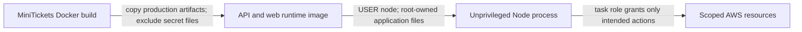

# Container hardening: non-root, slim, production-only deps

History: see [CHANGELOG.md](../CHANGELOG.md) or run `pnpm docs:history`

Area: DevOps & CI/CD · Status: ✅ built · Step doc: [11 docker](../../11-docker.md)
<!-- interview-card: v2 -->

## 1. What is it?

Container hardening reduces the privileges and unnecessary software available to a running application. It limits damage if application code is compromised, while still requiring other security controls.

## 2. Why do we need it?

A MiniTickets API exploit should not automatically let the process rewrite its own program or use package tools to install more software. Narrow runtime capabilities reduce that opportunity.

## 3. How does it work?



1. Ship required production artifacts on a maintained base.
2. Run without root and keep application files unwritable to that user.
3. Limit runtime credentials and review remaining writable paths.

## 4. How do we use it in MiniTickets?

API/web run as the node user with root-owned code. Their runtime patches Perl and removes package managers and shims. Secret files stay outside the image. ECS does not currently make the whole root filesystem read-only; Lambda uses its own runtime model.

## 5. Interview-ready answer

“MiniTickets hardens API and web images with non-root execution, root-owned code and a reduced production runtime. We patch the base and remove package managers, then rely on narrow task roles for AWS access. That limits an attacker’s options but does not make the container an absolute boundary or remove the need for image scanning.”

## 6. Important follow-up questions

- **Does non-root mean no writes anywhere?** No. User-writable directories still exist; a read-only root filesystem is a separate setting.
- **What if a required path is root-owned?** The application can fail with a permission error; define writable paths intentionally.
- **Why remove package managers?** They are unnecessary in the shipped app and increase available software.
- **Are secrets safe just because the image lacks them?** Injected runtime values still need access controls and safe logging.

## 7. Advanced details

<details>
<summary>Technical reference</summary>

### Source references

- Anchor: `apps/api/Dockerfile` · step 15 `USER node`; step 9 `pnpm … --prod deploy`; step 12 copies without `--chown`.
- Anchor: `apps/web/Dockerfile` · step 15 `USER node`; standalone output only.

Step by step:

1. `USER node`: the official Node image's built-in user (uid 1000). This prevents the process changing root-owned system/application files; user-writable paths remain.
2. Files are copied as root and not `chown`ed, so the app can read but not rewrite its own code.
3. Only production dependencies (`pnpm deploy --prod`; Next standalone tracing): fewer packages,
   fewer vulnerabilities.
4. API/web runtime is `node:24.22.0-bookworm-slim`; build stages remain `node:24.13.0-slim`. Runtime patches `perl-base` and removes npm/npx/Corepack/Yarn and shims.
5. `.dockerignore` excludes `.env`, `.env.*`, `.git`, docs and `.claude`, so secrets and history
   never reach a layer; runtime config comes from the environment ([twelve-factor-config](twelve-factor-config.md)).
6. The RDS CA file is added with `--chmod=644` so the `node` user can read it.

### Configuration and design

Non-root, root-owned read-only files, prod deps, slim base, no secrets in images. WHY: if someone
breaks in, they get as little as possible.

### Checks and troubleshooting

Recorded on the owner's laptop with the compose-built image:

```bash
docker run --rm --entrypoint id minitickets-api
# uid=1000(node) gid=1000(node) groups=1000(node)
docker run --rm --entrypoint sh minitickets-api -c 'touch dist/x'
# touch: cannot touch 'dist/x': Permission denied
```

**Isolated thought experiment (not performed):** remove `USER node`: the app runs as root inside the container, and any code
execution bug gets root there.

A file the app must write (a cache folder) owned by root: the app fails with `EACCES` at runtime.
Application output uses stdout; new writable cache paths need explicit ownership/mount planning. The ECS root filesystem is not configured read-only.

- *Why does non-root matter in a container?* Container escapes and mounted resources are worse as
  root.
- *Where are secrets then?* Injected as env vars at task start from Secrets Manager.

### Trade-offs and alternatives

- **Pros:** limited damage from a compromise; fewer CVEs to deal with.
- **Cons:** debugging tools (curl, ps) aren't in the image; the base image is pinned by tag, not
  digest; the root filesystem is not read-only on ECS.

- **`readonlyRootFilesystem: true`** in the task definition: no writes anywhere except mounted
  volumes.
- **Distroless images:** no shell or package manager at all.
- **Pin by digest** (`node:24.13.0-slim@sha256:…`) and drop Linux capabilities.

### Further technical context

Both images run as `USER node`, with app files owned by root so the process can't
  modify its code, only production dependencies on `node:slim`, and `.dockerignore` keeps env files
  and git history out. Config and secrets come in at runtime from ECS.

### Related reading

- **Uses ←** [docker-multi-stage](docker-multi-stage.md).
- **Gives →** smaller attack surface for [image-scanning](image-scanning.md); defence in depth with
  [least-privilege](least-privilege.md) and the task role.

[Open this piece in the city explorer](../guides/infra-explorer.html?concept=container-hardening#chapter=8&piece=api-task).

## Where it appears in the story

- [App story: 15. Docker](../app-story.md#15-docker)

</details>
