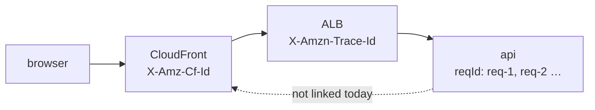

# Request IDs and correlation IDs

History: see [CHANGELOG.md](../CHANGELOG.md) or run `pnpm docs:history`

Area: Observability · Status: 🟡 partial (a request id inside the api; not passed between services or returned to the client) · Step doc: [02 errors](../../02-errors.md)

## 1. In one line

A **request id** tags every log line of one request so you can find them all; a **correlation id**
is the same idea carried across services (browser → CloudFront → ALB → api). We have the first, not
the second.

## 2. Real-life comparison

A parcel's tracking number: every depot writes it on its log, so you can follow one parcel through
the whole journey. Ours is only written inside the last depot.

## 3. Picture it

## 4. Where in our code

- Anchor: `apps/api/src/app.ts` · `reqId: req.id` in `onError`, `reqId: request.id` in `setErrorHandler`; Fastify adds `reqId` to every request log line.

Step by step:

1. Fastify gives each request an id. With `requestIdHeader` at its default `false`, it ignores any
   incoming header and uses `genReqId`: increasing numbers per process, `req-1`, `req-2`, …
   (verified in the installed Fastify 5.12.5 docs, `Server.md`; and seen in our logs).
2. Every log line in that request carries `"reqId"`, so one request's lines can be grouped.
3. Our error logs add `reqId` explicitly.
4. **Not done:** the id is not returned to the client, not read from the ALB's or CloudFront's
   headers, and resets per process, so two tasks both have a `req-1`.

## 5. See it yourself

In any api log, the "incoming request" and "request completed" lines of one request share a `reqId`
(see [structured-logging](structured-logging.md)). On AWS, filter one request in Logs Insights:
`filter reqId = "req-42"` (scoped to one log stream, because ids repeat across tasks).

**Break it on purpose (thought experiment):** set `requestIdHeader: "x-request-id"`. Now any caller
can choose the id that appears in our logs (Fastify's docs warn about this), so it must be validated
or trusted only from the ALB.

## 6. How it connects

- **Uses ←** [structured-logging](structured-logging.md), [trust-proxy](trust-proxy.md) (trusting
  headers from the ALB).
- **Gives →** debugging one request; the base for distributed tracing (explain-only card
  `distributed-tracing`).

## 7. Our settings and WHY

Fastify defaults. WHY: enough for one service on one task; nothing to correlate yet.

## 8. Trade-offs

- **Pros:** zero code; safe (callers can't set it).
- **Cons:** not unique across tasks or restarts; can't link a user's error report to a log line.

## 9. Alternatives and when to choose them

- **`genReqId` using the ALB's `X-Amzn-Trace-Id`** (trusted, because only the ALB reaches us):
  links ALB access logs and app logs.
- **Random UUID per request + `x-request-id` response header:** users and support can quote it.
- **OpenTelemetry trace ids:** across many services.

## 10. What breaks, and how we'd notice

With 2+ tasks, `req-7` exists on each; queries must be scoped by log stream or they mix requests.

## 13. Interview answers at 3 levels

- **Simple:** Each request gets a number on all its log lines.
- **Senior:** Fastify's default `genReqId` gives `req-N` per process and puts it on every log line;
  our error logs include it. We don't accept ids from headers (default `requestIdHeader: false`) and
  don't return it to clients, so it's per-service only.
- **Lead:** Correlation is what makes logs useful across hops. I'd derive the id from the ALB's
  trace header (trusted because of the security group), return it as `x-request-id`, and move to
  OpenTelemetry when there's more than one service.

## 14. Follow-up questions interviewers ask

- *Why not trust the client's request id?* They could inject misleading values into our logs.
- *Request id vs trace id?* Same idea; a trace id also links parent/child spans across services.

## 15. Say it in 30 seconds

"Fastify tags every log line of a request with a reqId, req-1, req-2 and so on, and our error logs
include it. It's per process and not shared with the ALB or the client, so it's a request id, not a
real correlation id yet. Next step: base it on the ALB's trace header and return it to the client."

## 16. Status

🟡 partial. **To make it production-grade:** unique ids (or the ALB trace id), returned in a response
header, then OpenTelemetry traces.
