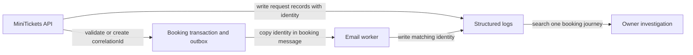

# Request IDs and correlation IDs

History: see [CHANGELOG.md](../CHANGELOG.md) or run `pnpm docs:history`

Area: Observability · Status: ✅ built in repository; live AWS acceptance is separate

<!-- interview-card: v2 -->

## 1. What is it?

A correlation ID is a shared label for work that belongs to one request. It lets us connect records written by different processes.

## 2. Why do we need it?

A booking succeeds but its email arrives late. One label helps us find that booking’s API, outbox and worker records without guessing from timestamps or customer details.

## 3. How does it work?

1. Accept a valid request label or create a fresh one.
2. Carry it through stored work and messages.
3. Search records using that label and an appropriate time range.

## 4. How do we use it in MiniTickets?

The API returns its ID in a response header and stores it with asynchronous booking work. Worker helpers preserve it in logs. Server-rendered cached catalogue calls avoid assigning a misleading visitor-specific identity to shared data.

## 5. Interview-ready answer

“MiniTickets carries a validated correlation ID from the API through the outbox and worker message. That lets us investigate one booking across asynchronous boundaries using structured logs. It is a diagnostic label, not authorization or proof that work completed. It also is not a distributed trace: the label alone does not measure each causal step.”

## 6. Important follow-up questions

- **Why validate caller-provided IDs?** To reject malformed or unbounded input while keeping useful propagation.
- **Can it identify a user securely?** No. It is not a credential or ownership check.
- **Does it replace tracing?** No. Timed spans would add relationships and durations.
- **Should we log the full message?** No. Useful identifiers do not justify exposing customer data.

## 7. Advanced details

Technical reference

### Identity contract and evidence

`apps/api/src/http/correlation-id.ts` validates a UUID from `x-correlation-id` or creates one; API responses return it. `packages/shared/src/schemas/jobs.ts` validates the message field; `apps/worker/src/correlation.ts` preserves/extracts identity. API/outbox/consumer JSON logs connect the same booking. SSR cached calls do not attach misleading per-user IDs.

`infra/src/observability` defines four symptom alarms, dashboard and saved queries. Historical P2 local measurements were **115 ms request-to-email** and retry recovery around **10 s**; they are not AWS guarantees or new measurements. Runbook §3.12 provides Logs Insights/console steps. SNS email confirmation and live alarms remain manual acceptance. Unlike the old copied “proposed extension” line, correlation propagation itself is built; timed tracing is not.

### Limits and growth

Logs explain events; metrics show rates and traces time causal steps. Symptoms include API errors, old queue work, DLQ messages and worker invocation failures. Missing-data semantics and traffic-aware thresholds matter. Logging full messages can leak personal data. Higher traffic may justify error rates, p99 latency, sampling, SLO burn alerts and explicit retention/trace budgets; those later systems are not implied by correlation IDs.

### Code anchors

- Anchor: `apps/api/src/app.ts` — `statusCode`; follow the numbered comments at this boundary.
- Anchor: `apps/api/src/http/correlation-id.ts` — `CORRELATION_HEADER`; follow the numbered comments at this boundary.
- Anchor: `apps/worker/src/correlation.ts` — `correlationIdOf`; follow the numbered comments at this boundary.
- Anchor: `packages/shared/src/schemas/jobs.ts` — `CorrelationId`; follow the numbered comments at this boundary.

### Related reading

[current system](../00-big-picture.md) · [scenario](../guides/interview-scenarios.md#observability) · [explorer tour](../guides/infra-explorer.html?tour=failing-email)

[Open this concept in the city explorer](../guides/infra-explorer.html?concept=correlation-ids#chapter=8&piece=logs).

## Where it appears in the story

- [infra-story: 9b. Follow a booking through symptoms](../infra-story.md#9b-follow-a-booking-through-symptoms)

