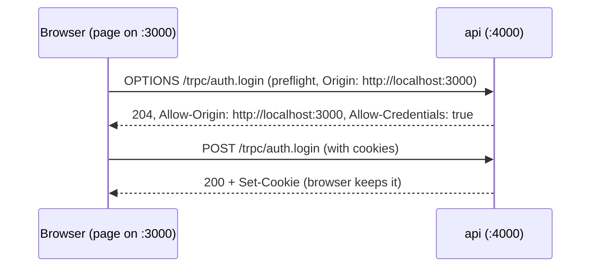

# CORS

History: see [CHANGELOG.md](../CHANGELOG.md) or run `pnpm docs:history`

Area: API · Status: ✅ built · Step doc: [01 setup](../../01-setup.md), [07 login](../../07-login-session.md)

## 1. In one line

**CORS** (Cross-Origin Resource Sharing) is how the api tells the browser which *other* websites may
call it from JavaScript; ours allows exactly one origin, `WEB_ORIGIN`, with cookies.

## 2. Real-life comparison

A building's guest list at the front desk. The desk (browser) asks the tenant (api) "is someone
from this company allowed in?". Only names on the list get in, and only with their badge (cookie) if
the tenant said badges are fine.

## 3. Picture it



## 4. Where in our code

- Anchor: `apps/api/src/app.ts` · `app.register(cors, { origin: env.WEB_ORIGIN, credentials: true })`.
- Anchor: `apps/web/src/lib/trpc/client.ts` · `fetch … credentials: "include"`: the browser side of the same deal.

Step by step:

1. An **origin** is scheme + host + port. `http://localhost:3000` and `http://localhost:4000` are
   different origins, so locally every tRPC call is cross-origin.
2. A POST with `content-type: application/json` is not a "simple" request, so the browser first
   sends a **preflight** `OPTIONS`.
3. `@fastify/cors` answers with `Access-Control-Allow-Origin: <WEB_ORIGIN>` and
   `Access-Control-Allow-Credentials: true`.
4. The browser compares the allowed origin with the page's origin. Match → it sends the real
   request with cookies and lets the page read the answer. No match → it blocks.
5. `credentials: true` never works with `*`; it needs one exact origin (browser rule).
6. **On AWS** the page and `/trpc` share one origin (CloudFront → ALB path routing), so the browser
   asks no CORS question at all ([same-origin-routing](same-origin-routing.md)). `WEB_ORIGIN` is
   still set to the CloudFront URL.

## 5. See it yourself

Recorded against a local api:

```bash
curl -s -i -X OPTIONS localhost:4000/trpc/auth.login -H 'Origin: http://localhost:3000' \
  -H 'Access-Control-Request-Method: POST' -H 'Access-Control-Request-Headers: content-type' | grep -i access-control
# access-control-allow-origin: http://localhost:3000
# access-control-allow-credentials: true
# access-control-allow-methods: GET,HEAD,POST
# access-control-allow-headers: content-type
curl -s -i -X OPTIONS localhost:4000/trpc/auth.login -H 'Origin: https://evil.example' \
  -H 'Access-Control-Request-Method: POST' | grep -i allow-origin
# access-control-allow-origin: http://localhost:3000   ← not evil.example, so the browser blocks
```

Note: the api does not refuse the evil origin itself; it answers with the one allowed origin, and
the **browser** enforces the mismatch. curl, which ignores CORS, can still call the api: CORS
protects users' browsers, not the server ([csrf](csrf.md)).

**Break it on purpose:** set `WEB_ORIGIN=http://localhost:3001` in `apps/api/.env`, restart, and
use the app on :3000: the console shows a CORS error and login fails.

## 6. How it connects

- **Uses ←** [config-validation](config-validation.md) (`WEB_ORIGIN` must be a URL).
- **Gives →** cross-origin calls with cookies in local dev; one layer of [csrf](csrf.md) protection.

## 7. Our settings and WHY

| Setting | Why |
| ------- | --- |
| `origin: env.WEB_ORIGIN` (exact) | Only our web app's pages can call with cookies. |
| `credentials: true` | The session cookie must travel. |
| Same origin on AWS | No preflights, no CORS config to get wrong in production. |

## 8. Trade-offs

- **Pros:** browsers stop other sites from reading our api with the user's cookies.
- **Cons:** preflights add a round-trip locally; misconfiguration shows up as confusing browser
  errors; it is not server-side access control.

## 9. Alternatives and when to choose them

- **Same origin everywhere** (a dev proxy like Next.js rewrites): no CORS at all locally either.
- **A list of origins:** when several frontends (admin, marketing) call the api.

## 10. What breaks, and how we'd notice

- Wrong `WEB_ORIGIN`: every browser call fails with a CORS error in the console; curl still works,
  which is the clue.
- `origin: "*"` with credentials: the browser refuses; cookies never travel.

## 13. Interview answers at 3 levels

- **Simple:** The api tells browsers which website may talk to it.
- **Senior:** `@fastify/cors` with one exact origin and `credentials: true`; the client fetches with
  `credentials: "include"`. JSON POSTs trigger a preflight; the browser enforces the answer. On AWS
  the web and api share an origin through the ALB, so CORS doesn't even come into play.
- **Lead:** CORS relaxes the browser's same-origin policy; it is not authentication. The safest
  setup is same-origin; where cross-origin is needed, use an exact allow-list and pair it with
  SameSite cookies and an Origin check for CSRF.

## 14. Follow-up questions interviewers ask

- *Does CORS protect the api from curl?* No; only browsers enforce it.
- *What triggers a preflight?* Non-simple methods or headers, e.g. `content-type: application/json`.

## 15. Say it in 30 seconds

"CORS lets the api tell browsers which other origin may call it. We allow exactly WEB_ORIGIN with
credentials, and the client sends cookies with credentials include. Locally web and api are
different ports, so it matters; on AWS they share one origin through the load balancer, so the
browser never asks."

## 16. Status

✅ built.
