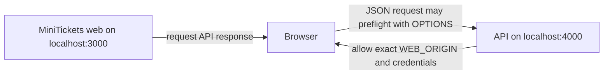

# CORS

History: see [CHANGELOG.md](../CHANGELOG.md) or run `pnpm docs:history`

Area: API · Status: ✅ built · Step doc: [01 setup](../../01-setup.md), [07 login](../../07-login-session.md)
<!-- interview-card: v2 -->

## 1. What is it?

Cross-Origin Resource Sharing, or CORS, tells browsers when a page may read responses from another origin. An origin is the combination of scheme, host and port.

## 2. Why do we need it?

Locally MiniTickets web and API use different ports. The browser needs explicit permission to expose API responses, including session-based ones, to our web app.

## 3. How does it work?



1. The browser checks whether the request crosses origins.
2. When required, it first asks permission with a preflight.
3. It exposes the response only when the CORS rules allow it.

## 4. How do we use it in MiniTickets?

Fastify allows our configured web origin and credentials. Browser fetch includes cookies. The current AWS public host serves pages and `/trpc` under one origin through the ALB, so that public browser path needs no cross-origin exception.

## 5. Interview-ready answer

“MiniTickets uses CORS for its separate local web and API origins. The API names the allowed origin and permits credentials; the browser enforces whether JavaScript may read the response. This does not authenticate callers or replace CSRF protection. On our public same-origin path, pages and API requests already share an origin.”

## 6. Important follow-up questions

- **Does CORS stop curl?** No. It is enforced by browsers, not arbitrary HTTP clients.
- **Can credentials use a wildcard origin?** Browsers reject wildcard allow-origin for credentialed response access.
- **Does a CORS error mean nothing reached the server?** No. Failed preflights can block sending, but some requests still reach the server.
- **What if only browser calls fail?** Check the exact configured origin, credentials mode and preflight response.

## 7. Advanced details

<details>
<summary>Technical reference</summary>

### Source references

- Anchor: `apps/api/src/app.ts` · `app.register(cors, { origin: env.WEB_ORIGIN, credentials: true })`.
- Anchor: `apps/web/src/lib/trpc/client.ts` · `fetch … credentials: "include"`: the browser side of the same deal.

Step by step:

1. An **origin** is scheme + host + port. `http://localhost:3000` and `http://localhost:4000` are
   different origins, so browser calls to the separate local API port are cross-origin. Server-side calls do not use the browser's CORS checks.
2. A POST with `content-type: application/json` is not a "simple" request, so the browser first
   sends a **preflight** `OPTIONS`.
3. `@fastify/cors` answers with `Access-Control-Allow-Origin: <WEB_ORIGIN>` and
   `Access-Control-Allow-Credentials: true`.
4. The browser compares the allowed origin with the page's origin. Match → it sends the real
   request with cookies and lets the page read the answer. No match → the browser blocks access to the response; failed preflights can prevent the actual request, while simple requests may still reach the server.
5. `credentials: true` never works with `*`; it needs one exact origin (browser rule).
6. **On AWS** the page and `/trpc` share one origin (current HTTPS ALB path routing; CloudFront is optional/inactive), so the browser
   asks no CORS question at all ([same-origin-routing](same-origin-routing.md)). `WEB_ORIGIN` matches the configured public application origin.

### Configuration and design

| Setting | Why |
| ------- | --- |
| `origin: env.WEB_ORIGIN` (exact) | Only the configured origin may read credentialed cross-origin responses. |
| `credentials: true` | The session cookie must travel. |
| Same origin on AWS | No cross-origin negotiation for this path; `WEB_ORIGIN` still controls mutation Origin checks. |

### Checks and troubleshooting

Recorded against a local api:

```bash
curl -s -i -X OPTIONS localhost:4000/trpc/auth.login -H 'Origin: http://localhost:3000' \
  -H 'Access-Control-Request-Method: POST' -H 'Access-Control-Request-Headers: content-type' | grep -i access-control
# access-control-allow-origin: http://localhost:3000
# access-control-allow-credentials: true
# access-control-allow-methods: GET,HEAD,POST
# access-control-allow-headers: content-type
curl -s -i -X OPTIONS localhost:4000/trpc/auth.login -H 'Origin: https://evil.example' \
  -H 'Access-Control-Request-Method: POST' | grep -i allow-origin
# access-control-allow-origin: http://localhost:3000   ← not evil.example, so the browser blocks
```

The CORS layer answers this OPTIONS request with the configured allowed origin, and the browser enforces the mismatch. Separately, our mutation guard rejects an unexpected or missing Origin on state-changing methods. curl ignores CORS but still must satisfy that guard and session/authorization checks ([csrf](csrf.md)).

**Isolated thought experiment (not performed):** set `WEB_ORIGIN=http://localhost:3001` in `apps/api/.env`, restart, and
use the app on :3000: the console shows a CORS error and login fails.

- Wrong `WEB_ORIGIN`: cross-origin browser calls can fail preflight or become unreadable. curl bypasses CORS, but a mutation with a missing or incorrect Origin still fails the server guard; authenticated work also needs a valid session.
- `origin: "*"` with credentials: the browser refuses credentialed response access; a failed preflight can also prevent the actual request.

- *Does CORS protect the api from curl?* No; only browsers enforce it.
- *What triggers a preflight?* Non-simple methods or headers, e.g. `content-type: application/json`.

### Trade-offs and alternatives

- **Pros:** browsers stop other sites from reading our api with the user's cookies.
- **Cons:** preflights add a round-trip locally; misconfiguration shows up as confusing browser
  errors; it is not server-side access control.

- **Same origin everywhere** (a dev proxy like Next.js rewrites): no CORS at all locally either.
- **A list of origins:** when several frontends (admin, marketing) call the api.

### Further technical context

`@fastify/cors` with one exact origin and `credentials: true`; the client fetches with
  `credentials: "include"`. JSON POSTs trigger a preflight; the browser enforces the answer. On AWS
  the web and api share an origin through the ALB, so CORS doesn't even come into play.

### Related reading

- **Uses ←** [config-validation](config-validation.md) (`WEB_ORIGIN` must be a URL).
- **Gives →** cross-origin calls with cookies in local dev; one layer of [csrf](csrf.md) protection.

[Open this piece in the city explorer](../guides/infra-explorer.html?concept=cors#chapter=8&piece=api-task).

## Where it appears in the story

- [App story: 4. Fastify: CORS, trustProxy, cookie](../app-story.md#4-fastify-cors-trustproxy-cookie)

</details>
