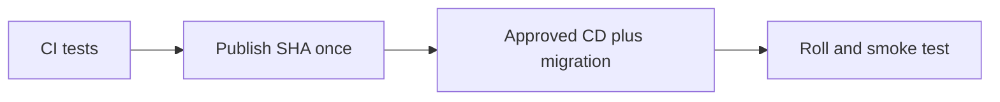

# Cost on/off switches

History: see [CHANGELOG.md](../CHANGELOG.md) or run `pnpm docs:history`

Area: DevOps & CI/CD · Status: ✅ built in repository; live acceptance is separate

## 1. In one line

Committed data/compute/entry/CDN switches define graph shape; current dev data/compute/entry are true and CDN false. Change mode with entry off. SSM image/deployed-commit records are separate. Standing queues/storage/secrets/ECR may retain costs while hourly services are off.

## 2. Real-life comparison

A sealed package is built once, then checked at a gate before the manager installs that exact version.

## 3. Picture it

## 4. Where in our code

- Anchor: `infra/index.ts` · `dataEnabled`, `computeEnabled`, `entryEnabled` and the two `RunError` checks.

`infra/Pulumi.dev.yaml` commits the shape; `apps/api/src/config/env.ts` validates INVENTORY_GATE_ENABLED. Proposed feature flags belong in validated API config/service policy with browser-safe public values only. Incident response starts from symptom, recent release, health/queue/DB evidence and reversible app rollback, not an unreviewed infrastructure teardown.

## 5. See it yourself

`infra/Pulumi.dev.yaml` commits the shape; `apps/api/src/config/env.ts` validates INVENTORY_GATE_ENABLED. Proposed feature flags belong in validated API config/service policy with browser-safe public values only. Incident response starts from symptom, recent release, health/queue/DB evidence and reversible app rollback, not an unreviewed infrastructure teardown.

Failure thought experiment: Is cdnEnabled a per-user product flag? No; it changes the infrastructure graph.

## 6. How it connects

Uses the [current system](../00-big-picture.md); gives a concrete decision to the [scenario](../guides/interview-scenarios.md#delivery-rollback) and [explorer tour](../guides/infra-explorer.html?tour=deploy).

## 7. Our settings and WHY

Committed data/compute/entry/CDN switches define graph shape; current dev data/compute/entry are true and CDN false. Change mode with entry off. SSM image/deployed-commit records are separate. Standing queues/storage/secrets/ECR may retain costs while hourly services are off. A reversible behavior switch can reduce blast radius but stale flags create hidden paths.

## 8. Trade-offs

Blue/green costs overlapping capacity and still shares data migration risk. Remote flag services add availability and privacy dependencies.

## 9. Alternatives and when to choose them

10x: flag owner/expiry and compatibility tests. 100x: staged cohorts, audit history and automated canary criteria.

## 10. What breaks and how we notice

Is cdnEnabled a per-user product flag? No; it changes the infrastructure graph.

## 13. Interview answers at 3 levels

- **Simple:** Committed data/compute/entry/CDN switches define graph shape; current dev data/compute/entry are true and CDN false. Change mode with entry off. SSM image/deployed-commit records are separate. Standing queues/storage/secrets/ECR may retain costs while hourly services are off.
- **Senior:** An environment switch controls infrastructure shape; a product feature flag controls behavior and needs ownership, expiry and safe defaults. MiniTickets commits data/compute/entry/CDN switches and uses a runtime inventory gate setting. It has rolling ECS deployments; blue/green and a general flag service are explain-only.
- **Lead:** 10x: flag owner/expiry and compatibility tests. 100x: staged cohorts, audit history and automated canary criteria.

## 14. Follow-up questions with answers

Is cdnEnabled a per-user product flag? No; it changes the infrastructure graph.

## 15. Say it in 30 seconds

An environment switch controls infrastructure shape; a product feature flag controls behavior and needs ownership, expiry and safe defaults. MiniTickets commits data/compute/entry/CDN switches and uses a runtime inventory gate setting. It has rolling ECS deployments; blue/green and a general flag service are explain-only.

## 16. Status and production work

Repository implementation and local evidence are described above. Live AWS/CI execution remains owner acceptance. 10x: expired approvals and automated rollback criteria. 100x: canary analysis, immutable manifests and cross-service compatibility.

## Where it appears in the story

- [Infra story: 14. Pulumi and the switches](../infra-story.md#14-pulumi-and-the-switches)
