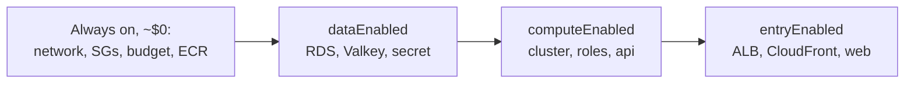

# Cost on/off switches

History: see [CHANGELOG.md](../CHANGELOG.md) or run `pnpm docs:history`

Area: DevOps & CI/CD · Status: ✅ built · Step docs: [14 data](../../14-infra-data.md) (section 3.10), [17](../../17-infra-ecs-api.md) (3.15), [19](../../19-infra-cloudfront.md) (3.13), [20 deploy day](../../20-deploy-day.md)

## 1. In one line

Three Pulumi config switches, `dataEnabled`, `computeEnabled` and `entryEnabled`, create or delete the
layers that cost money every hour, so the stack costs almost nothing while we are not working.

## 2. Real-life comparison

Light switches per room. The building (network, security groups) stays, but you switch off the
expensive rooms (database, kitchen, reception) at night.

## 3. Picture it



Each switch needs the ones to its left; `index.ts` refuses invalid combinations.

## 4. Where in our code

- Anchor: `infra/index.ts` · `dataEnabled`, `computeEnabled`, `entryEnabled` and the two `RunError` checks.

Step by step:

1. `config.getBoolean("dataEnabled") ?? false`: missing = off.
2. Each expensive layer is `dataEnabled ? createX(...) : undefined`.
3. `computeEnabled && !dataEnabled` → `pulumi.RunError` with a clear message; same for entry without
   data and compute.
4. Outputs of switched-off layers are `null` (not `undefined`, which would warn on every preview).
5. Off deletes for real: RDS has no final snapshot ([backups-dr](backups-dr.md)).

## 5. See it yourself

```bash
cd infra
pulumi config get dataEnabled; pulumi config get computeEnabled; pulumi config get entryEnabled
pulumi config set entryEnabled true && pulumi preview    # without data/compute: the RunError message
pulumi config set entryEnabled false
```

(The preview is read-only. Only the owner runs `pulumi up`.)

## 6. How it connects

- **Uses ←** [infrastructure-as-code](infrastructure-as-code.md).
- **Gives →** low running cost; the deploy-day on/off routine; [budget alerts](budget-alerts.md) as the
  safety net when someone forgets "off".

## 7. Our settings and WHY

| Layer | ~Per hour | Why switchable |
| ----- | --------- | -------------- |
| data | ~$0.033 | RDS and Valkey bill every hour they exist. |
| compute | ~$0.008 | Tasks and public IPs bill per second. |
| entry | ~$0.04 | The ALB has a fixed hourly price. |
| everything on | ~$0.08 | About $2 a day if forgotten ([docs/20](../../20-deploy-day.md)). |

## 8. Trade-offs

- **Pros:** dev costs cents per session; every "on" is a fresh, reproducible build.
- **Cons:** data is lost on "off"; "on" takes 25-40 minutes; CloudFront delete is slow.

## 9. Alternatives and when to choose them

- **Scale to zero** (desired count 0, Aurora Serverless pause): keep data, pay less while idle.
- **Scheduled start/stop** (EventBridge, RDS stop): automatic nightly savings.
- **Ephemeral preview environments per pull request:** teams.

## 10. What breaks, and how we'd notice

- Forgetting "off": the budget alert emails eventually.
- Wrong order: `RunError` stops the program before anything changes.

## 11. Reach / Allowed / Password

Not a connection.

## 12. Cost

This card is about cost: everything off leaves only cents a month (ECR storage).

## 13. Interview answers at 3 levels

- **Simple:** We switch the expensive parts of AWS off when not using them.
- **Senior:** Three boolean config switches gate the data, compute and entry layers; `index.ts` refuses
  invalid combinations; outputs become null when off. Everything on is about 8 cents an hour; off is
  nearly free.
- **Lead:** For a team I'd automate this (scheduled scale-down or ephemeral environments) and keep
  production always on with budgets per environment, because a manual switch depends on discipline.

## 14. Follow-up questions interviewers ask

- *Why not just stop RDS?* AWS restarts a stopped RDS instance automatically after 7 days, and the
  ALB, tasks and IPs would still cost money.
- *Why null outputs?* Undefined outputs make Pulumi warn on every preview.

## 15. Say it in 30 seconds

"Three config switches create or delete the data, compute and entry layers, in that dependency order,
with clear errors for invalid combinations. Everything on costs about 8 cents an hour; off, only ECR
storage remains."

## 16. Status

✅ built.

## Where it appears in the story

- [Infra story: 14. Pulumi and the switches](../infra-story.md#14-pulumi-and-the-switches)
