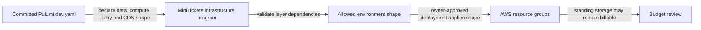

# Cost on/off switches

History: see [CHANGELOG.md](../CHANGELOG.md) or run `pnpm docs:history`

Area: DevOps & CI/CD · Status: ✅ built in repository; live acceptance is separate

<!-- interview-card: v2 -->

## 1. What is it?

An environment switch controls whether a group of infrastructure resources exists. It changes the environment’s shape rather than choosing which feature a visitor sees.

## 2. Why do we need it?

MiniTickets is a learning project and does not always need every hourly service running. Explicit switches let the owner choose an intended environment instead of forgetting individual resources.

## 3. How does it work?

1. Commit the intended environment shape.
2. Validate dependencies between enabled layers.
3. An owner-approved deployment applies it; review what still exists afterward.

## 4. How do we use it in MiniTickets?

MiniTickets separates infrastructure switches from runtime settings such as its inventory gate. The selected application image and deployment-history records are separate too. Turning off hourly layers does not promise zero cost because storage and other standing resources may remain.

## 5. Interview-ready answer

“MiniTickets uses committed environment switches to control infrastructure shape. That is different from a runtime feature flag, which changes behavior without rebuilding the environment. The switches must respect layer dependencies and be applied through the deployment process. Cost review still matters afterward: retained storage, queues, secrets and images may continue to incur charges even when application compute is off.”

## 6. Important follow-up questions

- **Is the CDN switch a per-user flag?** No. It changes infrastructure and the public request path.
- **Does off mean free?** No. Persistent or standing resources may remain.
- **Should an incident start with teardown?** Usually start with symptoms, recent releases and reversible recovery, not an unreviewed infrastructure change.
- **What makes a good feature flag?** An owner, safe defaults, expiry and tests for both paths.

## 7. Advanced details

Technical reference

### Shape, runtime configuration and state

`infra/Pulumi.dev.yaml` commits `dataEnabled`, `computeEnabled`, `entryEnabled`, `cdnEnabled` and domain shape. The recorded current dev shape is data/compute/entry **true**, CDN **false**; this is repository configuration, not live deployment verification. Dependencies are checked in `infra/index.ts`. Change entry/CDN mode with entry off as documented; do not improvise a running graph transition.

SSM image-tag and deployed-commit records are distinct from shape, written by CD. Standing queues, storage, secrets and ECR may retain charges when hourly resources are disabled. `apps/api/src/config/env.ts` validates `INVENTORY_GATE_ENABLED`, a runtime policy setting rather than an infrastructure mode.

### Operations and trade-offs

Any shape change is owner/deployment work; no AWS/Pulumi write was performed here. Incident response starts with symptoms, recent release, health/queue/DB evidence and a reversible app rollback where appropriate. Proposed general feature flags belong in validated API config/service policy; only browser-safe values should be public. No general flag service or blue/green deployment is built.

Remote flag services add availability/privacy dependencies. Blue/green adds overlapping capacity while retaining shared migration risk. Future controls include flag ownership/expiry, compatibility tests, staged cohorts, audit trails, canary criteria and expiring approvals.

### Code anchors

- Anchor: `infra/index.ts` · `dataEnabled`, `computeEnabled`, `entryEnabled` and the two `RunError` checks.

### Related reading

[current system](../00-big-picture.md) · [scenario](../guides/interview-scenarios.md#delivery-rollback) · [explorer tour](../guides/infra-explorer.html?tour=deploy)

[Open this concept in the city explorer](../guides/infra-explorer.html?concept=cost-switches#chapter=1&piece=pulumi).

## Where it appears in the story

- [Infra story: 14. Pulumi and the switches](../infra-story.md#14-pulumi-and-the-switches)

