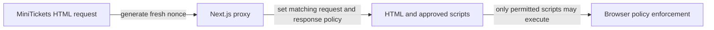

# Csp

History: see [CHANGELOG.md](../CHANGELOG.md) or run `pnpm docs:history`

Area: Auth & Security · Status: ✅ built in repository; live AWS acceptance is separate
<!-- interview-card: v2 -->

## 1. What is it?

Content Security Policy, or CSP, tells the browser which content a page may load or execute. A nonce is a fresh random value marking scripts approved for that response.

## 2. Why do we need it?

If attacker-controlled text accidentally becomes executable HTML in MiniTickets, the browser should not simply run every script it sees. CSP adds another barrier alongside safe rendering.

## 3. How does it work?

1. Generate a fresh nonce for the response.
2. Give approved scripts that nonce and send the matching policy.
3. Let the browser block execution outside the policy.

## 4. How do we use it in MiniTickets?

Our proxy overwrites caller-supplied policy and nonce headers. Production avoids unsafe-eval; Zod’s optional code-generation probe is disabled in the client. Nonce-bearing HTML is dynamic and private,no-store. Style attributes remain allowed for current layouts.

## 5. Interview-ready answer

“MiniTickets uses a fresh nonce CSP to reduce the damage of script injection. Approved Next scripts receive the response nonce, and production does not allow eval. This supplements safe rendering rather than sanitizing input. It also changes caching: we cannot share nonce-bearing HTML as a reusable public page.”

## 6. Important follow-up questions

- **Does CSP sanitize HTML?** No. Safe rendering and input handling remain necessary.
- **Why not reuse one nonce?** It would stop being a per-response approval value.
- **What if a dependency tries eval?** Remove or disable that behavior instead of broadly weakening production policy.
- **Does a clean scan prove safety?** No. Scanners find known issues; browser policy and application review solve other parts of the problem.

## 7. Advanced details

Technical reference

### Source anchors

- Anchor: `apps/web/src/lib/security-policy.ts` — `securityPolicy`; follow the numbered comments at this boundary.
- Anchor: `apps/web/src/proxy.ts` — `proxy`; follow the numbered comments at this boundary.

### Policy and cache boundary

`apps/web/src/proxy.ts` → `proxy` generates a nonce from a random UUID and replaces caller-supplied x-nonce/CSP headers. Next receives the request policy to mark its scripts, and the response receives the same policy. The matcher covers HTML/RSC routes while excluding API/tRPC/static/image/favicon paths. Responses are private,no-store, so an old shared HTML response cannot reuse a security nonce.

`apps/web/src/lib/security-policy.ts` → `securityPolicy` uses script-src self, the nonce and strict-dynamic. Production excludes unsafe-eval; development adds it for tooling. Production style elements require a nonce, while style-src-attr unsafe-inline remains for current React layouts. Connect/image rules include configured API and S3 destinations; object-src and frame-ancestors are none. This policy is not an HTML sanitizer.

`apps/web/src/lib/trpc/client.ts` disables optional Zod JIT/probing rather than weakening production eval policy. Browser-console violations point to a blocked source or a missing/mismatched nonce. Do not blindly add unsafe-eval or broad hosts to silence them. pnpm demo:security is prior local policy coverage, not a live CDN acceptance test, and was not rerun here.

### Other security gates and growth

Dependency audits and image scans cover known advisories, not all XSS or business errors. Earlier P10 evidence had high braces/moderate esbuild; later PENDING records the scoped loader override removing moderate esbuild, high braces remaining, and all six ARM64/AMD64 configured image gates passing. These are prior local results, not scans rerun here or proof of GitHub/live AWS execution. Keep explicit severity/exception policy, bounded CSP reporting, provenance and attack-surface reviews.

### Preserved references

- [current system](../00-big-picture.md)
- [scenario](../guides/interview-scenarios.md#csp-xss)
- [explorer tour](../guides/infra-explorer.html?tour=security-layers)

[Open this piece in the city explorer](../guides/infra-explorer.html?concept=csp#chapter=8&piece=web-task).

## Where it appears in the story

- [app-story: 4b. Mutation admission and browser security](../app-story.md#4b-mutation-admission-and-browser-security)

