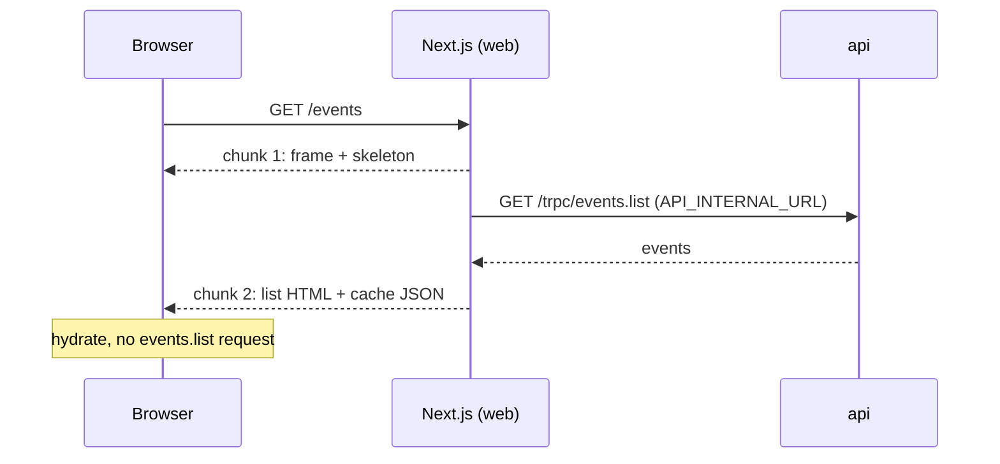

# Client-side vs server-side rendering

History: see [CHANGELOG.md](../CHANGELOG.md) or run `pnpm docs:history`

Area: Frontend · Status: 🟡 partial (CSR ✅, SSR ✅ locally, SSR on AWS 🟡) · Step doc: [21 events list](../../21-events-list.md), [22 events SSR](../../22-events-ssr.md)

## 1. In one line

With **client-side rendering (CSR)** the browser gets an empty page frame and then fetches the data
itself; with **server-side rendering (SSR)** the server fetches the data first and sends HTML with the
data in it. `/events` was CSR in Step 21 and is SSR (with streaming) since Step 22; both were measured.

## 2. Real-life comparison

CSR: a restaurant hands you an empty plate and the kitchen sends the food after you sit down. SSR:
the plate arrives with the food already on it. SSR with streaming: bread and water arrive at once,
the main course on the same visit as soon as it is ready.

## 3. Picture it

Step 21, CSR (two round trips before content):

Step 22, SSR (one round trip; the web server calls the api):

## 4. Where in our code

- Anchor: `apps/web/src/app/events/page.tsx` · `EventsPage`, `EventListWithServerData`: `force-dynamic`, `<Suspense>`, `HydrationBoundary`.
- Anchor: `apps/web/src/features/events/server/prefetch-events.ts` · `prefetchEvents`: fetches on the server, returns the dehydrated cache.
- Anchor: `apps/web/src/features/events/hooks/use-events.ts` · `useEvents`: reads the same cache; fetches from the browser only if the server could not.
- Anchor: `apps/web/e2e/events.spec.ts` · "with JavaScript disabled": the titles are in the server's HTML.

Step by step (SSR, Step 22):

1. `app/events/page.tsx` is a Server Component with `export const dynamic = "force-dynamic"`: it is
   rendered on every request (build output `ƒ /events`; it was `○ /events`, static, in Step 21).
2. It renders the heading and `<Suspense fallback={<EventListSkeleton />}>`. Inside,
   `EventListWithServerData` awaits `prefetchEvents()`, which calls the api from the web server
   ([server-to-server-calls](server-to-server-calls.md)) and dehydrates the TanStack cache.
3. `<HydrationBoundary>` sends that cache to the browser; `EventList` (a Client Component, unchanged)
   renders to HTML on the server with the data ([hydration](hydration.md)).
4. The response streams: frame first, list second ([streaming-suspense](streaming-suspense.md)).
5. In the browser, `useEvents` finds the data (`staleTime` 30 s), so no `events.list` request.
6. If the server's call failed, the list is not in the cache and `useEvents` fetches it from the
   browser: the Step 21 path is the fallback.

Step 21 (CSR) for comparison: `EventList` rendered in its pending state on the server (no data), the
first HTML had `aria-label="Loading events"` and no titles, and the browser fetched afterwards.

## 5. See it yourself

`curl -s localhost:3000/events | grep -o "Indie Rock" | wc -l` → `2` today (the title in the HTML,
and the same text in the cache JSON); it was `0` with CSR. DevTools → Network: no `events.list` request from the browser,
only `auth.me`.

**Break it on purpose:** point `API_INTERNAL_URL` at a port where nothing listens. The page still
works, but `curl` shows no titles again and DevTools shows the browser fetching `events.list`: you
are back to CSR.

## 6. How it connects

- **Uses ←** [tanstack-query](tanstack-query.md), [server-client-components](server-client-components.md),
  [trpc-client](trpc-client.md), [server-to-server-calls](server-to-server-calls.md).
- **Gives →** [hydration](hydration.md), [streaming-suspense](streaming-suspense.md); the "before" and
  "after" numbers that caching steps will be measured against.

## 7. Our settings and WHY

- CSR first (Step 21), then SSR (Step 22), on purpose: one change at a time, measured.
- `force-dynamic` and no cache in Step 22: only *where* the page renders changed, so the comparison is fair.
- `prefetchQuery` (never throws) instead of failing the page: an api problem degrades to CSR.

Measured on this laptop, production builds, same api and data (details in [docs/22](../../22-events-ssr.md)):

| | CSR (Step 21) | SSR + streaming (Step 22) |
| --- | --- | --- |
| Titles in raw HTML | no | yes |
| TTFB, median of 20 | 0.6 ms | 2.1 ms |
| Lighthouse mobile LCP, median of 3 | 3012 ms | 2457 ms |
| Lighthouse performance score, median of 3 | 93 | 98 |

The LCP element was the heading in every run (not the cards), so the LCP change is Lighthouse's
simulation, not "events appear sooner". TTFB rose because a static file became a per-request render.

## 8. Trade-offs

- **CSR pros:** simple; can be a static file (fastest TTFB); the api is called straight from the browser.
- **CSR cons:** two round trips before content; crawlers and slow phones see a skeleton; a visible
  loading state and a layout shift when the cards replace it (CLS 0.084 in all 3 CSR runs).
- **SSR pros:** content in the first HTML; one request fewer for the browser; layout usually stable
  (CLS 0 in 2 of 3 runs).
- **SSR cons:** every visit costs the web server a render and the api a database read (no static
  file any more); a new dependency (the web server must reach the api); hydration rules (identical
  output on both sides).

## 9. Alternatives and when to choose them

- **SSR:** public, content-heavy pages where first content and search engines matter (our `/events`).
- **SSG / ISR / cached SSR:** pages that change rarely; build or cache the HTML ahead of time. Later steps.
- **CSR:** private, interactive screens such as the dashboard.

## 10. What breaks, and how we'd notice

- The server cannot reach the api: silent fallback to CSR; the web log says
  `prefetchEvents: events.list failed on the server`. **On AWS this is the situation today** (and
  `API_INTERNAL_URL` is not set there, so `/events` would show its error page).
- Server and browser render different text (timezones): hydration error in the console. We avoid
  it with `EventDate` ([hydration](hydration.md)).
- `staleTime` removed: the browser fetches again; an e2e test fails.

## 13. Interview answers at 3 levels

- **Simple:** CSR draws the page in the browser after fetching data; SSR sends the page already filled in.
- **Senior:** `/events` prefetches `events.list` into a per-request TanStack cache on the server,
  dehydrates it through `HydrationBoundary`, and streams the list behind `<Suspense>`. The client
  hook reuses the cache, so the browser makes no data request; a failed server call falls back to CSR.
  Measured: titles now in the HTML, TTFB 0.6 → 2.1 ms (static file → render), Lighthouse 93 → 98.
- **Lead:** Choose per page, and measure: SSR moves work from every visitor's device to our servers,
  so it needs capacity and caching plans; it also adds a network path (web → api) that must exist in
  every environment. That path is why SSR on AWS is still 🟡 for us.

## 14. Follow-up questions interviewers ask

- *Why is SEO worse with CSR?* The first HTML has no content; crawlers that run JavaScript do it later and less reliably.
- *What is hydration?* React attaching state and handlers to server-made HTML ([hydration](hydration.md)).
- *Did SSR make anything worse?* Yes: TTFB (no more static file) and server load per visit.

## 15. Say it in 30 seconds

"We built /events client-rendered first as a baseline, then server-rendered with streaming. The
server prefetches into TanStack Query and hydrates the browser's cache, so the HTML has the events
and the browser makes no extra call. Measured: Lighthouse 93 to 98, TTFB up from 0.6 to 2.1 ms
because the page is no longer static. On AWS it waits for a web-to-api network path."

## 16. Status

🟡 partial: CSR ✅ built; SSR ✅ built and measured locally; **SSR on AWS 🟡**: the web task cannot
reach the api yet ([service-connect](service-connect.md), planned).

## Where it appears in the story

- [App story: 10b. Reading events](../app-story.md#10b-reading-events)
