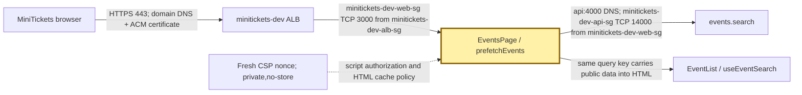
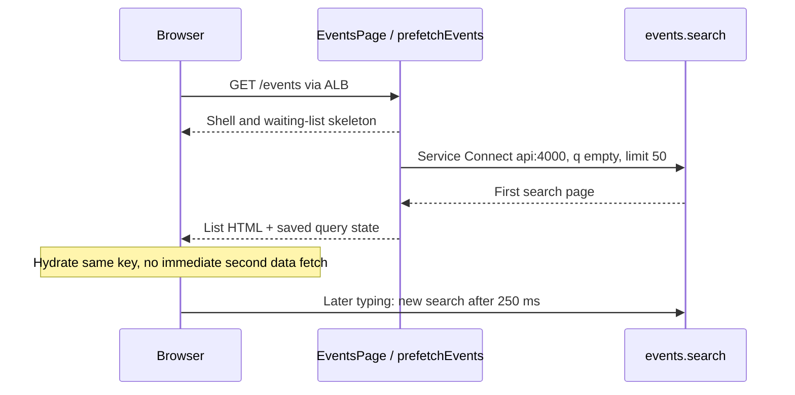

# SSR vs CSR: the catalogue arrives before the visitor writes

History: see [CHANGELOG.md](../CHANGELOG.md) or run `pnpm docs:history`

Area: Frontend · Status: ✅ built in repository; live AWS acceptance is separate

<!-- interview-card: v1 -->

## 1. In one line

MiniTickets first draws `/events` on the server ([SSR](../glossary.md#ssr)); the browser then handles typing and drawing updates ([CSR](../glossary.md#csr)).

## 2. Where it sits

[Open this piece in the city explorer](../guides/infra-explorer.html?concept=csr-vs-ssr#chapter=24&piece=web-task).

## 3. How it works

## 4. What happens in MiniTickets

1. `EventsPage` validates URL filters and sends the page shell while its list waits.
2. `prefetchEvents` calls `events.search` with `q: ""`, `limit: 50`, through `http://api:4000`.
3. The response carries list HTML and saved query data. Hydration means attaching browser behavior and reusing that data.
4. `useEventSearch` uses the same query key, with 30-second freshness. Typing waits **250 ms** before a new search.
5. Fresh script nonces make each HTML response private and `no-store`; data caching is a separate choice.

## 5. Reach / Allowed / Password

**Reach:** browser → HTTPS ALB; web → Service Connect `api:4000`, minitickets-dev-api-sg :14000 from minitickets-dev-web-sg.

**Allowed:** public `events.search`; identical input identifies reusable browser data.

**Password:** not needed for this public catalogue call.

## 6. In our code

`apps/web/src/app/events/page.tsx` → `EventsPage`, `EventListWithServerData`

`apps/web/src/features/events/server/prefetch-events.ts` → `prefetchEvents`

`apps/web/src/features/events/hooks/use-event-search.ts` → `useEventSearch`

## 7. In the AWS console

ECS → Clusters → `minitickets-dev` → Services → `minitickets-dev-web` → Tasks → task → Networking: task address. Service → Configuration and networking: Service Connect. Browser rendering itself is inspected in browser developer tools, not AWS.

## 8. Good / Bad

**Good:** useful list arrives without a second browser fetch; typing stays interactive.

**Bad:** initial HTML costs server work; hydration sends data and JavaScript.

## 9. Other choices

- Pick pure CSR when a private tool can tolerate a slower first screen.
- Pick static HTML when public content can wait for rebuilds and its script policy permits it.

## 10. Connected to

| Neighbor | Direction | What allows it | Console check |
| --- | --- | --- | --- |
| [ALB](alb.md) | → web HTML | minitickets-dev-web-sg :3000 from minitickets-dev-alb-sg | EC2 → ALB → Resource map |
| [ECS service](ecs-service.md) | → API data | Service Connect name + minitickets-dev-api-sg :14000 from minitickets-dev-web-sg | ECS → web service |
| [Cache-aside](cache-aside.md) | separate list path | search bypasses old list cache | CloudWatch → API logs |

## 11. When it breaks

- List fetched again immediately → compare server/browser query keys → use identical input.
- Server list missing → web prefetch logs → fix internal API reach; browser can retry.
- Another visitor’s HTML reused → cache headers → retain private,no-store with fresh nonces.

## 12. Say it in 30 seconds

“MiniTickets combines server and browser rendering. The server fetches the first search page and sends useful HTML plus query data. The browser reuses that data, attaches interaction and makes later searches. The query keys must match. Our script security uses a fresh nonce, so HTML is dynamic and no-store even when public data could be cached separately.”

## 13. Likely follow-ups

- **Does a Client Component render only in the browser?** No. Next.js can first render its HTML on the server.
- **Does dynamic HTML ban cached data?** No. Correctly keyed public data can still be cached.

## 14. Remember it

Send the catalogue already printed; let the visitor turn and search its pages.

## 15. More detail

Source notes, earlier detail and code anchors

The catalogue SSR prefetches events.search into a per-request QueryClient and the browser hydrates the same infinite key. HTML is now dynamically nonced/no-store; client search remains interactive and data caches are separate.

### Earlier card: 2. Real-life comparison

A catalogue with a bookmark: each question and position has its own identity, and only the visible page lies open.

### Earlier card: 3. Picture it

### Earlier card: 4. Where in our code

- Anchor: `apps/web/e2e/events.spec.ts` — `response`; follow the numbered comments at this boundary.
- Anchor: `apps/web/src/app/events/page.tsx` — `dynamic`; follow the numbered comments at this boundary.
- Anchor: `apps/web/src/features/events/hooks/use-events.ts` — `useEvents`; follow the numbered comments at this boundary.
- Anchor: `apps/web/src/features/events/server/prefetch-events.ts` — `prefetchEvents`; follow the numbered comments at this boundary.

`apps/web/src/app/layout.tsx` waits for a request; `apps/web/src/features/events/server/prefetch-events.ts` hydrates public data. `apps/web/src/features/events/server/cached-events.ts` provides an explicit public-data cache; the current search-prefetch path bypasses that helper to avoid unbounded cursor/text keys. Run `pnpm demo:security` for production HTML/cache acceptance; there is no static-site export.

### Earlier card: 5. See it yourself

Run `pnpm demo:security` and inspect the asserted outcome described above.

Failure thought experiment: Does dynamic HTML forbid cached data? No. Cache only public results with complete keys. Do not change a live stack to demonstrate it.

### Earlier card: 6. How it connects

Uses the [current system](../00-big-picture.md); gives a concrete decision to the [scenario](../guides/interview-scenarios.md#rendering-models) and [explorer tour](../guides/infra-explorer.html?tour=search).

### Earlier card: 7. Our settings and WHY

The catalogue SSR prefetches events.search into a per-request QueryClient and the browser hydrates the same infinite key. HTML is now dynamically nonced/no-store; client search remains interactive and data caches are separate. Initial content and interactivity have different latency and security constraints.

### Earlier card: 8. Trade-offs

Static HTML has cheap delivery but cannot reuse a fresh per-request nonce. CSR adds client work. Dynamic HTML costs server work even when data is cached.

### Earlier card: 9. Alternatives and when to choose them

10x: measure TTFB/cache hit rate. 100x: evaluate hash-based static CSP or separating public/static routes as a deliberate redesign.

### Earlier card: 10. What breaks and how we notice

Does dynamic HTML forbid cached data? No. Cache only public results with complete keys.

### Earlier card: 13. Interview answers at 3 levels

- **Simple:** The catalogue SSR prefetches events.search into a per-request QueryClient and the browser hydrates the same infinite key.
- **Senior:** SSR sends useful initial HTML, CSR handles interactive changes and static output suits public content that tolerates rebuilds. MiniTickets combines server-prefetched catalogue data with client queries. P10 nonce security makes HTML dynamic and no-store; explicit public data caching remains a separate choice.
- **Lead:** 10x: measure TTFB/cache hit rate. 100x: evaluate hash-based static CSP or separating public/static routes as a deliberate redesign.

### Earlier card: 14. Follow-up questions with answers

Does dynamic HTML forbid cached data? No. Cache only public results with complete keys.

Can public data still be cached inside dynamic HTML rendering? **Yes with correct data keys.**

### Earlier card: 15. Say it in 30 seconds

SSR sends useful initial HTML, CSR handles interactive changes and static output suits public content that tolerates rebuilds. MiniTickets combines server-prefetched catalogue data with client queries. P10 nonce security makes HTML dynamic and no-store; explicit public data caching remains a separate choice.

### Earlier card: 16. Status and production work

Repository implementation and local evidence are described above. Live AWS/CI execution remains owner acceptance. 10x: measure TTFB/cache hit rate. 100x: evaluate hash-based static CSP or separating public/static routes as a deliberate redesign.

## Where it appears in the story

- [app-story: 1b. Search input, hydration and bounded rows](../app-story.md#1b-search-input-hydration-and-bounded-rows)
